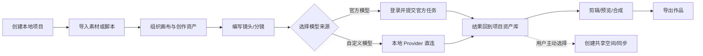

# Link Studio 产品与架构蓝图

## 1. 产品目标

为视频创作者提供一个本地优先的桌面创作工作台，使创作者能围绕项目组织素材、画布、脚本、分镜、模型生成和视频输出；同时提供由官方服务支持的官方模型、账号、积分和未来共享空间能力。

产品以“完成作品”为中心，不以 Git 仓库、编程会话或 Agent 编排为主导航。

## 2. 目标用户与核心任务

### 个人创作者

- 在本机管理项目、原始素材、生成结果与导出作品。
- 使用个人配置的第三方 Provider 或本地模型服务。
- 登录后购买/获得积分并使用官方配置的模型。

### 内容团队成员（后续）

- 在工作电脑创建本地项目，主动发布/迁移到共享空间。
- 在另一台设备恢复项目，按需下载大体积资产。
- 由组织策略限制官方模型、用量和成员权限。

## 3. 主线创作旅程

主线能力应支持创作者逐步完成一条视频生产链路；短剧、营销和 3D 导演台作为创作域工作区逐阶段接入，不应阻塞最小视频生成与导出闭环。

## 4. 产品能力范围

### 桌面创作基础

- 本地项目创建、打开、重命名、归档和恢复。
- 项目素材导入、预览、检索、去重和引用。
- 无限画布、节点、连线、分组、自动保存和版本恢复。
- 图片、视频、音频、脚本、角色、分镜和导演台节点。
- 统一任务中心，显示官方与本地任务的来源、状态、进度、失败原因和输出。
- 本地预览、媒体处理、时间线/合成和导出。
- 设置与画布双入口 Agent 共用 durable 引擎：页面/选择上下文、结构化工具、配置变更单、生成审批与等待、插话/恢复/撤销、技能/code-mode 和运行反馈；V1 不限 Provider 作者，专业域随域扩展。

### 模型能力

- 官方模型：后续阶段登录获取服务端模型目录，由官方服务验证权限和积分；请求采用服务端代理还是受限短期凭证另行评审，当前不冻结。
- 自定义模型：用户在设备上配置 Provider、端点、模型和本地密钥；由桌面端发起请求。
- 通过能力描述统一模型选择与输入表单，例如图像、视频、音频、文本、参考素材和异步任务能力。
- V1 吸收上游 Provider JS 插件机制，以插件扩展协议；支持内置插件、人工导入/编辑和内置 Agent 辅助配置，不把可扩展范围限制为固定协议。
- 官方凭证不得打包进客户端；个人密钥由用户输入后进入安全存储，不再回传 Renderer，也不提供给插件脚本或 Agent。官方执行路径仍待后续阶段评审。

### 账号、消费与未来团队

- 本地项目可在未登录时使用。
- 官方模型需要登录；积分/价格/可用模型由官方服务作为权威来源。
- 消费应由服务端账本记录，客户端展示余额和任务结算信息。
- 未来组织关系属于账号、授权、额度和共享空间策略；不作为第三种 Provider 来源。
- 当前不提供自托管服务端，也不做工作室渠道配置产品。

### 项目共享（后续）

- 用户显式创建共享空间，不能隐式将全部本地项目上传。
- 项目结构、画布和任务元数据与媒体 Blob 分开同步。
- 媒体支持按需、选择性同步，展示文件大小、同步方向和状态。
- 离线修改必须有可检测的冲突处理；不能使用“最后写入覆盖”静默丢失更改。

## 5. 产品原则

1. **本地优先**：项目和创作过程默认在本机可用，登录仅用于官方在线服务和用户主动选择的共享能力。
2. **执行来源透明**：每项生成任务明确标示“官方”或“本地自定义”，以及数据是否离开本机。
3. **同一创作体验**：两种模型来源共用画布、任务状态、结果资产和节点关联；差异隔离在执行适配层。
4. **服务端权威结算**：官方积分不能依赖客户端提供的结果或自报用量。
5. **可恢复**：项目保存、任务执行、上传和导出都必须有可恢复状态或明确失败结果。
6. **逐步迁移**：先保持业务行为，再逐模块桌面化和本地化；不为统一语言而重写成熟领域逻辑。

## 6. 建议版本规划

此路线是规划建议，不表示范围已完全冻结。

| 版本 | 主题 | 目标 | 规划文档 |
| --- | --- | --- | --- |
| V1 | 桌面创作闭环 | 分阶段交付本地项目/资产、画布、自定义模型生成和基础导出；后续阶段再接入官方模型 | [V1 版本总览](当前版本/V1-版本总览.md) |
| V2 | 完整创作工作室 | 完善短剧/分镜、营销工作台、导演台和媒体工具 | [V2 规划](后续版本/V2-专业创作工作室.md) |
| V3 | 共享空间与组织 | 跨设备项目同步、冲突解决、组织成员/权限/预算和管理能力 | [V3 规划](后续版本/V3-共享空间与组织.md) |

### V1 首阶段

- Electron 桌面壳、自动更新和跨平台安装包基础。
- 本地项目目录、画布和资产管理。
- `video-canvas` 画布的核心节点交互与本地生成工作流。
- 自定义 Provider 的本地安全配置及至少一种兼容适配。
- 任务恢复、日志和明确的错误反馈。
- 基础视频预览、顺序拼接 MP4 与可选 BGM；完整角色/分镜/短剧/营销/导演台统一归 V2。

### V1 后续阶段

- 官方账号、官方模型目录和积分消费。官方请求由桌面直连还是官方服务代理、凭证机制及消费结算需另行决策。
- 按创作能力补充专有 Provider 适配。

### V1 建议暂缓

- 共享空间和多人实时协作。
- 组织/工作室管理后台和复杂 RBAC。
- 所有上游 Provider 插件一次性迁入。
- 完整 3D 建模、复杂多轨时间线和高级调色。
- 工作室自托管、服务器安装包和离线官方推理。

## 7. 待确认的产品决策

下列事项会影响协议、数据模型或 V1 范围，需在进入功能规格前确认：

| ID | 问题 | 推荐默认值 | 影响 |
| --- | --- | --- | --- |
| Q01 | 官方模型请求和积分结算采用何种执行路径？ | V1 首阶段不接官方模型，后续基于密钥安全和账本可信度评审 | 官方凭证、积分、外部调用和隐私 |
| Q02 | 首批上游插件兼容性与运行时如何验证？ | 插件机制已确定；M0 按文本/图像/视频/音频及 sync/async 建兼容样例，再确定首批迁移清单和沙箱运行时 | 插件兼容与跨平台打包成本 |
| Q03 | 本地项目共享是否纳入 V1？ | 否，已确认；预留可迁移格式 | 项目 schema 与同步成本 |
| Q04 | V1 是否覆盖短剧、营销和 3D 导演台全量流程？ | 否，已确认分阶段迁移，最终覆盖整体能力 | V1 边界和后续路线 |

## 8. 成功指标建议

- 新用户在首次启动后无需登录即可创建并重新打开本地项目。
- 自定义模型任务在无 Link Studio 登录状态下可完成，密钥不进入 Renderer 日志或项目文件。
- 应用重启后项目、画布和已完成任务结果可恢复。
- 一条脚本到生成素材再到导出的视频主链路可被测试资产端到端验证。
