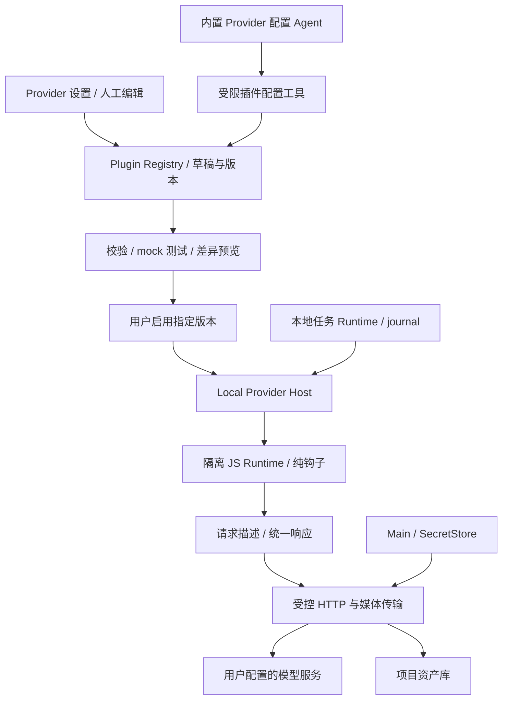

# Provider 插件与 Agent 配置设计

本文件聚焦 Provider 插件子流程；完整设置与画布助手、共享引擎和工具机制见 [内置 Agent 完整迁移设计](内置Agent完整迁移设计.md)。D005/D011 为产品依据；插件本身验收见 FR004/005，Agent 验收另见 FR007～009。M0 本机 mock 与兼容缺口见第 8 节，不代表业务接入已完成。

## 1. 从上游吸收的能力

依据 video-canvas 提交 `f0b8ced3687b22de6af0358c682c5e768001ff4f` 的 `backend/docs/plugin-contract.md`、`backend/internal/provider/pluginrunner` 和 `backend/plugins/*.js`：

- 插件为 CommonJS 风格纯 JS，导出 `meta` 和转换钩子；一个插件负责 text/image/video/audio 中的一种能力，支持 sync/async。
- 插件构造请求描述、解析响应；网络发送、鉴权、媒体读写、轮询调度由宿主承担。
- 异步插件必须具备查询钩子；跨调用数据通过可序列化 `state` 保存。
- 上游以 Goja 运行，脚本没有 `require`、网络、文件、定时器、Promise 或 async/await；不能按任意 Node.js 插件执行。
- 基线限制为源码不超过 512 KB、meta 不超过 64 KB；桌面端还需验证执行时间、内存与输出限制。

迁移目标是保留插件能力与调用语义。上游的 `utils`、Request Descriptor、媒体引用及 JS 子集要通过兼容样例验证后，才能宣称具体插件无需修改。

## 2. 模块边界与技术栈

建议工程职责：

| 模块 | 职责 | 技术选型 |
| --- | --- | --- |
| Provider 设置 | 插件、端点、凭证和模型的人工配置；显示 Agent 差异 | React/TypeScript，桌面 typed IPC |
| Registry | 草稿、不可变版本、源码 hash、启用引用与兼容记录 | Main 协调、本地原子持久化 |
| Plugin Contract | manifest、hook 输入输出、请求描述及错误 schema | TypeScript 公共契约，匹配上游 API v1 |
| Plugin Runtime | 运行不可信 JS，限制资源和可用全局对象 | M0 采用独立 Goja sidecar；macOS 沙箱和限制见第 8 节，其他平台待验证 |
| Provider Host | 解析资产句柄、验证请求、注入凭证、HTTP、下载 | 本地受控工作进程；Main 管理授权与 SecretStore |
| Job Runtime | 队列、轮询时间、持久化、恢复、取消与输出绑定 | TypeScript，独立于插件脚本 |
| 设置 Agent | 当前页上下文、模型诊断、变更单、插件接入、密钥/试跑 | 共享 Pi Durable 的 settings scope；与画布助手共用机制、工具分离 |

Electron Utility Process 适合作为进程载体，但它或 `node:vm` 本身不能作为不可信插件的安全隔离证明。Goja sidecar 只运行插件转换，不意味着把整个 Go/Gin/Postgres/Redis 后端塞进桌面安装包。最终引擎由兼容性、资源限制、平台打包和维护成本共同决定。

## 3. 保留的钩子与宿主能力

| 上游钩子 | 桌面迁移行为 |
| --- | --- |
| `buildPrepareRequests` / `parsePrepareResponses` | 适配上传准备等步骤；Host 解析项目资产句柄并执行上传，不向脚本暴露任意磁盘路径 |
| `buildSubmitRequest` / `parseSubmitResponse` | 生成提交描述，解析立即结果或供应商任务句柄；Host 持久化后推进任务 |
| `buildQueryRequest` / `parseQueryResponse` | 从保存的 handle/state 构造查询；Job Runtime 决定轮询与重试 |
| `buildCancelRequest` | 存在时由 Host 尝试取消；不存在时不能把“停止本地轮询”显示为“供应商已取消” |
| `classifyError` | 将供应商错误归类；最终是否重试由 Host/Job Runtime 判断 |

模型目录与插件分离：插件提供协议能力，Provider Profile 绑定 endpoint/secretRef，Model Binding 指定 modelId、插件版本和参数。上游弃用的模型导入/检测钩子不恢复成必需契约；首版保留手工添加模型的完整路径。

### 概念数据对象

| 对象 | 关键字段 | 保存位置 |
| --- | --- | --- |
| PluginVersion | pluginId、apiVersion、version、sourceHash、manifest、source、origin | 设备级插件目录；版本内容不可变 |
| PluginActivation | pluginId、sourceHash、enabled、acceptedAt | 设备级设置；精确绑定版本 |
| ProviderProfile | providerId、label、endpoint、networkPolicy、secretRef、revision | 设备级配置，不随项目共享 |
| ModelBinding | bindingId、providerId、modelId、capability、pluginId/version/hash、settings | 设备级配置 |
| ProjectModelRef | bindingId、非秘密展示快照 | 项目；换设备后提示重新绑定本机配置 |
| GenerationJob | jobId、binding 快照、plugin 版本/hash、阶段、输出引用 | 项目非秘密投影；敏感 handle/state 进入设备 userData 受控运行存储 |

卸载或升级插件不能使进行中的任务隐式切换实现。保留旧版本供恢复；缺失/不兼容时暂停并提示恢复环境，不自动改用新版本提交任务。插件私有 state 也要做秘密字段过滤，不因为可序列化就允许落入项目。

## 4. 人工和 Agent 两种配置入口

### 人工路径

选择内置插件或导入/编辑 JS → 自动生成配置表单 → 填端点/模型/参数和密钥 → 静态及 mock 校验 → 查看差异并启用 → 用户发起连接或实际生成测试。

不要求用户必须编写插件：常见接口优先使用已迁移的内置插件。启用新源码时确认一次具体版本即可；同一版本的后续创作调用不重复弹出代码审批。

### Agent 路径

用户提供 API 文档或请求样例 → Agent 解释接入方式 → 生成/修改插件草稿与非秘密配置 → 调用校验和 mock 工具 → 展示差异、端点、能力和潜在费用 → 用户启用指定版本并填写密钥 → 用户选择实际测试。

Agent 工具范围建议为读取用户选定资料、读取非秘密配置、创建/修改草稿、校验、mock 测试和提出配置变更。Agent 不获得通用终端、任意文件或密钥读取工具；HTTP 执行沿用 Host，不再实现一套 Agent 直连流程。

首次使用存在模型依赖：先通过内置插件或人工配置得到一个可用文本模型，再开启配置 Agent。这个文本模型可来自用户自有服务，不要求登录官方账号；未来可选择官方模型。没有可用模型时人工路径仍完整可用。API 文档/请求样例中的凭证先移除，不发送给 Agent 所用模型。

“用户启用精确版本”是当前工程建议，用于避免 Agent 静默执行新脚本；用户已确认的是插件扩展及 Agent/人工双入口，并未额外要求复杂的审核工作台。

## 5. 网络与凭证

- 手工密钥输入框会短暂持有输入值，经受限 IPC 写入 Main 后清空；之后仅返回 hasSecret/secretRef，不回显明文，不进入 Renderer 持久状态、项目、日志或 Agent 上下文。
- 凭证只在 Host 的受控 HTTP 边界按指定认证方式注入，不提供给纯 JS 钩子；若上游自定义签名方式不能在该边界下兼容，登记兼容缺口并另行设计宿主认证能力。
- 用户明确配置的 localhost/LAN 模型服务可以使用；不把本机模型误判为一律禁止的内网目标。限制云 metadata、危险 scheme、重定向和 DNS/IP 绕过。
- 供应商认证只发送到配置并获准的服务 origin。签名下载/上传 URL 可使用不同公网 origin，但不得转发供应商 Authorization；每次跳转重新检查网络策略。
- 真正的本机模型执行仍是插件调用用户运行的本地服务；首阶段不承诺内置权重管理、推理引擎或 GPU 安装器。

### 本地参考素材如何提交

上游 `__fileRef` 的 `as: url` 依赖服务端对象存储的签名地址，桌面不能把 `file://` 或 localhost URL 当作远端供应商可读地址。Host 需要显式区分 multipart/base64/dataUrl 直传、供应商 prepare 上传，以及用户明确配置的对象存储。首批优先验证直传或供应商上传；需要公网 URL 又无上传路径/存储配置时在提交前返回 MEDIA_TRANSPORT_UNAVAILABLE，并给出所需配置，不自动上传至官方服务。

图片/视频参考能力的兼容验证必须包括这一层，不能仅以插件编译或文本请求成功判断可用。上传产生的外部数据、暂存时限和清理策略应在插件兼容记录中说明；任何签名 URL 和上传 token 按敏感运行状态管理。

## 6. 退出和恢复矩阵

| 退出前持久化阶段/能力 | 重启行为 | 是否允许自动重新提交 |
| --- | --- | --- |
| 队列中，已确认尚未尝试发送 | 恢复本地排队，按有效配置执行 | 可以首次提交 |
| 已开始发送，是否受理未知 | 标记 outcome_unknown，提供查询或人工处理入口 | 不允许，除非供应商明确保证同幂等键安全 |
| 已获得 task handle 且支持 query | 使用原插件版本与 state 恢复查询，再下载输出 | 不重发 submit |
| 已获得 handle，但没有可用查询能力 | 保留 handle；显示不能自动恢复，供人工核对 | 不允许 |
| 同步请求中，退出后无已持久化结果 | 无法仅靠本地恢复响应，标记 outcome_unknown | 不允许 |
| 已有结果描述，下载或入库中 | 恢复下载/本地提交；URL 失效时仅在支持查询时刷新 | 不重发生成 |
| 已提出取消 | 查询取消结果；区分已取消、仍运行和未知 | 不重发 submit |

接受响应中的 task handle/state 无论是否支持 query 都先持久化。退出界面提供等待、尝试取消、退出后恢复；“可恢复”以供应商能力为条件，不能承诺所有正在运行的任务都能恢复。

## 7. 实施顺序与验证要求

1. M0 建立上游 manifest/hook/utils 兼容样例，覆盖 text/image/video/audio、sync/async 和 prepare/query/cancel。比较引擎并验证死循环终止、权限隔离、输出限制和目标平台打包。
2. M1 建立桌面 typed API、Registry、配置与 SecretStore，先跑通人工选择内置插件；不依赖官方服务。
3. M2 接通插件 Host 与 Job Runtime，验证提交未知、退出查询、输出恢复、旧版本保留和密钥不泄漏。
4. M2 在同一套配置 API 上增加 Provider Agent 工具、草稿差异和启用动作，人工与 Agent 使用相同校验规则。
5. V1 同步完成核心画布 Agent 的理解/编辑/生成审批/watch/恢复/撤销；专业域工具随 V2，官方计费和组织按独立阶段。见 [完整 Agent 设计](内置Agent完整迁移设计.md)。

以上为完整迁移要求，当前 M0 覆盖范围如下；配置与持久任务仍按后续批次实现。

## 8. M0-02 实现范围与兼容缺口

实现落点为 `packages/provider-runtime/src/` 和 `packages/provider-runtime/runner/`；复现命令、版本、结果和打包证据统一见 [M0-02 实测记录](实施基线与开发批次.md#9-m0-02-实测记录)。采用与基线相同的 Goja 版本，减少 JS 语义差异；本轮未另行实现或压测 QuickJS/V8，不能宣称跨引擎比较已经完成。

### 执行与宿主边界

- 每次 hook 创建新 runner/VM，通过 stdin/stdout 传受限 JSON，不起 Go HTTP 后端，不加载 Node 插件，不继承桌面环境变量。`module/exports/utils` 及标准 JS 内建对象可用，动态 Function/eval、Promise、网络/文件/定时器/进程 API 不暴露；原型在加载源码之前锁定。
- macOS 使用 sandbox-exec 拒绝网络、文件写入和 fork；Goja 未暴露文件读取接口，但 OS profile 当前仍允许文件读取，不能视为原生引擎漏洞下的完整文件机密保护。非 macOS 明确返回 `SANDBOX_UNAVAILABLE`；跨平台沙箱与签名分发是后续门禁。
- 单次从初始化至结果编码的 VM 预算 200ms；进程启动/总墙钟 5s。堆使用超过 48 MiB 发出中断，GOMEMLIMIT=64MiB 仅为软目标；宿主每 25ms 采样 RSS，超过 128 MiB 杀进程。采样可能超调，不宣称严格内核内存配额。每个 runner 实例最多同时执行 2 个子进程。
- 源码 512 KiB、meta 64 KiB、单个输入/结果 1 MiB、state/prepared 64 KiB。getter、hook、toJSON 和顶层执行均纳入时限；异常只返回稳定 code，丢弃原文与 stderr。取消等待进程关闭后返回。
- 批准校验绑定 sourceHash，但当前 Binding 是受信内部输入；Registry、用户批准持久化、Renderer IPC 授权和 safeStorage 尚未实现，不能将此检查冒充完整审批系统。
- Host 验证请求描述、同源注入 bearer/header/query、解析文件引用、调用 prepare/submit/query/cancel 与错误分类。响应回显的宿主凭证在传回钩子前遮盖；没有 Renderer 接口或密钥持久化实现。
- mock transport 只允许明确列出的 `http://127.0.0.1:<port>`，不使用 DNS、代理和自动重定向；外部 URL、localhost 别名和未授权端口均不发出。正式公网/LAN 授权、DNS/IP 绑定与多跳策略尚未实现，不能换成裸 fetch 后声称生产网络边界成立。
- submit 发送后失败/取消返回 `PROVIDER_OUTCOME_UNKNOWN`；429/5xx 分类而不自动重发 submit。查询由调用方使用原 handle/state 重试；取消返回 requested/local_only，不能宣布供应商已取消。任务 journal、自动轮询、崩溃恢复和真实资产入库属于后续 Job Runtime。

### 样本与缺口

| 样本/能力 | 本地 mock 证据 | 尚未覆盖 |
| --- | --- | --- |
| openai 1.2.0 | 原文件未修改；Responses/Chat 请求及文本/usage 解析 | 真实网关、视觉公网 URL 和流式 Agent 模型 |
| openai-image 1.3.0 | 原文件未修改；生成 URL、参考图片 multipart 编辑 | image_json 内联 base64 到真实资产的转换、媒体探测 |
| sora 1.1.0 | 原文件未修改；multipart、task handle、ready state、二次二进制查询与解析 | mock 二进制为合成字节，asset 回执不入库；真实 MP4 下载/取消语义 |
| doubao-video 1.1.0 | 原文件未修改；文本 submit/query 到视频 URL | 参考媒体需要公网 URL；无上传配置时发送前明确拒绝 |
| 合成 audio 插件 | prepare→submit→query→cancel，JSON 重建 state | 不代表上游音频插件或供应商兼容 |
| 文件引用 | multipart/base64/dataUrl；槽位与大小校验 | multipart 当前缓冲编码，未实现流式大文件上传；不自动上传官方存储 |
| utils | uuid/unixNow/base64/base64URL/base64Decode/sha256/hmacSHA256/hmacSHA256Hex/jwtSignHS256/jwtSignRS256 | utils.log 当前丢弃，不返回追踪日志 |
| manifest | 单类型、模式、认证、必需/成对钩子、协议设置、poll 基础校验 | 非完整上游预检器；未知导出警告、弃用 import.args 全量规则与表单补默认仍待接入 |
| custom auth | 宿主把安全存储中的凭证以 `ctx.credentials.apiKey` 传给插件；插件自行签名/组装请求，宿主不自动注入 Authorization | `kling/jimeng/vidu/vertex-ai` 已可 inspect；Vertex 的准备阶段使用 RS256，Kling 使用 HS256；catalog 仍走手动添加模型 |

23 份内置适配器的固定提交/hash、MIT 与 Apache 来源说明保存在 `resources/provider-plugins/`。Apache 衍生代码的具体上游版权/NOTICE 和 Go 依赖清单仍须正式分发前审计；本机目录包不是正式发布。
