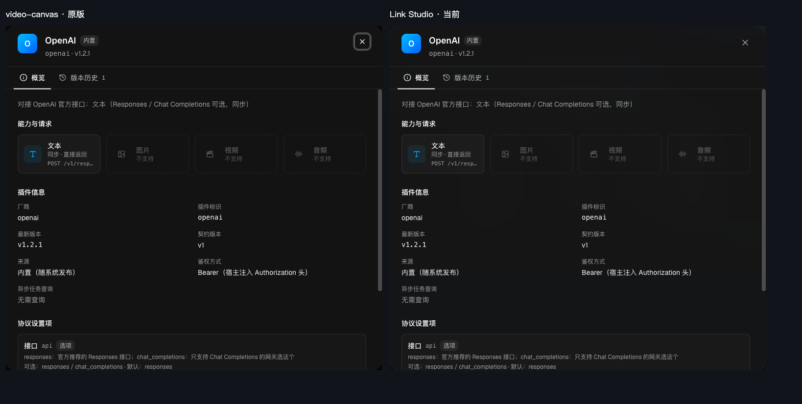
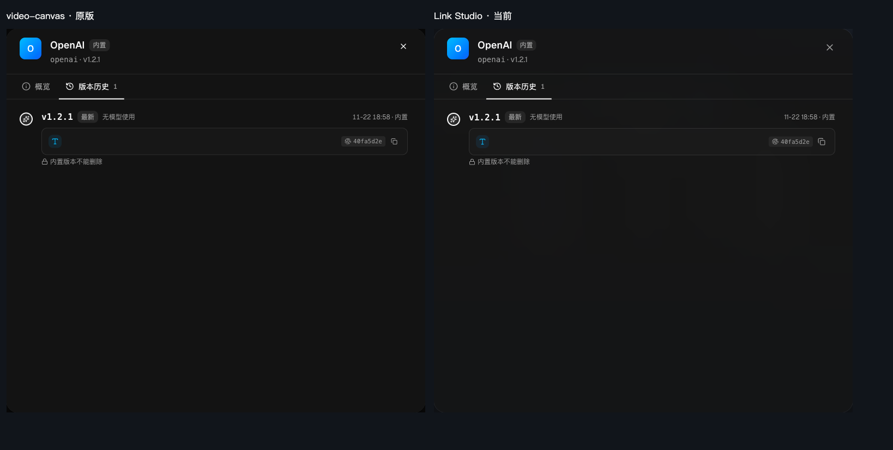
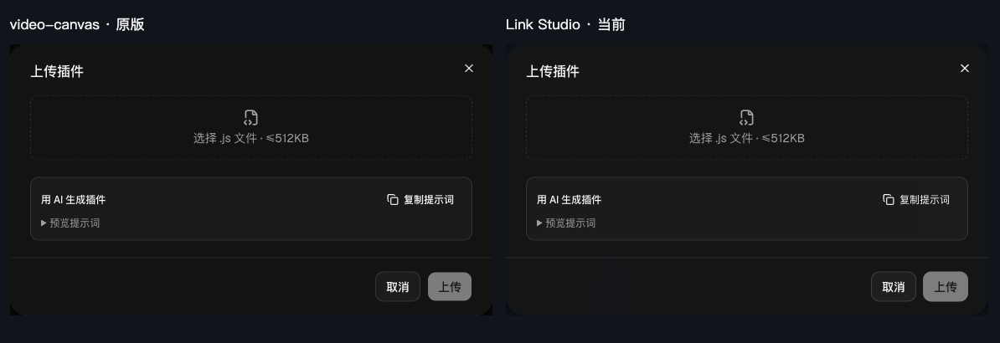
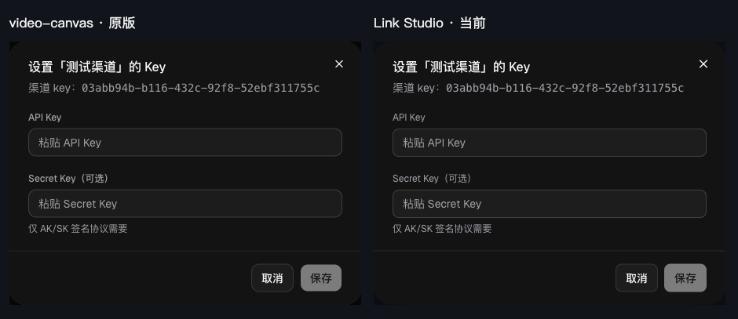
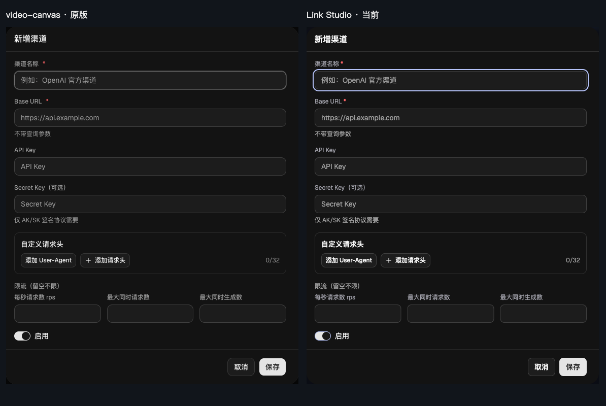
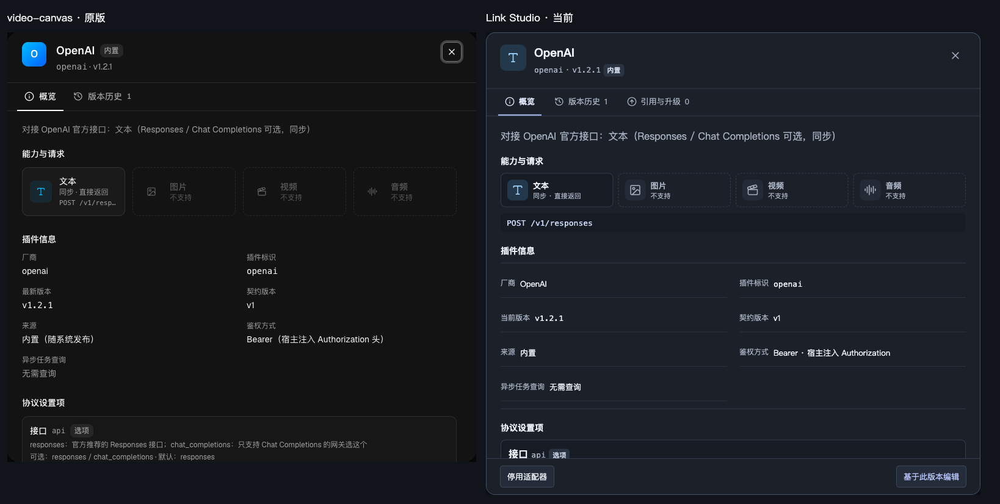

# Provider 与插件复刻差异审查

当前交接入口见 [23 项验收表与定向复测](Provider复刻验收表.md)。本页保留原始问题、分轮实验和视觉基线。

2026-11-21。参照本机 `video-canvas` 的 `ccffac4e`，审查 `link-studio` 工作区（HEAD `d8065a0`）。范围包括管理侧渠道、模型、协议插件，以及会改变这些配置使用结果的宿主行为。

## 本轮实现与复验（更新至 2026-11-22，参照 `4277d16f`）

以下对照按 C1–C9、M1–M6、P1–P8 回填。后面的原始审查保留修改前的行为和尺寸。

**模型目录与识别的架构边界**：原版 `ai_channel_ops.go`／`ai_catalog_list.go` 查询渠道和内置快照；桌面由受信 IPC 调用主进程 Registry，按原渠道授权、Key、自定义头和限流读取 `/v1/models`（已有 `/v4`、`/v1beta` 等后缀则只补 `/models`）。目录最多 2000 条／4 MiB，成功和失败返回后均不允许过期修订应用建议；普通插件的 JSON 限额仍为 1 MiB。目录取不到仍可用本地建议，禁用渠道或没有 Key 时不向上游发请求。原版禁用渠道的后台只读查询与此不同。识别 IPC 不返回 Key、上游正文或请求头。

`resources/model-meta/limits.json`（2107 条）和 `modalities.json`（2310 条）逐字节取自参照提交 `4277d16f` 的 `backend/internal/provider/modelmeta/`。原项目的 `scripts/update-model-limits.mjs` 从 models.dev（MIT）生成；桌面在构建时打入主进程，不在运行时下载。验证两个文件可用 `cmp` 对照对应路径。

**C3 公开模型 key（2026-11-23）**。拉取型号按原版 `importModelKey` 替换非法字符、去首尾标点并截取 80 字符，空值用 `model`。全局重名先加渠道 key，再追加 `-2`、`-3`。配置 JSON、批改、模型搜索、头像、设置助手上下文及模型查询使用公开 key。新模型另存内部 UUID，用于修订检查、审批和历史任务。旧配置继续使用已有标识。SQLite 逐项写入，中断时保留已创建行，重试时跳过这些行。桌面额外保留内部 ID 名称空间。多用户只读角色与真实生产目录仍待验收。

### 试跑恢复、自定义参数与插件日志复验

#### 最新增量验收

C1 编辑窗：已修复重新授权提示将底部按钮下推 34 CSS px 的偏差。两种授权状态各测宽窄两次，整窗与排除桌面专用提示后的差异分开记录，见[授权提示视觉基线](Provider复刻验收表.md#c1-编辑窗授权提示可见时的视觉基线)。

C1 / C9：端点等价写法不再误提示清除双凭证；本机配置不授予官方后台角色。原版前后端权限对照、桌面决策依据和定向复现见 [端点授权与平台角色](Provider复刻验收表.md#c1-与-c9端点授权与平台角色)。

P5 升级与手动改绑：补齐已绑定模型从表单或 JSON 更换协议版本时的凭证授权检查。原版逐模型保存、桌面旧共享连接成组策略及两种视口下的回环试跑结果见 [P5 定向验收](Provider复刻验收表.md#p5协议升级与手动重新授权)。

M5 按秒预览（2026-11-23）。旧规则引用的比例仍在模型中，已改成固定值且退出规格维度时，预览按原版使用该参数的默认值计算价格，并显示旧条件提示。此前固定比例 `16:9` 的高档视频按 2 积分/秒预览，默认 6 秒显示 12。修复后，两端每秒、2 秒、6 秒和 10 秒分别为 7、14、42 和 70。修改单价为 5 后两端各时长均重新报价。移除 `aspect_ratio` 条件后保留单价、清除错误。用 `node scripts/compare-provider-dialog.mjs --model=price --price-second` 复验，[宽窗](Provider对照图/新增模型-price-second.png)和[窄窗](Provider对照图/新增模型-price-second-窄窗口.png)整窗像素差分别为 1.50% 和 1.60%。

M5 规格定价（2026-11-23）。修复点击「可供用户使用」文字无响应、条件按钮比原版高 4 px、价格输入框偏左 2 px。宽窄窗口均验证文字点击和空格操作同步更新开关和报价矩阵。第二档价格 9、积分成本 3 时显示利润率 67%，关闭成本后隐藏成本框和利润率。五个主要控件的位置和尺寸在两端相差小于 0.1 CSS px。[规格定价宽窗](Provider对照图/新增模型-price-tiers.png)与[窄窗](Provider对照图/新增模型-price-tiers-窄窗口.png)整窗像素差为 1.19%／1.45%。

旧条件草稿保留失效维度、取值和错误提示。移除条件后价格 4 和 9 的两条规则均保留，预览在「标准」行显示 4／4，在「高」行显示 9／4。旧值标签和移除按钮的位置、尺寸与原版相同。[失效条件宽窗](Provider对照图/新增模型-price-stale.png)与[窄窗](Provider对照图/新增模型-price-stale-窄窗口.png)整窗像素差为 1.17%／1.32%。用 `node scripts/compare-provider-dialog.mjs --model=price --price-stale` 复验，普通分档用 `--price-tiers`，窄窗加 `--compact`。

P2 插件概览滚动（2026-11-23）。修复点击当前页签会跳回顶部的问题。对照原版和 Electron，从目录打开插件并用滚轮读到协议设置底部，再次点击「概览」并按回车。OpenAI 保留宽窗 225 px、窄窗 313 px 的阅读位置，Vertex AI 分别保留 241 px、329 px。两端逐项核对设置项顺序、卡片及说明位置。[OpenAI](Provider对照图/openai-协议设置滚动到底.png) 的整窗像素差为 0.10%／0.12%，[Vertex AI](Provider对照图/vertex-ai-协议设置滚动到底.png) 为 0.08%／0.11%。执行 `node scripts/compare-provider-dialog.mjs --detail-settings=vertex-ai` 复现，窄窗加 `--compact`，另一个插件用 `--detail-settings=openai`。

本轮通过类型检查、构建、496 项单元测试、132 项设置与生成任务集成测试，以及 19 条渠道、模型、上下文、批改和插件桌面流程。插件固定模型名单与删除预检返回公开 key 和内部 ID。链接使用公开 key，点击时用内部 ID 再查当前模型。

2026-11-23 的 SQLite 集成用例覆盖跨渠道前缀、二次碰撞序号、同批规范化碰撞、内部 ID 冲突、截断、中文回退、公开 key 读价与同名重建。通过 SQLite 触发器在导入的第二行制造写入失败，重试补齐后两项。Electron 验证模型 JSON 使用 `gpt-fixture`，另用故障注入验证失败保留勾选、重试后显示冲突数量。此前宽窄窗口的文本／Agent 规格裁图复查分别为 0.19% 和 0.63%。拉取五态再跑全部通过原门槛，其中含已存在项、失败态的窄窗本次为 2.74% 和 2.13%。

同一组件在 1280×800 与 1024×700（DPR 2）分别对跑；表内依次为宽窗／窄窗。差异率是裁图内任一 RGB 通道相差大于 16 的像素占比，不是功能完成率。下文较早的 M5 数字是公共控件调整前的基线。

| 范围 | 本机交互证据 | 对照及复现 |
| --- | --- | --- |
| M3、M4 上下文识别 | 文本／Agent 停止输入 400 ms 后读渠道目录；有效规格优先，否则回退内置库，均未知则手填。请求返回前手填 `88000` 不被覆盖；窗口和输出都未填才自动填，两种媒体建议始终只在手动应用时生效，且非 Gemini 不应用视频。实测回车、空格、放弃、切接口、保存和重读 JSON。 | `node scripts/compare-provider-dialog.mjs --model=params --context-hint`（Agent 换 `--context-agent`，窄窗加 `--compact`）。[文本](Provider对照图/新增模型-params-上下文识别.png) 550×104：**0.19%／0.19%**；[Agent](Provider对照图/新增模型-params-Agent输入能力.png) 550×305：**0.63%／0.63%**。比较整个能力区而非整个编辑器；两输入、应用按钮和两个媒体按钮的相对矩形各坐标差小于 0.1 CSS px。 |
| C3 拉取模型 | 渠道清单保留上游顺序、trim 后首个同名生效。默认含已存在项一并勾选；无匹配时键盘执行「取消全选」不会清掉隐藏项。空清单可转手动新增，不支持目录可重试；拉取中只能关闭。提交时禁止关闭，提交失败保留选择。 | `node scripts/compare-provider-dialog.mjs --pull=ready`，另可选 `empty/error/loading/nomatch`，窄窗加 `--compact`。整窗依次为[含已存在](Provider对照图/拉取模型-已存在.png) **2.69%／2.73%**、[空清单](Provider对照图/拉取模型-上游空清单.png) **1.03%／1.10%**、[失败](Provider对照图/拉取模型-上游不支持.png) **2.08%／2.09%**、[拉取中](Provider对照图/拉取模型-拉取中.png) **0.51%／0.51%**、[无匹配](Provider对照图/拉取模型-无匹配.png) **2.33%／2.36%**。主操作与型号标签位置已对照；差异仍可测。 |
| M2、M3 离线原文 | 编辑器可保存带未知字段的离线正文，语法有效时不会多出一条结构错误栏。退出应用再打开后原文、空白和键序不变。实际批改任务时限后再读，只有 `deadline` 改变。列表、编辑器以及主进程阻止未修复的模型上线或试跑。删除扩展并修正上下文后，回环插件执行成功。 | `node scripts/compare-provider-dialog.mjs --model=json --json-extension`（窄窗加 `--compact`）：[宽窗](Provider对照图/新增模型-json-离线扩展草稿.png) **0.95%**／[窄窗](Provider对照图/新增模型-json-离线扩展草稿-窄窗口.png) **1.16%**。编辑区距弹窗顶 132 px，高 510／418 px，双端相同。这是编辑态，不是整个设置页的像素结论。 |
| M3 JSON 与表单往返 | 数组、`null`、数字、字符串显示「JSON 语法正确」，返回表单时提示正文必须是 JSON 对象。两端均能从带扩展字段的对象返回、改名并切换页签。桌面修改另一模型的 `key` 再保存，保留输入并拒绝写库，不再把「仅含未知键」当作拒绝条件。 | `--model=json --json-non-object`：[非对象宽窗](Provider对照图/新增模型-json-正文非对象.png) **0.94%**／[窄窗](Provider对照图/新增模型-json-正文非对象-窄窗口.png) **1.14%**。编辑区距弹窗顶 195 px，高 447／355 px。 |
| M6 请求描述 | 点击「只看请求」不发送网络请求；完成时切页，显示本地时间及两空格 JSON。默认全文；超过 12 行或 1500 字符可收起，按 Enter／空格切换，展开标明字符数。长提示词随内容增高，左栏可滚动。 | `--trial-dry=short/long/folded` 分别运行（窄窗加 `--compact`）：[短请求](Provider对照图/模型试跑-请求描述-short.png) **0.76%／0.84%**；[长请求](Provider对照图/模型试跑-请求描述-long.png) **1.01%／0.99%**；[折叠](Provider对照图/模型试跑-请求描述-folded.png) **1.11%／1.11%**。整窗上限 1.5%；同一提示词、模型配置和时刻，长提示词左栏距底部 4 px。断言输入框、执行按钮、时间、正文、折叠按钮和结果面板的位置、尺寸与滚动指标。 |
| M6、P8 试跑结果 | 桌面内置 OpenAI 插件连接本机回环，原版组件读取相同任务 ID 与模拟结果。普通鉴权可展示的业务失败显示完整任务编号、failed、原因和复制修复信息；复制成功后按钮显示「已复制」1.5 秒。无可安全公开的原因走通用提示。 | `--trial-failed`：[失败宽窗](Provider对照图/模型试跑-业务失败.png)／[窄窗](Provider对照图/模型试跑-业务失败-窄窗口.png) **0.86%／0.95%**。`--trial-success` **0.79%／0.87%**。不代表生产任务及云端报告相同。 |
| M6 追踪刷新 | 进行中和已完成均能按模型、修订、任务号读取。专用 IPC 不重提、不恢复任务、不续期、不重新签发媒体授权。刷新等待时保留原步骤；读取失败替换为「没能取到追踪」和刷新按钮，切页返回不清掉失败。刷新成功后同步步骤数；空追踪显示 0，不显示汇总和复制按钮。请求描述的普通失败则保留上次预览与当前页签，运行器不可用才替换旧预览。 | `--trial-timeline` **0.90%／0.99%**（之前 **4.62%／5.21%**）；`--trial-timeline-expanded` [HTTP 展开](Provider对照图/模型试跑-HTTP追踪展开.png)／[窄窗](Provider对照图/模型试跑-HTTP追踪展开-窄窗口.png) **1.19%／1.32%**。`--trial-trace-state=empty/error`：[空追踪](Provider对照图/模型试跑-追踪刷新-empty.png) **0.87%／0.95%**，[读取失败](Provider对照图/模型试跑-追踪刷新-error.png) **0.79%／0.87%**。四态整窗门禁 1.5%；刷新按钮、三行步骤、失败提示矩形有独立断言，展开后比较两端脱敏文本。 |
| M1、M2 批处理 | 上线、下线、修改、设置能力与协议、删除各在 0/2、1/2 暂停；检查操作禁用、取消选择不撤销执行、修订冲突逐项反馈。 | `node scripts/compare-provider-dialog.mjs --batch-progress=delete --progress-done=1`；操作可换 `enable/disable/edit/protocol`，进度可换 `0`，窄窗加 `--compact`。20 张工具条裁图均 **0%**。[第一个请求](Provider对照图/批量删除-进行中-初始.png)／[第二个请求](Provider对照图/批量删除-进行中-窄窗口.png)。 |
| M3 JSON | 无效 JSON 返回时保留原文，按行列定位；不会提交最后一次有效配置。保存时的协议设置／规格条件问题：JSON 页选中相应键，表单页聚焦相应控件。正常页脚和原版一样只有测试、取消和保存。为保留桌面直接编辑、迁移能力，标题下的模型标识（新建时为「未填写」）可点击或用键盘打开 JSON，这是桌面扩展；结构校验仍比原版严格。 | `--model=json`：**1.01%／1.19%**，两端编辑区矩形相同。`--json-invalid-return` 操作及[宽窗](Provider对照图/新增模型-json-返回表单错误.png)／[窄窗](Provider对照图/新增模型-json-返回表单错误-窄窗口.png)。 |
| M3 厂商、标签与排序 | 40 个厂商；按 Enter 打开即聚焦搜索。选「通义千问」再开保留「通义」，Esc 清搜索并回焦。标签去重、满五项禁输、叉号移除、空框退格；点击文字不移除。新建排序默认 100，清空回到 0。 | `--model=basic --logo-menu=all/empty/selected`（每次选一项）。表单滚动 96 px，让整张菜单均在视口内：[全部](Provider对照图/新增模型-basic-Logo-all.png) **2.61%／2.61%**、[无匹配](Provider对照图/新增模型-basic-Logo-empty.png) **1.16%／1.16%**、[筛选后选中](Provider对照图/新增模型-basic-Logo-selected.png) **0.80%／0.80%**。两端菜单、搜索框与抽查选项矩形一致。基本信息 **2.05%／2.16%**、Agent **2.49%／2.29%**。 |
| M3、M5 参数与定价 | 超时预设支持空格、回车，手填 90 秒取消预设。验证统一价、规格价矩阵和 Token 成本。 | 参数 **1.03%／1.28%**；[统一价](Provider对照图/新增模型-price.png) **1.44%／1.71%**、[规格](Provider对照图/新增模型-price-tiers.png) **3.30%／2.97%**、[Token 成本](Provider对照图/新增模型-price-token-cost.png) **1.36%／1.73%**。 |
| M6、P8 自定义鉴权 | 请求预览与失败追踪仅保留 URL 来源，路径可能含凭证；普通鉴权仍可查看清洗后的请求路径与失败原因。 | `pnpm exec vitest run tests/integration/generation.test.ts -t '同步失败的生成与试跑一致'`，本机回环 2/2。不是原版云端授权全文日志。 |
| P3 上传 | 已登记版本再上传时显示 `meta` 问题并支持复制；没有可执行的修复时不显示修复按钮，重选同名文件清除旧提示。异常问题列表不崩溃、不虚构问题。 | `--upload-duplicate`，弹窗均为 576×441.5；[宽窗](Provider对照图/插件上传-重复版本.png) **0.42%**／[窄窗](Provider对照图/插件上传-重复版本-窄窗口.png) **0.40%**。 |
| P5 插件升级 | 同批 text → image：离线渠道模型迁移并保留原配置、显示不兼容原因；在线模型失败并保留原绑定与修订。修复前不能上线、试跑或用于新任务。重试不重写成功项。 | SQLite 验证两种状态与修复后重新执行；同批四项的真实 Electron 场景在 `tests/e2e/provider-catalog.spec.ts`。鉴权方式、凭证位置及不受信自定义鉴权代码变更仍不继承授权；协议设置必填与共享连接仍受检查。 |

**回归范围**：`pnpm typecheck` 和 `pnpm build` 通过；设置、生成、插件修复报告、模型模板及报价五组 Vitest **164/164**。`pnpm exec playwright test tests/e2e/{model-channels,model-custom-parameters,provider-catalog,model-trial-media,model-trial-playback,channel-migration}.spec.ts --workers=1` **20/20**（2.3 分钟）。含从无任务编号首次打开试跑、追踪读取失败→切页返回→重试、下载失败与重启播放、JSON 缺 key 不保存、协议升级三项离线成功和一项在线拒绝。23 个内置 JS 的文件名集合和每个文件的全部字节与参照目录相同；这不证明执行宿主或生产服务也等价。

**移除页脚 JSON 入口后的整窗基线**（覆盖下面较早的表单数据）：基本信息 **1.97%／2.05%**，Agent **2.40%／2.18%**，能力与参数 **0.94%／1.17%**，统一价格 **1.35%／1.60%**。

- **本次本地回归（P2／M5）**。`pnpm typecheck`、`pnpm build` 通过。`pnpm exec vitest run tests/integration/settings.test.ts tests/unit/{desktop-contract,catalog-version-order,model-kind-template,model-price}.test.ts` **99/99**。`pnpm exec playwright test tests/e2e/{model-channels,model-trial-media,provider-catalog}.spec.ts --workers=1` **17/17**；此前一次并发取图时音色菜单读取到零项，同组合无并行取图复跑通过。收紧数字时长校验后，渠道与媒体试跑两个文件再跑 **9/9**。这些是桌面、SQLite 与回环读写，不证明云扣费或发布环境等价。

- **P2 版本引用的数量、名单和跳转**。概览不取名单；进入历史才按插件标识读取，只返回模型标识、名称、版本哈希和可选渠道。详情按版本独立统计所有引用（含离线模型）；即使名单失败，也保留数量、升级数和删除阻断。切页后重读，前一请求迟到不覆盖当前名单。十项引用只显示前八个及「等 10 个」，名单未读到则不显示该后缀。点击链接按当前模型归属进入编辑；目标已删除时报错、留在历史；本机无渠道模型没有伪造链接。复制 SHA 的两种剪贴板方式均失败时按原版静默；上传修复信息仍单独提示失败。
- **P2 像素复验**。1280×800／1024×700、DPR 2，两端 768×704／768×616 CSS 像素弹窗；RGB 单通道容差 16。修正头像渐变及引用标签后，[十项引用](Provider对照图/OpenAI版本历史十项引用.png)／[窄窗口](Provider对照图/OpenAI版本历史十项引用-窄窗口.png)差 **0.54%／0.63%**；空引用历史 **0.42%／0.48%**、概览 **0.26%／0.31%**、详情骨架 **0.08%／0.10%**。已逐个对齐八个链接矩形；未覆盖其他厂商全部色板。用 `node scripts/compare-provider-dialog.mjs --history-pins` 复现，窄窗加 `--compact`。
- **M5 定价编辑**。原来使用计价下拉框，统一价与规格价同时出现在表单；现在按原版分别显示计费方式、适用范围、默认价格卡或规格卡、成本开关和利润率。规格可选「任意」或某个值，可单独移除失效条件；回到统一价清除规格并保留兜底价格。按秒需实际声明数字 `duration`，单凭协议支持、枚举或已移除的参数不够；Agent 不能选按次、按秒。更改成本或预览不触发扣费。[新建模型定价](Provider对照图/新增模型-price.png)／[窄窗口](Provider对照图/新增模型-price-窄窗口.png)实测 **3.55%／4.28%**，两个分段组、五个选项、默认价格输入和成本开关的矩形差均小于 0.1 CSS px。宽窗改前同次基线为 7.43%。
- **M5 多规格及 Token 成本**。同条件实跑 [多规格](Provider对照图/新增模型-price-tiers.png)／[窄窗](Provider对照图/新增模型-price-tiers-窄窗口.png) **5.74%／5.96%**；[Token 成本](Provider对照图/新增模型-price-token-cost.png)／[窄窗](Provider对照图/新增模型-price-token-cost-窄窗口.png) **3.95%／4.93%**。矩阵默认星唯一，键盘更改条件后高规格行从 `9,2` 变为 `4,4`，再到 `9,4`。打开成本未填不能保存，定位错误后修正可保存；显式 0 有效，只填一侧另一侧补 0。售价 2000／3000、成本 3000／1500 显示利润率 −50%／50%，不改变创作端冻结预估。五文件 Vitest **158/158**，定价相关 Electron 组合 **9/9**。这是本地配置与报价验收，不是实扣账单。

- **C7 渠道删除与迁移**。复用插件删除框的标题、阻断说明、确认输入、按钮、背景与间距。模型引用为可聚焦链接，迁入渠道用可键盘选择的下拉菜单；迁移部分成功时，顶部报成功数，框内只列失败项。一次 Electron 用例从重复模型冲突出发，清除冲突后迁移；输入名称后再并发导入一个模型，删除事务拒绝、复查列出新引用。将该模型迁出后，名称输入保留，最终只删除原渠道。`channel-migration.spec.ts` 与 `provider-catalog.spec.ts` 合计 **8/8**。
- **C7 像素证据**。同一数据、DPR 2、1280×800／1024×700，原版真实组件对 Electron，比较 512×322 CSS 像素裁图，任一 RGB 通道差值大于 16。[迁移引用](Provider对照图/渠道删除-迁移引用.png) **0.04%／0.04%**，[输入名称确认](Provider对照图/渠道删除-名称确认.png) **0.12%／0.12%**。`node scripts/compare-provider-dialog.mjs --migrate` 或 `--delete-channel`，加 `--compact` 复跑窄窗。这四张不是所有阻断、错误、菜单展开或多用户状态的签收。
- **P8 插件结果失败原因**。参照原版 `executor.go` 将 `status:failed` 的业务原因交给任务层。桌面项目保留稳定错误码，另存可展示的原因；历史、通知、节点失败条目优先展示该原因，旧记录仍回退到错误码。真正的 `status:cancelled` 仍是取消；Sora／豆包把上游取消解释为失败时不提供复查，而重新生成产生独立提交。普通鉴权过滤凭证、完整提示词、请求参数和 URL；结构化／可疑内容回退，自定义鉴权不展示详情。未据此宣称所有非 2xx 请求错误、错误分类、云端日志或真实供应商均已等同。
- **P8 证据**。同步结果用普通与自定义鉴权分别穿过生成、试跑；异步豆包回环检验重开工程、清洗原因及再次生成。设置、生成、运行时、版本顺序和错误展示五文件合计 **186/186**。独立 Electron Sora 用例 **1/1**，实测从任务中心读「Sora 任务失败：cancelled」、从通知定位原节点、再次生成后读取上游「镜头时长不受支持」。不使用真实供应商凭证或扣费。

- **P7 发行撤包（2026-11-22）**。主进程按编译时发行清单逐份验 SHA、沙箱预检并登记。空清单、缺文件、哈希不符、预检失败或同号源码冲突时不执行撤包；同批健康插件仍能登记。完整登记后才逐 key 核对来源及全部版本的模型／任务引用，只清退无引用的纯内置组。清除禁用标记与写系统审计同事务；一组写失败不影响其他组，下次启动重试。手动删除使用本机操作者类别，不等于原版平台账号审计。
- **P7 恢复与证据**。撤包的源码不再进入目录或用于新绑定；旧库内置源码及尚有任务快照的源码可保留在恢复档案中，需匹配原工程、任务、模型修订、哈希及渠道授权才能用。回环豆包视频在结果未知、移除模型、撤包并重开工程后，复查同一回执并成功写入 MP4，提交仅一次。设置、生成、运行时和版本顺序四文件 **173/173**，插件目录 Electron **7/7**（含两次真实冷启动）。原版对照依据源码；本机 Go 1.26.4 未满足原仓 Go 1.27 要求，未执行原版 Go 用例。未验证真实供应商或缺原始绑定的早期任务。

- **P6 整组删除与并发**。参照 `ai_plugin_delete.go` 与 `delete-dialog.tsx`。点「删除插件」后只按插件 key 读取内置标记、模型标识／展示名、进行中任务数，不再把整库源码和配置发到界面。三个阻断原因按内置 → 模型 → 任务排列；模型可用键盘打开。确认框要求输入 key（忽略首尾空白，展示名不算）。预检是只读快照，提交在写事务内重新统计；模型离线仍计入，任一版本被占用就保留全部版本。打开后显示的版本被另一操作删除，只要还有其他版本，仍可按 key 删除整组。首次预检失败可重试；提交失败先恢复操作，复查期间保留上次结果、已输入文本和提交错误，复查错误单独显示。
- **P6 单版本**。历史行按 key + 版本号删除，仍兼容原有按 hash 调用。区分插件已消失、插件尚在但版本不存在、版本被模型／任务占用；冲突显示事务里实际统计的两项数量。错误既留在确认框也有全局提示，可重试；成功等待刷新、回到历史，不额外显示「已移除版本」。
- **P6 视觉证据**。`compare-provider-dialog.mjs --plugin-delete=ready|loading|error|blocked|refs|pending`（任选一项）；原版真实组件与 Electron，1280×800／1024×700、DPR 2、CSS 像素裁框，任一 RGB 通道差值大于 16：[整组确认](Provider对照图/插件删除-确认.png) **0.18%／0.20%**，检查中 **0.14%／0.06%**，检查失败 **0.29%／0.20%**，内置阻断 **0.12%／0.03%**，[模型与任务同时占用](Provider对照图/插件删除-模型与任务占用.png) **0.11%／0.14%**，删除中 **0.14%／0.16%**。标题、按钮、输入框与引用链接比较相对坐标和尺寸。单版本 `--delete-version` 确认 **0.51%／0.39%**，`--delete-version=pending` 提交中 **0.14%／0.11%**，[占用错误](Provider对照图/插件历史-删除版本-占用错误.png) **0.40%／0.40%**。进行中状态使用受控延迟，不是供应商延迟实测；上述数字不是逐字节相同率或项目总体完成率。
- **P6 行为证据与边界**。`provider-catalog.spec.ts` **6/6**；SQLite 集成验证两版本、两个离线模型与两项任务的事务保护；Electron 在预检后加入任务，再通过真实删除接口验证冲突文案与双错误重试，并验证并发删除旧版本后的整组操作。类型检查和构建通过；设置、生成、运行时和版本顺序四文件 **167/167**。没有把本机操作记录当作原版带操作者的后台审计；旧工程未登记的任务也不在已验收范围。

- **P5 三次取数，不能用一张清单替代**。参照 `web/src/pages/admin/ai/plugins/upgrade-models.tsx` 和 `backend/internal/service/ai_config_upgrade.go`：点入口时重读模型与渠道展示名，按排序值与标识顺序列出低核心版本；读失败或已无旧版，只提示而不开窗。打开后保持预览不跳动。确认和重试只提交插件 key，由主进程在各次执行时重选版本、读取当前绑定。单模型失败保持原绑定，成功数在框内累计，顶部通知只报本次成功数和实际目标。设置错误按声明顺序说明字段和原因，不回显配置取值。仍保留桌面共享连接原子性及鉴权授权边界。
- **行为证据**。独立 Electron 从预览 `2.0.0` 开始，在确认前发布 `3.0.0`、新增绑定并清除渠道 Key；实得两项升级、一项保留。补回 Key，再新增一个旧版模型、发布 `4.0.0`，点「重试失败项」后四项都固定到 `4.0.0`。同一测试还验证空预览、预览读取失败、提示自动消失。主进程另验超过 JS 安全整数的版本核心、同核心不同后缀、重复提交不增加修订、旧任务读取其原始版本。
- **P4 停用插件**。启用直接执行；停用使用独立警示框，在线数取模型上线开关，不因渠道已停用而改写。提交仅锁定相应插件开关，确认框禁用双按钮，不因遮罩或提交时的 Esc 关闭；请求失败保留说明、允许再试。按 key 切换全部版本，即使打开时的版本已删除而其他版本仍在，也不误报整个插件消失。宽／窄截图：[确认](Provider对照图/插件停用-确认.png) **0.91%／0.91%**，[提交中](Provider对照图/插件停用-提交中.png) **0.66%／0.65%**，[失败](Provider对照图/插件停用-失败.png) **0.93%／0.93%**。停用请求等待和失败为受控夹具，成功启停和重启走真实 SQLite。
- **P5 视觉范围**。宽 1280×800、窄 1024×700，DPR 2；原版真实 React 组件与桌面 Electron，按 CSS 像素裁图，单通道容差 16。同版和混合来源各 **0.76%／0.76%**；[真实缺 Key 的部分失败](Provider对照图/插件升级-部分失败.png) **0.90%／0.84%**（渠道标识实际生成）；提交中 **0.82%／0.82%**、整插件停用 **0.81%／0.91%**。[顶部成功通知](Provider对照图/插件升级-顶部成功通知.png) **0.40%／0.42%**，两边均宽 356、高 53.5、距顶 24 CSS px，图标和标题矩形相等。不是整屏零差异，也不是对真实云服务的证明。
- **本次命令**。`pnpm typecheck`、`pnpm build` 通过；设置、生成、运行时与版本顺序 4 个 Vitest 文件 **165/165**；`provider-catalog.spec.ts` **5/5**。`compare-provider-dialog.mjs` 用 `--plugin-disable=confirm|pending|error`（任选一值）和 `--upgrade-notice` 可复跑新增状态；窄窗加 `--compact`。原仓 Go 单测未运行：本机工具链为 1.26.4，参照模块要求 1.27。

- **P2 单插件读取**。目录摘要先显示标题、来源与版本数；内容由受信 IPC `pluginDetail` 按 key 读取，不拿上一个插件的详情填充。首读时切到历史仍显示 11 块骨架；关闭再打开另一插件时，前一请求迟到的失败不会关闭当前插件。当前请求确认插件不存在则退回目录、报错、焦点回到行按钮。[加载中](Provider对照图/OpenAI详情加载中.png)与[窄窗口](Provider对照图/OpenAI详情加载中-窄窗口.png)分别差 **0.35%／0.41%**，11 块骨架的位置和尺寸逐块完全相同；同批概览差 **0.53%／0.62%**。
- **P5 运行时复验**。已上线模型在协议升级时重做可用性检查：清除渠道 Key 后，在线模型返回 `PROVIDER_SECRET_MISSING` 并保留原版本，离线兄弟模型仍可升级；补回 Key 但停用渠道仍拒绝在线项，恢复渠道再试成功。这是上一轮按预览快照提交的历史验证，提交范围已由本轮按 key 重查取代。`pnpm typecheck`、`pnpm build` 通过；`pnpm exec vitest run tests/integration/{settings,generation,provider-runtime}.test.ts tests/unit/catalog-version-order.test.ts` **155/155**，`pnpm exec playwright test tests/e2e/provider-catalog.spec.ts --workers=1` **4/4**。不代表授权外的平台角色、账单或真实长任务已验收。

- **P2／P3／P6 版本历史和标识归属**。原版 `ListVersions` 按登记 ID 倒序，`latestVersion` 另按版本核心选最高者。桌面现在同样处理：先装 `1.2.1`、后登记 `1.2.0` 时，历史第一行是 `1.2.0`，但「最新」与星形标记仍在第二行。内置和上传版本号都是文本；点版本号不会开编辑器。本机额外的「插件草稿」移至设置页顶栏，支持选择旧上传版本、审阅源码、离线检查、保存及返回历史。没有虚构平台用户 ID，上传人仍以本机来源显示。
- **旧库兼容**。手动导入、草稿和助手审批共用实际登记时的内置标识检查。旧库内置组中曾由桌面草稿写入的手动行仍可读取，保留原 hash 与 origin，但不可删除单行、删除整组或作为可编辑版本列出；助手也将整组报告为内置。临时 SQLite 混合来源回归不依赖新增生产绕行入口。
- **P2／P5 双尺寸取证**。1280×800／1024×700、DPR 2；按弹窗裁框，任一 RGB 通道差值超过 16 的像素占比。[版本历史](Provider对照图/OpenAI版本历史对照.png) **0.70%／0.81%**：版本号非交互，七个历史控件矩形逐一完全相同。升级确认从点击真实上传插件行进入，**[两项同版](Provider对照图/插件升级-两项引用.png) 0.76%／0.76%，[两项不同旧版](Provider对照图/插件升级-混合来源版本.png) 0.76%／0.76%，[部分失败](Provider对照图/插件升级-部分失败.png) 0.99%／0.99%，[提交中](Provider对照图/插件升级-提交中.png) 0.82%／0.82%，[已停用](Provider对照图/插件升级-插件已停用.png) 0.81%／0.91%**。这些状态已加 1% 门槛，并比较标题、说明、清单行、错误条与按钮矩形；不含周围管理页面。升级窗是警示框，遮罩不撤销，提交中两按钮禁用、有转圈、Esc 不关闭。失败时保留失败项与原因，可单独重试。

- **P3 上传登记与结果窗**。按原版 `decideVersion` 区分版本声明合法性和可比较性。上传声明 `v1.0` 的新插件，结果提示「代码里没有写合法的版本号，已自动登记为 v1.0.0」；已登记版本的补丁位达到 uint64 上限且不能采用新声明时，不写入，并保留 `meta.version` 字段问题及「复制修复信息」。成功窗的版本和哈希不再继承桌面全局 `dl` 的 12px／右对齐，两行使用 14px 并左对齐，状态图标也与原版同高。宽／窄整窗差异：普通成功 **0.56%／0.56%**、合法低版本自动调整 **0.42%／0.43%**、非法声明自动调整 **0.46%／0.45%**（[宽窗](Provider对照图/插件上传-非法版本自动登记.png)、[窄窗](Provider对照图/插件上传-非法版本自动登记-窄窗口.png)）。脚本 `--upload-success`、`--upload-adjusted`、`--upload-invalid-version`，窄窗加 `--compact`；RGB 单通道容差 16、差异上限 1%，另核对九或十二个控件矩形，坐标容差 0.1 CSS px。原版是实际上传组件加契约响应，桌面是真实登记；不是整个页面或两端后端对跑的结论。
- **P3 助手审批**。只有本次运行最近一次通过离线检查且与草稿逐字节相同的源码可以发起审批；沿用旧检查标识更换源码或样例无效，后续失败的检查撤销旧通过状态。其他运行不能复用，运行结束清理摘要。内置标识在预览和实际登记两处均受保护。审批显示预计登记版本但不写库；Electron 中预览为 `1.0.0`，打开源码核对后，审批期间另行登记 `2.0.0`，最后批准实际得到 `2.0.1`。集成用例还覆盖跨 JSON 传输重放同一次批准不增版。旧库中没有载荷指纹的检查标识不作为新检查凭据；原有次数保留。
- **P3／P7 内置发行与旧安装**。按原版 `registerOneBuiltin` 使用发行号，即使低于已登记最高版本也按原值登记；无合法发行号拒绝，同源码幂等，同号不同源码拒绝，不接管上传方的标识。发行冲突按插件记启动警告，其他插件继续登记。使用桌面 `d8065a0` 的豆包视频源码哈希 `2b962fbf…` 建立模型和在途任务，再换为原版同号源码重启：未新增虚构的补丁版本、未换绑、旧代码仍可读取；同批另一插件成功更新。**所以旧安装的同号冲突版本不等于新安装的原版代码**，要切换行为须提供更高的正式发行号，并显式升级模型。此阶段尚无自动清理；后续实现和旧工程保护见本页最新增量验收 P7。

- **C4 双凭证写入中与部分失败**。提交即清空明文，写入时两个输入、清除勾选、取消与保存禁用，保留右上角关闭与 Esc；关窗不撤回已提交请求。旧请求完成后可以刷新渠道状态，不会关闭新开的编辑窗。对照脚本分别延迟 HTTP 和 IPC；第二项失败时两端均显示同一提示，清空输入后可只补填 Secret Key。复跑 `--keys-saving` 的[宽窗](Provider对照图/渠道Key-写入中.png)／[窄窗](Provider对照图/渠道Key-写入中-窄窗口.png)差异 **1.44%／1.54%**；`--keys-partial` 的[宽窗](Provider对照图/渠道Key-第二项失败.png)／[窄窗](Provider对照图/渠道Key-第二项失败-窄窗口.png)均为 **2.02%**。除宽窄对照夹具外，插件目录 Electron 使用实际本机设置库验证第二项拒绝后仅重试第二项、保存、重开与清除。
- **M1／M2／M3 协议交互**。插件清单首次加载／失败时五个能力按钮均禁用，已选非 Agent 的草稿分别显示加载占位或「协议列表加载失败」；重试成功后按钮可选。批量切换不兼容能力和切换 Agent 都会说明为何清空协议。布尔设置使用有名称的开关，实测空格切换、升降版本及保存重开。原版后端明确拒绝单个版本声明多个 endpoint，未把「多能力插件」当成运行时缺口。
- **M2 搜索空态**。`--batch-protocol-empty` 校验无匹配时不能应用，输入 `openai` 后能用 Enter 选择协议。搜索框、空态行、右栏说明和五个能力按钮矩形逐项相等；[宽窗](Provider对照图/批量协议搜索-无匹配.png)／[窄窗](Provider对照图/批量协议搜索-无匹配-窄窗口.png)差异 **1.24%／1.29%**。统一焦点环、滚动条留位及亚像素居中后，已选 OpenAI 宽窄差异进一步降为 **2.20%／2.21%**，未选择和 Agent 两种宽窗均为 **0.44%**。最新宽窄回归上限为空态 2%、已选 OpenAI 3%，不代表整套界面逐像素一致。渠道、模型自定义参数及插件目录三文件 Electron **11/11**。

- **M2／M3 已选 OpenAI 的协议弹窗**。单模型与批量共用版本及枚举下拉，支持键盘打开、选择和回到表单。清空可选设置时保留空草稿，配置 JSON 和保存请求不写空串；重开时有声明默认值的字段显示默认值。清空必填枚举报错，批量应用不可用。三文件 Electron 组合 **11/11**，含鼠标降版、键盘升版、保存重开及批量应用。
- **双尺寸对照**。选「文本」、搜索 `openai`、选中 OpenAI 后，整窗纵向滚动，与原版一样不固定页脚。五个能力按钮矩形一致；搜索框、协议卡、版本和三个设置控件的相对位置与尺寸逐项误差不超过 **1/64 CSS px**。`node scripts/compare-provider-dialog.mjs --batch-openai`（加 `--compact` 切窄窗）：[宽窗](Provider对照图/批量设置能力与协议-OpenAI.png) **768×736、4.26%**，[窄窗](Provider对照图/批量设置能力与协议-OpenAI-窄窗口.png) **768×644、4.34%**。同尺寸截图中任一 RGB 通道相差超过 16 即计为差异，设 5% 回归上限。该上限用于防止退化，不等于逐像素相同；本项也不代表其他协议、后台角色或生产链路已验收。

- **P2 概览逐字段复验**。本地通用 `dl > div` 原先把字段名与值排在同一行。已按原版上下排列、分栏、滚动条槽宽、设置卡的说明和默认值重新对齐。头像和页签之外，还逐项断言四张能力卡、七组字段名和值、三张设置卡与说明／默认值（27 个矩形及文字）。[概览宽窗](Provider对照图/OpenAI详情复刻后对照.png)／[窄窗](Provider对照图/OpenAI详情复刻后对照-窄窗口.png)差异由 **5.74%／4.95%** 降到 **0.53%／0.67%**，两者设 1% 门禁。历史另设 3% 门禁，最新宽／窄 **1.70%／2.01%**。
- **M2／M3 协议升降版**。单模型与批量设置复用协议单选组。搜索支持插件名、标识、厂商和带 HTTP 方法的路径，切换能力重置搜索。版本下拉保留当前固定版本，切换时保留同名兼容值，补新默认值，并列出丢弃的字段。Electron 用两个实际登记的版本验证降版保留 `/custom` 并提示丢弃 `extra`，升版后 `extra` 恢复默认值 `7`，保存并重开仍保留选中的版本、路径和数值。用例位于 `tests/e2e/model-channels.spec.ts`。
- **M2 进行中、全失败和清空列表**。对照发现 tooltip 的 `disabled` 不会禁用内部原生按钮；执行中现在禁用五种操作但仍可清除选择，已有批次继续按原快照完成。进度条从表内移至列表之后，最后一条删除后结果窗也不再因转为空列表被卸载。`--batch-progress` 在第二次 IPC 人为等待、清选后拍摄 [宽窗](Provider对照图/批量上线-进行中.png)／[窄窗](Provider对照图/批量上线-进行中-窄窗口.png)，裁框分别为 966×38／732×38，固定动画相位，超 RGB 容差像素均 **0.00%**。五种操作加 `--all-failed` 由真实修订冲突产生两条失败，逐条核对顺序、无成功／跳过块，原配置均未被覆盖；十次裁框均 512×242、差异 **0.35%**。独立 Electron 测试还验证最后两个模型全删后结果窗保留到按 Enter。
- **C1／C2 渠道保存中**。表单现在使用原生禁用组，提交时字段仍保留可访问性、可见的输入及操作控件不可修改，保留重复提交保护。`--channel-saving` 分别等待更新渠道的 HTTP 与 IPC，九个控件的相对矩形逐个对照：宽／窄弹窗 **576×534**，[宽](Provider对照图/渠道编辑-保存中.png)／[窄](Provider对照图/渠道编辑-保存中-窄窗口.png)差异 **2.15%／2.14%**。本机释放请求后返回修订冲突，错误可读、输入值未丢失、可再次保存。
- **P3 Agent 上传端到端**。通过文件输入上传 Agent JS、搜索、核对标签与四类筛选、打开概览与历史、编辑版本、离线报告、保存新版本。Agent 保存成功不再错误提示可用作模型协议。插件目录 Electron **3/3**；加渠道与生成两个文件的组合 **10/10**（含此前偶发的参考视频用例）。此结果不保证其他时序没有偶发问题。

- **P2 详情和历史**。历史的启停、整插件删除仍从目录操作；单版本删除只在对应历史行出现。移除了原版没有的重复页脚，版本号仍可用键盘打开本机草稿，返回不改变最新版本头。Electron 目录两项通过，含旧版编辑、引用、升级部分失败、重试和重启。相同 DPR 2 的可见 Chrome 与 Electron，概览宽／窄初测 **5.74%／4.95%**，历史[宽](Provider对照图/OpenAI版本历史对照.png)／[窄](Provider对照图/OpenAI版本历史对照-窄窗口.png) **1.34%／2.67%**。该差异率统计单通道误差超过 16 的像素，不是整体完成率。
- **P3／P8 Agent 登记不等于执行**。元数据接受 Agent，预检仍核验声明模式所需的钩子；生成模型绑定、离线执行和宿主传输不借此调用插件。Agent 网关独立。目录显示 Agent 标签，能力筛选与概览仍只有四种，纯 Agent 历史显示 `—`。普通鉴权支持合法标点头名、64 UTF-8 字节内的 query 名并正确编码；仍拒绝覆盖宿主保留头。运行时与设置两个集成文件共 **95/95**。
- **P3 上传双尺寸**。`compare-provider-dialog.mjs` 的宽／窄比对：空态 **0.39/0.40%**、[提示词预览](Provider对照图/插件上传-提示词展开.png) **1.19/1.19%**、运行器不可用 **0.40/0.40%**、文件超限 **0.39/0.39%**、预检成功 **2.80/2.80%**、版本调整 **2.20/2.19%**、字段错误 **0.39/0.41%**、等待 **0.65/0.66%**。提示词全文、Tab 顺序、Enter 展收和滚动到底已核对；内容框 492×222，滚动高度 5886。超限／运行器不可用的弹窗均为 576×381.5，提示框相对 (24,254.5)、528×38。下文较早的上传截图尺寸及比率仅为历史记录。
- **生成链路的复跑范围**。三文件 Electron 组合为 **8/9**，一次视频用例等待画布拖拽目标稳定超时；另一次隔离跑在终态数量断言失败，最新构建隔离重跑原断言 **1/1**。未据此认定组合稳定性已解决。

- **C5 无项目也可从生成历史选图**。关闭项目后，从真人库打开「选择图片」，可在个人资产库和生成历史之间切换。生成历史仅索引最近项目中有对应任务输出的本地图片，不复制原图，不把历史图自动加入个人库。同一任务的多张输出单列；同一来源跨标签保持单选，内容相同的不同素材仍然独立。支持提示词搜索、本地自然日时间范围、按画布筛选、清除和每页 40 项续读。移除最近项目或工程目录失效后，其历史原图不再可读。旧工程须实际重开才补登记，不扫描用户磁盘，不代表账号历史或首页对话已有图像来源。
- **行为验证**。`tests/e2e/generation.spec.ts` 的 S4 用回环供应商生成两张图，仅一张加入个人库；重启 Electron、关闭项目后，在备案选择窗验证两张结果、真实原图解码、库徽章、来回切换与筛选后保留托盘。未向真实供应商提交备案。`tests/integration/filing-history.test.ts` 验证游标锚点被删后仍能续读、日期边界、无图画布、索引重开、项目移动／移除及重新授权后旧选择失效。
- **C5 可复现的视觉范围**。`--filing-picker-history` [空历史](Provider对照图/真人备案-个人库生成历史空态.png) 宽／窄整窗差异 **0.14%／0.18%**；`--filing-picker-history-filtered` [搜索无匹配](Provider对照图/真人备案-个人库生成历史无匹配.png) **0.13%／0.16%**。`--filing-picker-history-menu` 用可见 Chrome 与 Electron、DPR 2，另验[宽窗时间菜单](Provider对照图/真人备案-个人库生成历史时间菜单.png)与[窄窗时间菜单](Provider对照图/真人备案-个人库生成历史时间菜单-窄窗口.png)：裁框均为 256×192、四行均为 236×40，点「今天」收起，点「清除筛选」恢复。两次菜单裁图超过单通道容差 16 的像素均为 **0.00%**，不是所有像素值逐字节相等。对照程序不使用仅内容相似的示意图替代原版组件。

- **C5 搜索故障不撤销已选图片**。原版 `AssetPickerDialog` 的选择独立于 `LibraryPane` 的加载状态。桌面端仅在新列表读取且渠道修订复核成功后替换旧页授权；读取故障仍可用已选图提交，或重试后用新编号取消选择。同一已获授权目录的上传按钮在搜索防抖／列表失败时不再禁用；从未成功打开的目录不沿用另一目录的写入授权。Electron 临时库分别验证重试和不重试直接提交；对象存储与审核用本机夹具。`--filing-picker-search-error` [宽窗](Provider对照图/真人备案-个人库搜索失败保留已选.png)／[窄窗](Provider对照图/真人备案-个人库搜索失败保留已选-窄窗口.png)整窗分别为 1088×736／960×636，RGB 差异 **0.46%／0.22%**。
- **M2 批量删除的键盘与滚动**。原版与桌面端首焦均为「知道了」，Tab 到关闭、Shift+Tab 返回；宽窗 Enter 确认、窄窗 Esc 退出。桌面使用真实本地删除，原版 `BatchBar` 使用相同结果数据。三项混合结果为 512×316.5 CSS px，三个结果块和两个按钮的位置、尺寸相同，[宽窗](Provider对照图/批量删除-混合结果.png)／[窄窗](Provider对照图/批量删除-混合结果-窄窗口.png)整窗差异 **1.37%／1.43%**。17 项结果（成功 1、失败 1、跳过 15）为 512×465，滚轮滑过 288 px 高的列表直至最后一行可见，[宽窗](Provider对照图/批量删除-长结果滚动.png)／[窄窗](Provider对照图/批量删除-长结果滚动-窄窗口.png)差异 **0.57%／0.26%**。复跑 `--batch-result` 或 `--batch-result-long`，窄窗加 `--compact`；可见 Chrome 与 Electron、DPR 2、RGB 单通道容差 16、上限 2%。
- **M2 其余四种操作**。`--batch-result=enable|disable|edit|protocol` 分别执行上线、下线、修改时限为 90 秒和设置 Agent 能力，重新读取本地设置核对持久化。单成功项时，四类结果窗均为 512×215.5 CSS px，1280×800 与 1024×700 两种窗口的八次整窗比对各为 **0.47%**。加 `--mixed-result` 实测三项各一成功、一跳过、一修订冲突；宽／窄差异分别为上线 **1.03%／1.39%**、下线 **1.78%／1.34%**、修改 **1.68%／2.00%**、设置能力与协议 **1.74%／1.91%**。`--batch-result-first` 对照 17 项结果的[未滚动首屏](Provider对照图/批量删除-长结果首屏.png)：失败首行可见、末条不可见，首焦未造成滚动，宽／窄 **0.52%／0.26%**。
- **C5 历史索引不是授权来源**。工程提交失败后，恢复逻辑按最终发布的清单通知索引；未发布的改动不会进入历史。冷启动移除项目先载入已有最近列表，持久化撤销后即使缓存清理失败，也不再允许凭旧条目读取原图。
- **C5 索引和撤权故障验证**。`filing-history.test.ts` 注入索引更新失败：工程仍可提交，旧索引不可列出也不可读取，重建后恢复，与工程用例合计 **9/9**。Electron `generation.spec.ts` 的 S4 在真正关闭工程后阻止删除 SQLite 缓存行；移除最近项目仍能落盘，历史列表为空，同一预览 URL 重新请求从 200 变为 404。此测试不声称能收回渲染进程已经解码的图片。
- **C8 冷启动后的等待次序**。设置库保留递增票号，临时队列只包含已重新打开、确实请求名额的任务。两任务同毫秒入队，重启后即使唤醒顺序相反仍按原票竞争；关闭项目不挡队，取消旧票后重新入队排在队尾。生成与设置集成用例 **90/90**，不涉及未打开项目自动发送请求或多用户配额。
- **P3 枚举设置的预检**。与原版 Go 解码和校验逐项比对：非字符串元素保留空槽并报告类型错误，`null` 留空但不单报类型错误；重复值和空值按原顺序报告首个语义错误，合法默认值不误报。非字符串 `type` 不再当成枚举。`pnpm test:provider` **50/50**；后续补齐五类元数据登记、四类生成执行的区别，见最新增量验收。

- **本次本机验证**。`pnpm typecheck`、`pnpm build` 均通过；设置、个人库、上传队列、修复报告和渠道限流五文件 **52/52**。渠道迁移、备案、渠道模型、自定义参数、试跑媒体、播放与插件目录七个 Electron 文件 **15/15**；托盘悬停提示补齐后备案三条再跑 **3/3**。23 个内置 JS 与 `4277d16f:backend/plugins` 对应文件再次逐字节一致。下面的图有各自的取景范围，不能将其差异率换算为整体功能完成率。

- **C5 长列表续读**。个人库每批 40 项，距滚动容器底部 400 CSS px 开始追加；读取失败停在原位，只在点「重试」后再读。Electron 用 43 张图片和真实 SQLite 故障验证：首批、选中托盘和预览不丢，重试追加至 43 项，同一张已选图的编号不变，离开目录后旧续读请求被拒绝。双端脚本 `node scripts/compare-provider-dialog.mjs --filing-picker-more-error`（窄窗加 `--compact`）验证触底、失败、重试和读完后收起。页脚高 64、按钮 42×28 CSS px；[宽窗](Provider对照图/真人备案-个人库续读失败页脚.png)／[窄窗](Provider对照图/真人备案-个人库续读失败页脚-窄窗口.png)页脚裁框差异 **0.79%／0.90%**，不是整窗差异。
- **C5 上传中切换位置**。发起时固定目标文件夹；前三个传输中或第四个仍排队，都可搜索、进出文件夹。任务卡只出现在原目录，不出现在搜索结果。切走后成功项可在新位置进入托盘，不插入其他目录的网格。Electron 以四个受控文件读取验证，放行后四条记录都在发起目录，返回后托盘与卡片仍一致；另测失败卡搜索时隐藏、清空搜索后原位重试。上传会话独立于每次查询的临时编号，关闭弹窗、导航或进入项目会撤销；旧页和重复使用的上传回执均不能签发选择编号。
- **C5 禁选与单选同屏**。两张相同内容、独立登记的图片，仅已备案的一张变淡并标注「已在真人库」，另一张可用空格勾选，随后在托盘用回车取消。双端检查卡片及原因标签相对位置、尺寸容差 0.1 CSS px。`--filing-picker-mixed` [宽窗](Provider对照图/真人备案-个人库已备案与可选图片.png)／[窄窗](Provider对照图/真人备案-个人库已备案与可选图片-窄窗口.png)整窗差异 **0.71%／0.58%**。两侧详情背景也使用同一张预览图。

- **上传队列复验**。类型检查、构建通过；个人库、上传队列、渠道限流、设置和修复报告五组测试 **50/50**；渠道迁移、备案图片、渠道模型、自定义参数、试跑媒体、音视频播放及插件目录七个 Electron 文件 **15/15**。23 个内置插件 JS 再次逐文件验证与原版一致。以下为具体状态的验收，不是全项目完成率。
- **C5 个人库上传队列**。一次选四张时最多三张并发，第四张显示「等待上传」。正在处理时仍能追加文件；每张单独取消，失败卡片可移除或重试。取消按当前窗口、上传会话和上传编号传至主进程，不取消同批其他图片；已提交的库记录不会因关闭窗口而删除。Electron 直接中止真实入库写入，并用 SQLite 拒绝一张图片登记；解除故障后仅重试该图，最终只新增一条记录，未发起备案。
- **C5 新增六种视觉对照**。1280×800／1024×700 下，整窗裁框分别为 1088×736／960×636（DPR 2，任一 RGB 通道差值超过 16 计入差异）。[读取中](Provider对照图/真人备案-个人库读取中.png) **0.47%／0.23%**，[读取失败](Provider对照图/真人备案-个人库读取失败.png) **0.47%／0.23%**，[仅文件夹](Provider对照图/真人备案-个人库文件夹.png) **0.58%／0.38%**，[已选图片和托盘](Provider对照图/真人备案-个人库选中图片.png) **0.63%／0.46%**，[三张处理、一张等待](Provider对照图/真人备案-个人库上传队列.png) **0.57%／1.00%**，[上传失败](Provider对照图/真人备案-个人库上传失败.png) **0.54%／0.58%**。双端实际点「重试」可从读取失败恢复到空库；已选夹具在 Electron 走真实入库和预览。脚本 `node scripts/compare-provider-dialog.mjs --filing-picker-queue`，状态可换 `loading`、`error`、`folders`、`selected` 或 `rejected`，加 `--compact` 复测窄窗。队列为受控停留状态，不是生产上传性能测量。
- **P3／P4 预检报告**。只有每一项都是 `meta` 上的「完全相同」时才隐藏复制修复信息，混合问题仍可复制。Electron 覆盖两种剪贴板写入方式都失败、保留可重试提示、兜底成功后恢复焦点并清掉错误。只针对上传预检，不代表全部插件状态等价。
- **本轮回归范围**。类型检查和构建通过。个人库、设置、渠道限流和修复报告四组共 48 项；Electron 的渠道迁移、备案素材、渠道模型和插件目录四个文件共 11 项；23 个内置 JS 与参照源码逐文件字节相同。下文十张渠道表单对照图是五种状态各两种窗口，不是对所有管理页的像素签收。
- **C1／C2／C4 渠道表单的提交边界**。新增时可填两种普通凭证；界面先创建渠道，再按顺序独立保存非空凭证。一次失败不会重复创建，也不抹掉成功项。Electron 以真实设置库触发器拒绝第二项写入，验证仅存在一个渠道、第一项已配置、提示去「设置 Key」；补写后两项均已配置。编辑时普通凭证只在「设置 Key」中维护，方舟备案凭证仍独立。没有改动时点保存直接关闭，不增修订号。点击取消或按 Esc 时，只有脏表单才出现「放弃未保存的修改？」；取消保留输入，确认放弃后重开取原值。「启用」为可用空格切换的开关。
- **渠道表单像素对照**。同一常规渠道在 [1280×800](Provider对照图/渠道编辑-常规.png) 和 [1024×700](Provider对照图/渠道编辑-常规-窄窗口.png) 时，编辑窗均为 576×534；名称、端点、两项请求头按钮、三项限流及取消／保存九项控件相对位置和大小差异不超过 0.1 CSS px，整窗 RGB 差异 **2.46%／2.45%**。本机额外的「允许本机或内网端点」未隐藏。[放弃修改](Provider对照图/渠道编辑-放弃修改.png)及[窄窗口](Provider对照图/渠道编辑-放弃修改-窄窗口.png)均为 448×143 CSS px，整幅截图取整至 448×144，差异均为 **0.72%**。新增空表单[宽窗口](Provider对照图/新增渠道对照.png)与[窄窗口](Provider对照图/新增渠道对照-窄窗口.png)分别为 576×704、576×630，差异 **3.28%／3.89%**。
- **C1／C3 字段级校验**。首次保存显示错误，之后随输入更新；错误与输入有无障碍关联。名称上限按 128 个 Unicode 码点计；URL 拒绝非 HTTP(S)、登录信息、查询和片段（含空 `?` 和 `#`）。全空请求头行忽略、重复名不区分大小写，本地宿主禁设敏感头。小数 RPS 合法，并发和生成数须为非负安全整数。只增加空行不写库。`--channel-invalid` 对照[宽](Provider对照图/渠道编辑-字段错误.png)／[窄](Provider对照图/渠道编辑-字段错误-窄窗口.png)窗口的名称和 URL 双错误：均为 576×556、差异 **2.35%／2.35%**。不等于所有组合错误态已逐像素验收。
- **C4／C5 方舟配置与凭证**。备案分区有键盘开关、推断站点、素材组 ID、项目名和只写 AK/SK；已配置显示「留空不改」，只填一把在原处报错。配置与备案凭证按原版分步保存，凭证失败不回滚配置，保持输入供重试。Electron 用 BytePlus 站点和本机 SQLite 故障验证：配置已启用、修订 2 → 原窗仅补写两把凭证、修订 3 → 重开不回显明文。`--channel-filing` 使用国内站，滚动至底部；原版 Chrome 开启原生滚动条，与 Electron 在相同条件裁图。两端 12 项控件几何容差 0.1 CSS px；[宽窗](Provider对照图/渠道编辑-方舟备案.png) 576×720、差异 **2.68%**；[窄窗](Provider对照图/渠道编辑-方舟备案-窄窗口.png) 576×630、**2.82%**。未调用真实备案接口。
- **C5 无项目时的备案选图**。可从真人详情追加图片，也可选图建立新真人。根目录、文件夹、文件名搜索、滚动续读共用单选托盘。续读保留同一视图中的全部临时编号；切换目录或查询时只为仍有效的已选条目重新签发编号，旧视图失效，关闭后亦不能复用。点另一张会替换，再点已选图或托盘可取消。预览和提交都检查窗口、渠道、修订及当前库记录，不返回本机路径或永久素材 ID。
- **上传不等于备案**。从系统选择多张 PNG、JPEG 或 WebP（每张不超过 10 MiB），逐一校验文件内容、保存至当前文件夹；有空位自动勾选，已满则仍保存但不覆盖已有选择。失败可重试，取消备案不会删除已入库图片。集成测试验证同内容共用 Blob 但来源独立、损坏及伪装文件不能入库。Electron 使用实际文件对话框选两张、关闭重开均可找到；此时对象存储请求仍为四次。点「添加并提交备案」后才变成五次写入、五次创建备案；新开项目时同源已备案图片仍禁选。方舟与对象存储均使用本机夹具。
- **C5 空窗像素对照**。原版与 Electron 均从已有真人详情点「添加图片」。[1280×800](Provider对照图/真人备案-个人库空态.png) 下整窗裁框均为 1088×736，差异 **0.47%**；[1024×700](Provider对照图/真人备案-个人库空态-窄窗口.png) 下均为 960×636，差异 **0.24%**。上传按钮相对弹窗坐标分别为 (931,22)、(803,22)，两端均为 80×36，图标 16×16。DPR 2、CSS 像素截取、RGB 单通道容差 16。这是个人库空态的历史测量；无项目的本机生成历史见最新增量，不含云账号历史。

- **M3／M5 官方音色与生成方式**。从 `4277d16f:backend/migrations/0044_official_voices.sql` 提取 181 条名称及原公网地址，本地按初次迁移的 `created_at DESC, id DESC` 顺序保存。试跑打开音频参考的「音色库」时才加载，和原接口一样仅展示前 100 条。桌面 Electron 验证首项 Zayne 2.0、末项 Anna，可滚动／Esc 回焦／重复选同项不占额／满额禁用／移除恢复。只看请求：两条豆包 `reference_audio` 携带原始 HTTPS 地址，次序未变；切换文生视频后请求中不带音频，切回全能参考保留选择。视频生成方式按配置顺序，不再强制按宿主枚举排序。未访问音色 CDN、未发起真实生成；不等价于验证全部在线素材可播放或生产渠道可访问。
- **音色菜单实测**。`node scripts/compare-provider-dialog.mjs --trial-voices` 在原版运行真实菜单和默认分页，逐项核对迁移的 181 条名称及地址。1280×800、DPR 2 时，[左右对照](Provider对照图/模型试跑-官方音色菜单首屏.png)触发器均为 (233,329.28125)、61.859375×28，弹层均为 (233,363.5)、240×431.71875，各选项宽 228、高 36。弹窗底边以外的可见菜单项也能点击。可见弹层整幅 240×432 裁框差异 **3.84%**（RGB 单通道容差 16，回归门限 5%），不是整个测试窗口像素相等。
- **窄窗口与输入边界**。1024×700 下，音色菜单两端均为 (105,357.5)、240×337.71875，[可见弹层](Provider对照图/模型试跑-官方音色菜单首屏-窄窗口.png)差异 **3.93%**。媒体试跑与编辑器共享输入：先按配置顺序渲染生成方式，再按图片、视频、音频排列参考项；只用文字时显示提示。空参考直接在输入附近提示「图生方式需要至少 1 张参考图片」或「全能参考需要至少 1 个参考素材」，不切换结果页。提示词不再用 HTML 的 UTF-16 长度限制强截；Electron 以六字上限验证六个 emoji 可完整进入请求，七个字符保留原文并在提交时就地报错。IPC 的传输上限留足双码元空间，主进程仍按实际模型的字符数校验。
- **本轮回归**。网关、宿主、设置、生成、报价等 11 文件上轮 **191/191**、本轮 **193/193**；试跑媒体／IPC 单元测试 **4/4**。渠道、模型、备案和插件 Electron 七文件 **12/12**，补齐引用错误后媒体专项 **2/2**。构建成功，23 个内置 JS 已与参照提交逐文件核对一致；这些通过项不代表其余状态已验收。

- **P8 网关诊断**。原版 `llmgateway/gateway.go` 在限流之后按网络尝试编号，`llmlog/llmlog.go` 写 `llm.call`。桌面渠道 Agent 网关在本机设置库保留最近 1024 次尝试：调用编号、从 1 开始的尝试号、用途、渠道、模型、协议、发送字节、上游状态、耗时、首个输出耗时、文本码点数、停止原因及用量。没有用量和明确的零值分开；没有输出时首字耗时为空。回环校验 16 次请求对应 16 条记录，三对重试各共享同一调用编号；排队中止没有记录，读流前关闭、请求者取消、部分输出后超时均不重记。另测无 `[DONE]` 但有结束原因的回复成功，没有结束原因的提前断流和 HTTP 200 的错误帧失败，诊断写入故障不阻止回复。
- **本机读取边界**。有设备文件权限时，可在 Electron 用户数据目录的 `settings` 下运行 `sqlite3 -readonly settings.sqlite 'SELECT metadata FROM gateway_attempts ORDER BY rowid DESC LIMIT 20;'`。不写请求头、URL、提示词、回复或工具参数；不随项目诊断导出。这不等于原版管理员跨账号的运行汇总、全文留存和权限体系。
- **C2／C4 渠道 Key**。[未设置](Provider对照图/渠道Key对照.png)（1280×800）及[覆盖 API Key、同时清除 Secret Key](Provider对照图/渠道Key-覆盖与清除-窄窗口.png)（1024×700）分别为 448×335、448×419 CSS 像素。双端逐项断言标题、密码框、复选框、覆盖警告、取消与保存的位置和尺寸；裁框差异 **2.36%／2.05–2.06%**（RGB 单通道容差 16）。勾选清除再输入新 Secret Key，勾选保留但禁用，删除输入后恢复可用；失败后可重填，明文仍不回显。复现：`node scripts/compare-provider-dialog.mjs --keys`、`--keys-replace --compact`。
- **M3／M5 参考素材来源**。原版管理端 `models/test-node.tsx` 给共享 `VideoParamPanel` 传 `listAssets={() => []}`，不是全局个人库查询。桌面单独实现该空菜单：上传保留本地方式，打开「画布素材」见对应类型的空提示，Esc 关闭并回焦，满额禁用、移除恢复。单图生图模型的[菜单对照](Provider对照图/模型试跑-画布素材菜单.png)：按钮 86×28、弹层 224×68、偏移约 6 px，两行内容位置和尺寸相同；菜单裁框差异 **5.08%（前次 6.81%）**，非整页一致。公开链接是桌面额外折叠入口；音频官方音色、上传到云素材库的语义，以及混合生成方式的全部状态未按此项验收。复现：`node scripts/compare-provider-dialog.mjs --trial-ref-menu`。

- **C5 同一素材跨项目备案**。个人库条目按原项目、原素材编号和内容哈希核对。同一条目在其他项目已有备案（含提交失败、审核中）时显示「已在真人库」，不能二次上传；仅凭同源归属不向副本授予已审核图片的调用凭据。同字节但独立登记的个人库条目不会被合并。Electron 从详情上传第二张本机 PNG，关闭项目、新建另一项目，再次从个人库选图：原条目禁选，两个项目合计仍仅 2 次对象上传和 2 次创建备案。对象存储及方舟响应是本机夹具。遗留记录若只在派生项目备案且从未保存来源，不能保证回溯；没有采用按哈希一律禁选的补救策略。
- **C5 移除确认**。与原版组件同条件对跑：无引用时两端均为 384×171，两张图被同一角色卡引用且另有一张卡使用时均为 384×245。后者只列两处位置，确认禁用；取消获得初始焦点，点背景不关闭，Esc 回到原操作按钮。`node scripts/compare-provider-dialog.mjs --human-remove` 与 `--human-remove-used` 校验两按钮及引用行的文字、位置和尺寸；[可移除](Provider对照图/真人详情-移除确认.png)和[角色卡占用](Provider对照图/真人详情-角色卡占用.png)裁框分别为 384×172、384×246，超过 RGB 容差 16 的像素为 **0.60%／0.37%**。不是全页逐像素一致。
- **C3／P8 转存名额**。原版 `backend/internal/repository/generation_task_slot.go` 将转存计入用户并发，不计入渠道的上游生成数。桌面现在用同一套上游占用记录显示负载、决定能否提交。正式任务开始转存后同渠道的新任务可运行，但转存中的正式任务仍占设备的四个名额之一；设置库重开后仍然成立。试跑在转存时释放渠道名额，有下载检查点时恢复不再抢占；Electron 拦住结果图的下载，实测渠道负载已为空，重启后仍能取回混合图片且不再提交。此验证不覆盖任意时刻断电、其他用户额度或所有项目的排队次序。
- **P3 主进程判定超限**。除本地文件大小检查外，真实 Electron 用 200 KiB 非 UTF-8 文件触发解码后源码超限。主进程拒绝后提示「文件超过 512KB 上限」，不可原样重试、无修复信息按钮；换文件即可再次预检。运行器暂不可用时仍允许用同一文件重试。
- **C3 并发排队**。同一渠道的有限生成名额按可运行且已申请的任务创建时间排序，同毫秒按首次申请顺序。重试不会把自己排至队尾；有两个空位时第三位不能越过前两位。十二个项目身份的 SQLite 测试覆盖倒序申请、取消、退出、过期与剩余空位；四个实际项目共用一个名额的 HTTP 回环覆盖关闭最早等待的项目，后两项依序各提交一次。等待记录在当前设置库连接内维护，连接重开后由重新启动的项目重新登记；未打开或尚未运行到申请步骤的任务不参加排名。不等同于云端多用户、跨实例全局排序。
- **本机回归证据**。`pnpm typecheck`、`pnpm build` 通过；设置、个人库、正式生成、Provider／Agent 运行时和五组单元测试 **10 文件 186/186**。渠道迁移、备案、模型渠道、自定义参数、试跑媒体、播放和插件目录 **7 文件 11/11** Electron 通过；个人资产库额外 **8/8**。对 `4277d16f:backend/plugins` 逐文件比较，内置 JS **23/23** 字节一致。没有使用生产账号或付费 Key。

- **本次回归**。`pnpm typecheck`、`pnpm build` 通过；设置、Provider／Agent 运行时、渠道限流、模型模板、定价、能力切换和插件修复报告共 **8 文件、138/138**；渠道迁移、备案、模型渠道、自定义参数、试跑媒体、音视频播放和插件目录共 **7 文件、11/11** Electron 用例通过。调整审核状态圆点动画（遵守减少动态效果偏好）及图片遮罩后，备案用例另跑 **3/3**。`--human-detail-preview` 用同一对 300×180 合成 PNG 验证两端都解码成功、方形 `cover` 裁切、可重试；[有预览图的详情](Provider对照图/真人详情-有预览图.png) 672×472 裁框差异 **2.23%**。选择器覆盖真实本机 PNG 导入，此视觉夹具单独模拟预览回执，不访问真实云账号。

- **M2 批改渠道与离线草稿**。所属渠道下拉支持键盘、Esc 回焦和越出弹窗点选；空选不会连带保存其他字段。批设协议时，已有离线模型可保留未改动但与新协议不兼容的旧价格，结果计入「跳过」并列出上线前要处理的问题；不放宽新写入的非法价格或上线校验。`node scripts/compare-provider-dialog.mjs --batch-channel=open`（亦可传 `selected`、`long`）：两端弹窗 448×329、触发器 400×36，菜单在其下 4 px；八项长菜单高 224 px，末项可点击。[展开](Provider对照图/批量修改-渠道展开.png)／[已选](Provider对照图/批量修改-渠道已选.png)整窗裁框 448×330，差异 **4.09%／4.54%**；[长列表](Provider对照图/批量修改-渠道长列表.png)仅菜单裁框 400×225，**4.54%**。下述对照亦使用 1280×800、DPR 2、CSS 像素截图、每 RGB 通道容差 16；差异率的分母是所列裁框，不是整页。
- **P3 上传边界与错误反馈**。Electron 验证扩展名、空 `.JS`、大小等于 512 KiB 和超出 1 字节、运行器失败后用同一文件重试，以及无字段错误时的复制内容。`--upload-limit`／`--upload-down`：两端弹窗 576×381，提示框相对坐标 (24,254)、528×38，均有硬断言；576×382 裁框中[文件过大](Provider对照图/插件上传-文件超限.png)差异 **2.25%**，[运行器不可用](Provider对照图/插件上传-运行器不可用.png) **2.35%**。
- **C5 真人详情和选图**。封面／状态显示在图上，失败说明及重试／设封面／移除在图下；Enter 或失焦保存名称，无效名称恢复；没有原图的失败记录禁用重试并说明原因。`--human-detail`：两端弹窗宽 672、高 470.58 左右，输入框、三个卡位、七个操作按钮的位置和尺寸逐项容差 0.1 CSS px；[详情混合状态](Provider对照图/真人详情-混合状态.png)裁框 672×472，差异 **1.96%**。此夹具无预览原图，桌面保留旧记录文件名。已有打开项目时「添加图片」打开个人资产选择器并按目标渠道标记已归属图片；Electron 以两张不同 PNG、模拟对象存储和方舟验证重复禁选、Esc 原位返回、上传并加入同一真人、保留封面；两次 PUT、两次创建备案。不等于真实云审核，也不等于无项目时可使用全账户资产；当时的无项目入口只收公网 URL，现已由最新增量中的本机个人库替代。

- **M1／M3 独立 Agent**。渠道 Agent 不再绑定协议插件。停用内置 OpenAI 插件后，编辑器仍能上线、下线、切换 OpenAI 兼容／Gemini 原生格式并保存重开；Agent 不显示协议卡，也不开放普通插件试跑。重启迁移解除旧渠道 Agent 的协议引用，不改旧式本地连接及已提交任务的快照。路径前缀留空时，展示 `/v1` 占位而不写入配置。
- **P8 宿主执行**。分镜生成经本机回环 Gemini 网关，验证路径、渠道凭证和自定义头、结果落库及重开不重发。任务总时限与响应空闲超时分开；排队取得名额后启动空闲计时，心跳续期，首个请求空闲且未交付内容时最多重试一次，已交付或总时限到期不重试。覆盖无响应头、部分输出、整段 JSON 回复、流尾 usage、DONE 后保持连接及限额释放，不代表真实供应商验收。
- **M3 模型编辑器视觉**。同一夹具、DPR 2、RGB 每通道容差 16：[Agent 大窗](Provider对照图/新增模型-agent.png) 弹窗裁框 1152 × 736，差异 **5.48%**；[Agent 窄窗](Provider对照图/新增模型-agent-窄窗口.png) 1024 × 644，**5.86%**；[基本信息](Provider对照图/新增模型-basic.png) **4.82%**。缺 Key 提示、模型身份、网关格式、路径和三种能力控件已按位置尺寸测量；比例非零，不算像素相同。
- **M1／M2 操作细节**。导入后未选能力的已有模型显示「还没有选择模型能力」，不再误报「先保存模型」。开始编辑后未保存优先提示；已上线时仍可下线。禁用操作可用 Tab 查看原因；保存的普通协议模型可打开试跑查看详情，实际请求仍受主进程权限校验。批量重设已有 Agent 不覆盖各模型的网关格式、路径、视频能力与价格。Electron 在停用 OpenAI 插件时对 Gemini Agent 执行批设，重开 JSON 核对格式和视频能力。
- **M2／P1 同条件几何**。批量能力弹窗由横排图标改为与原版相同的图标在上、文字在下；五项按钮的位置、宽、高逐一断言相等，空态差异 **3.58%**，[Agent 已选择](Provider对照图/批量设置能力与协议-Agent.png) **3.67%**。插件行操作键盘菜单两个尺寸的触发器均 32 × 32、弹层 176 × 48、菜单项 164 × 36，向下 4 px、右缘对齐。[大窗面板](Provider对照图/插件目录-行操作菜单.png)差异 **3.81%**，[窄窗面板](Provider对照图/插件目录-行操作菜单-窄窗口.png) **5.41%**；分母是面板，不是菜单自身。
- **C3／P8 限流**。对照原版 `llmgateway/limiter.go` 与 `provider/plugin/limiter.go`：Agent 按渠道独立按间隔预约，不借用普通插件初始可突发的令牌桶。并发队列按登记顺序交接名额，取消等待不会插队或占住名额，已预约的速率时刻不回收，修改限制后旧请求释放不影响新配置。普通插件仍有令牌桶专项测试。网关暂未复刻原版完整的逐次请求后台观测界面。
- **M2／M4 待定价草稿**。按原版 `pricing.pending` 保留明确的「待定价」状态，既不是免费也不是缺能力。允许离线保存／试跑，报价函数不产生数值，JSON 重开不会写入虚构的 Token 价格对象。界面和 IPC 均拒绝上线；直接提交在线配置也不能绕过。待确认时禁止夹带占位售价或规格价格，修改成本不取消标记，填入有效售价后才结束待定价。已在 Electron 核对导入、重开、试跑按钮不报积分、定价框为空、补价保存后上线开关可用。
- **M3 二次确认**。新建或没有选择能力时不询问；已保存模型一旦选择过能力，再次切换即须确认。弹窗说明将重置能力、参数及定价，并清空不兼容协议，取消不改草稿。单独挂载确认框，避免继承宽编辑器的头部和页脚样式：[切换 Agent](Provider对照图/模型能力切换-确认.png) 双端外框均 448 × 163、页脚距顶部 94 px，高 69 px，整个确认框裁图差异 **6.41%**。关闭脏编辑器时使用另一个「放弃未保存的修改？」确认框，不与切换能力混用。
- **最新回归**。`pnpm typecheck`、`pnpm build` 通过；设置、画布生成、插件运行时、限流、能力模板、报价、协议版本和模型切换 8 个测试文件 **168/168**；渠道、迁移、备案、目录、素材、定价、播放与恢复的 Electron 回归 7 个文件 **11/11**。逐文件复核 23 个内置 JS，全部与参照版本一致；这些数据不等同整套系统验收。
- **保存边界**。原版编辑器把展示名称、上游 ID、能力及非 Agent 的调用协议缺失列为阻止保存的问题；缺 Key、渠道停用和未设价格是警告。不能把原后端允许离线保存部分无效配置，解释成前端允许提交空表单。桌面强类型 IPC 与原后端宽松草稿接口仍须区分。
- **M1 列表顺序和写入语义**。对照 `ai_catalog_list.go`、`ai_config_channel_models.go`、`ai_config_save.go`：启用模型优先，同组按排序值、标识排列。手动新增默认 100；拉取从渠道已有最大排序值起每项加 10。拖动、键盘调整位置只重排本页命中的行，跨启用／未启用组不写入。专项检查了拒绝跨组前后模型版本均不变；同组结果重启仍在。编辑已有条目即使提交 JSON 的 sort=999，也不改原排序；相同排序重复提交不增加版本。
- **M1 列表状态与操作**。搜索涵盖标识、名称、上游型号、厂商、渠道名、协议名、标签。输入停 300 ms 后筛选，清空即时生效；待配置筛选优先于状态，分页可选 10／20／30／40／50。首次读取有四行骨架，无数据时可重试，空渠道给拉取／新建入口，搜索无匹配时仍保留表头和分页。渠道停用、协议停用或缺 Key 现在给出不同原因，主进程拒绝上线且版本不变，仍可下线。
- **M1 双尺寸视觉**。同一在线文本模型（有厂商 Logo、标签）及待配置模型，选中第一行、保留底部批量操作浮条，双端均有测试和删除按钮。对照上游真实 `ModelTable`，DPR 2、各 RGB 通道容差 16：[1280 × 800](Provider对照图/渠道模型列表-混合状态.png) 裁框 966 × 532，差异 **2.29%**；[1024 × 700](Provider对照图/渠道模型列表-混合状态-窄窗口.png) 裁框 732 × 432，差异 **3.59%**。两尺寸工具栏 64、分页 61、表头 40、两模型行 65／66.5 CSS px，逐行高度一致、列宽差不超过 1 px。批量浮条和混合结果单独回归为 3.01%／4.40%。以上均是组件裁框的差异比例，并非整页通过率。
- **C1／C8 渠道负载与状态**。新增独立的只读 IPC。主进程从本机各项目持有的有效生成名额及在途引用汇总，不把任务引用总数写成「生成中」。同项目同任务只计一次，不同项目同名任务独立；试跑持有的名额也计入占用。项目进入转存时不再计作生成或排队，但保留删除保护引用。可见页每 15 秒刷新，失败保留旧数并标记，重新可见立即刷新。Electron 的测试时钟验证 `2/4 · 排队 3 → 旧数据 → 1/4 · 排队 0`；真实本机 SQLite 测试另验名额分配及释放。这不是账号级云端统计。
- **C2 渠道停用**。确认框支持 Esc 取消和焦点恢复。确认期间另一 IPC 修改并发上限，第一次确认被拒且错误留在框内；重试读取新版本停用，不覆盖并发配置。停用后显示画布不可见警示。[启用渠道详情](Provider对照图/渠道详情-启用.png) 头部 966 × 86、三行边界一致，差异 6.88%；[停用确认](Provider对照图/渠道停用-确认.png) 两端均 448 × 183、标题区和页脚高度一致，差异 5.24%。渠道侧栏可搜索渠道标识；筛选后仍显示全集时保留排序，只有子集时隐藏手柄。首次读取区分骨架、失败和真正的空渠道，在详情重试后侧栏与详情一起恢复。
- **验证范围**。类型检查、桌面构建通过，23 个内置 JS 与 `4277d16f` 字节一致。设置／生成／宿主／能力模板／报价五组 149/149；Electron 六个文件 8/8（含自定义参数及音视频恢复播放）；渠道首次读取及模型管理追加回归 2/2。未使用真实付费供应商或官方账户。仍有非零像素差异，未核销全量 23 项。

- **M2 批量操作**。浮条支持方向键、Home／End、Esc 和选中数播报。表头能区分未选、部分选和全选。执行顺序是勾选顺序；完成后仍在本页的选中项保留，已删除或迁出的行不再计数，切页或改筛选清选。批量删除先确认，在线模型跳过；Electron 在确认期间通过另一条 IPC 删除一项，实测另一项成功、在线项跳过、已变更项失败，并分别展示原因。结果不等待列表刷新才出现。
- **M2 待配置批改与迁移**。勾选价格时，无定价和 Token 计费沿用原版跳过文案，其他勾选字段也不写。未勾价格时，待配置模型可在同一事务保存时限及渠道，不补造能力或价格。Electron 实测反序勾选 4、3、2，统一迁移并改时限为 90 秒。目标已有 3，主进程拒绝整行修改：源和目标的 3 均未写时限。4、2 按勾选顺序显示「已保存，但有 3 个问题，上线前要处理」，已迁出、仍为待配置；源列表只余 3 被勾选。对 4 批设文本协议后，编辑器重开 JSON 仍是 90 秒。草稿问题按字段返回：能力、字数上限和计价方式；上游型号超过 128 字时另有一条，过期版本不能覆盖，草稿仍不能上线。其他尚未通过校验的已配置模型不能据此推定支持原版的宽松保存。
- **M2 像素比对**。1280 × 800、DPR 2、RGB 各通道容差 16。[底部浮条](Provider对照图/模型批量工具条.png)两端都是 376 × 48、距底 24，六个按钮的矩形逐一相等，差异像素 6.02%。混合删除结果都是 512 × 315，失败／跳过／成功三块宽均为 456、高分别为 42／42／38；键盘焦点及双尺寸截图见本节最新增量。没有把几何相等当成整窗逐像素一致。
- **M3 能力模板**。手动切能力重设定价并保留任务总时限；批设协议换能力时保留原定价和总时限，同能力保留参数。文本／Agent 预填字数 20000、输出 8192、上下文 128000／200000，默认 Token 输入／输出价 2／8、3／15；Agent 默认可看图。媒体按实际协议支持范围预填参考数、时长、清晰度、音频、生成数量和规格价，不向不支持的模型声明能力。Electron 从空表单选择豆包视频，再填型号，保存重开后验证 5–10 秒、1／2／4 份、按秒 2、四档规格价 3／4／5／8。已自定义的配置项不因切换绑定而无条件抹除，提交仍经过宿主校验。对原版不受协议限制的媒体模板，这是一处有意保留的差异。
- **本轮验证口径**。23 个内置 JS 再次逐文件比对一致。类型检查与构建通过；模板、报价、宿主运行时、设置和项目生成五组 147/147 通过；Electron 五个文件 6/6 通过，覆盖模型管理、渠道迁移、插件管理、自定义参数与媒体试跑。不借用真实用户密钥、未发起实际扣费。C9 权限、官方账本及账户资产仍受 D003／D004 和服务端契约约束，余项看下表，Goal 尚未达成。

- **宿主回归与删除竞态**。恢复时 `tasks.settled` 早于后续模型调用，测试现在等到该次交付运行的成功事件再关闭 Worker，不再用 `idle` 猜测是否已经启动。保留三次模型请求、一次任务交付等原断言，三组宿主集成并行运行 117/117 通过。这是测试同步的修正，不等于所有断电场景已验证。另在 Electron 确认删除之后、实际提交之前为版本写入测试库的在途任务引用：主进程拒删，警示框内有原因，原版本仍在；解除引用后在同一框内重试成功。
- **P2／P6 详情与版本历史**。详情的名称、来源、头部版本始终属于插件及其最新版，选中旧版本只改变编辑／移除目标。概览保留轮询参数显式零值，区分没有默认值与默认 `0`／`false`，自签名协议说明两把密钥的用途。源代码审阅在历史页的「基于此版本编辑」内。版本历史在时间线上方显示升级目标和模型数，支持复制完整 SHA、按版本显示模型引用、跳转及删除。每个复制按钮独立反馈 1.5 秒。详情点击遮罩关闭；删除为独立警示框，不随遮罩点击关闭，取消恢复到原行按钮。上传版本的使用人显示本地来源，未伪造平台用户 ID。
- **P1 下拉交互**。来源、状态和每页条数使用与原版相同的 Base UI Select；前两项向下、分页向上。双端实测弹层距锚点均为 4 px，宽 144 px，高分别为 84、112、140 px，脚本分别断言触发器宽高、弹层宽高、方向及选中值。三个比例是整个目录面板的像素差异，不是弹层相似率。Electron 覆盖 Esc 关闭、焦点返回、键盘打开、来源与状态组合及变更分页大小。
- **P2／P6 早期像素取证**。1280 × 800、DPR 2，概览和历史均为 768 × 704；当时差异分别为 6.43%、3.85%。历史重复页脚已移除，只保留版本号上的本机草稿入口。最新头像、页签、字段和整窗指标见最新增量。单版本删除确认均为 448 × 183（截图取整高 184），标题区、页脚高 70、69 px；[两端对照](Provider对照图/插件历史-删除版本.png)。
- **验收边界**。本次七个文件的 Electron 回归 10/10，覆盖渠道迁移、备案、生成接纳、自定义参数、试跑媒体与播放、插件目录；单版本确认改动后插件目录另跑 2/2。真实供应商审核和付费长任务未实测。按[冻结决策 D003／D004](../06-决策记录/冻结决策.md)，本地自定义 Provider 不要求官方登录；平台身份、实际账户结算及退款不可在桌面模拟后签收。平台部分需要先明确是否变更首阶段范围和官方服务契约；其余未覆盖页面、状态和并发恢复仍独立待验。
- **P3 上传预检与修复信息**。Go Runner 不再把超过 64 KiB 的清单统报为执行失败。64–128 KiB 的清单可同时定位其他字段，超过 128 KiB 只传大小错误标记；二者都不能安装。与原版对照验证了元数据缺失、枚举顺序／重复／默认值、多个 endpoint 的方法和路径、异步查询钩子、四个轮询字段及鉴权类型。上传窗口按路径排序、去重，各复制按钮独立反馈；目前鉴权字段名例外是宿主保留头保护。两条错误样例（空枚举且保留原默认值）的错误区两端均为 164 px 高，提示词及修复按钮宽分别为 98、110 px；[同尺寸对照](Provider对照图/插件上传-字段错误.png)。
- **C5 存储预设与审核中生成**。OSS、COS 按区域推导 HTTPS 虚拟主机，COS 检查桶的 APPID 后缀；R2 按 32 位账号推导端点、固定路径寻址；S3 可选虚拟主机、路径或自动。已保存的旧桶仍按原路径签名。专项使用真实 SigV4 和模拟网络检查同一个对象的 GET、PUT 地址、Host 和签名区域，未连真实供应商。豆包视频遇到本项目已上传且在审核的图片时，画布不再索要手填 URL；生成时重新签名并按五秒上限查询审核，通过用方舟回执，未通过本次查询则用图片地址。测试排除了其他项目的同 ID 和内容哈希不符的图片。平台个人资产库与浏览器直传不是本实现。
- **P1 目录数据状态**。首次读取显示三行骨架；失败显示「加载失败／重试」；无插件时直接提供上传入口；已筛选但没有结果仍显示普通无匹配行。Electron 实测加载→失败→重试→无插件→打开上传。1280 × 800、DPR 2 两端组件均为 1232 × 631，工具栏 64 px，骨架首行 61 px、错误行 128 px，两态均无分页；[等待](Provider对照图/插件目录-加载中.png)与[失败](Provider对照图/插件目录-加载失败.png)的差异分别为 1.60%、1.15%。
- **本机验证范围**：`pnpm typecheck`、`pnpm build`；`pnpm exec vitest run --no-file-parallelism tests/integration/provider-runtime.test.ts tests/integration/settings.test.ts tests/integration/generation.test.ts` 117/117；`pnpm exec playwright test tests/e2e/provider-catalog.spec.ts tests/e2e/filing-library.spec.ts` 5/5。并发跑集成测试时一次 Worker 中止用例期望三次模型请求而收到两次，串行全量通过；不能据此签收并发恢复的稳定性。

- **P1、P2、P5 插件目录和菜单**。页面标题改为原版的「插件」，工具栏和分页贴上下边，仅表体滚动，搜索无匹配时分页不跳位。行尾菜单改用与原版相同的 Base UI 菜单，向下弹出、与触发器右缘对齐；Electron 实测 Esc 返回触发器，方向键打开、Enter 选择删除。停用插件有旧版引用时仍能查看升级清单，提交显示「插件已停用」且保留清单，不会错报模型逐项失败。窗体最小尺寸 1024 × 700 的插件目录面板为 976 × 531，工具栏 64 px、分页 61 px、空行 128 px，均与同容器原版组件一致。两尺寸下表头和首行各列宽差不超过 1 px，有脚本断言。1280 × 800 搜索三项面板 RGB 容差 16 差异 3.72%，1024 × 700 搜索三项 5.29%，无匹配 2.51%；比例包括表格留白，不代表全屏相似率。[最小窗口三条结果](Provider对照图/插件目录-搜索-窄窗口.png) · [无匹配](Provider对照图/插件目录-无匹配-窄窗口.png)。

- **C5 本机原图备案**。原版对对象存储中的个人图片提交读取 URL，而非把方舟密钥用于上传原图。桌面现在可以从项目素材库选本机图片：单次签名 PUT 写入 S3 兼容桶，使用独立加密保存的方舟凭证提交公开前缀或一小时签名 GET。模拟出网验证真实上传字节、过期后重新签名、提交失败重试不重传、先创建角色后备案也有删除保护。项目原图与从真人库引入的副本均能识别归属；独立导入的同字节素材不按内容误认。审核通过才给豆包可用回执，失败或审核中只显示归属；成功提交后立即用「真人 · 人名」替换重复入口。停用备案且保留原渠道范围时，仍可进详情移除本地残留，不会使用新渠道或已停用的凭证删除远程素材。

- **C5 加入方式与证据**。新增名称默认取文件名前缀、聚焦全选；有已有真人时分段切换，带封面、选中勾和计数，五张禁选；素材列表无可用备案凭证时不提供入口。对照原版实际 `EnrollDialog`：1280 × 800、DPR 2 下新建为 448 × 241、已有真人为 448 × 349；输入、按钮、卡片位置及尺寸脚本严格一致。两图像素差异分别为 2.76%、2.35%；已有真人样例含满额禁用与选中、未设置封面。设置与生成 67/67、人物库 Electron 3/3。没有使用真实付费账号。这条路径不是完整的跨项目个人资产中心，目前只支持 HTTPS 路径寻址桶，未覆盖所有存储预设、原版全局资产页和全屏像素验收。[新建](Provider对照图/加入真人库-本机图片.png) · [已有真人](Provider对照图/加入真人库-已有真人.png)。

- **C5 引入时审核刷新及回执匹配**。选择窗与人物详情共用三秒审核轮询。Electron 端以临时图片和模拟审核接口验证：选择窗先显示一张可用，审核通过后变为两张，依序引入，失败图片不引入；保存角色并重启后，移除确认禁用。完整专项耗时 7.2 秒。内置豆包可按项目资产记录的备案来源、原渠道及图片内容哈希取回执，无须为这条已备案路径手填 HTTPS；集成测试覆盖内容不匹配、匹配及无渠道。设置与生成组合回归 65/65，类型检查、构建均通过，未调用真实供应商。

- **C5 角色卡与真人库**。角色详情可从真人库引入备案可用的图片，按封面和图片顺序替换主图及补充图。项目保存图片副本并记录来源。Electron 用两张可用图片和一张失败图片验证选图与保存，退出再启动，在项目关闭的情况下，移除确认框仍列出该角色且确认禁用。同一角色占用两张图片时位置去重。集成测试覆盖两个项目共用一张图、解除其中一个项目后仍被保护、全部解除后允许移除。保护范围为带备案来源的项目图片。个人资产选择与本机图片上传、真实供应商生成、选择窗视觉比对仍待验证。

- **C5 备案图片预览**。详情页新增按当前渠道与图片编号加载的预览。主进程读取保存的公网地址，限制下载体积为 10 MiB，按图片内容识别格式，向当前窗口发放预览地址。集成测试校验 PNG 原始字节、超限回退、缺少来源的旧记录。缺来源时 Electron 流程继续按文件名展示。该改动后备案专项 3 项和 Electron 专项 1 项通过。个人资产选择、上传和实图界面的双端截图仍待验收。

- **C5 人物详情与移除**。现在从列表打开独立详情，在图片网格中设封面、改名、移除单图或整人。唯一图片的移除确认禁用，Esc 关闭最上层并还原焦点。整人远程删除中断时保留所有本地行，重开设置库重试只发送剩余回执，成功后一次清理本地记录。Electron 使用六张测试图片验证筛选、确认、取消、改名与封面持久化。详情里的添加图片当前转到公网地址输入。个人资产选择、实图预览、跨项目角色卡引用保护和详情页双端像素对照仍待完成。
- **C5 生成前审核刷新**。内置豆包视频正式生成与管理试跑遇到同一渠道已备案的图片时复用回执；遇到审核中的图片时按五秒上限查询。已通过结果写回，超时或查询失败则继续传普通图片。设置和项目生成组合回归 65/65，通过类型检查与构建。详情改动后再次通过类型检查、构建及 Electron 人物库流程（2.0 秒）。本次方舟上下游使用模拟响应。

- **P8 准备回执和重试上限**。带准备钩子的插件在首次提交前执行一次准备请求。正式提交返回 429 后重开项目，插件从加密设置库读取首次准备结果。测试断言项目快照中没有该回执，任务终止后设置库清除回执。另用模拟时钟验证连续 429 时按 2、4、8、16、32 秒基数退避，每次带 ±20% 抖动。初次请求加五次重试共六次，耗尽后显示失败。查询返回 401 时落为失败，首次提交断线且受理情况不明时保留未知状态。准备回执改动后，类型检查、构建、宿主和生成两组测试 89/89 通过。
- **P8 任务重试时使用的渠道**。原版 `4277d16f` 的 `provider/snapshot.go` 与 `worker/worker_submit.go` 固定创建时的渠道与插件，按原渠道读取执行时的 Key。此前表内的“跨渠道重试”应按模型迁移期间原任务的恢复来验收。桌面回环覆盖首次提交返回 429、退避中迁移模型及轮换源渠道 Key、重开项目、查询返回 503。四次请求按 POST、POST、GET、GET 到达原服务，后两次使用同一任务号。源渠道请求头保持创建时的值，后三次使用轮换后的源渠道 Key。旧数据库没有历史请求头快照的任务使用渠道现值。传输目标变更仍受桌面端点授权约束。
- **P8 画布批量生成的部分接纳**。原版 `generation_task_create.go` 对每个位置独立创建，同一幂等键重试会复用已有编号，并尝试补建缺项。桌面按设备套用原版默认的 4 个正式运行名额和 5 倍排队倍数。Electron 通过图片节点提交三份，队列满时在提示词面板显示原因，释放两个位置再提交后收到一份未提交的提示、两个成功结果和两次供应商请求。集成测试重开项目后以同一编号补建第三份，再次重提返回三个原编号。两个渠道的运行名额专项验证同一任务可续用名额，正式任务共用四个名额，管理试跑仅受渠道上限约束。平台按用户覆盖默认额度、积分冻结和不同项目排队公平性仍待验收。
- **P3 插件预检**。Electron 测试在预检中点取消、重开上传窗，随后释放旧请求。旧文件登记成功，新窗口仍为空且上传按钮禁用。版本历史仍显示两个模型固定在内置 OpenAI 版本。双端固定在 1280 × 800、DPR 2 时，等待态外框均为 576 × 359，提示行高 16，页脚距顶 290。RGB 容差 16 下的差异像素占比为空态 2.65%、预检中 2.62%、成功 4.35%、字段错误 6.11%、自动调整版本 6.26%。[等待态左右对照](Provider对照图/插件上传-预检中.png)
- **C5 备案失败原因**。提交失败与有方舟回执但审核失败时分别显示原版的重试提示和换图建议。主进程返回固定中文文案。集成测试覆盖失败、重试、恢复审核中、通过及被拒，并检查重试后清除旧原因。Electron 验证失败人物筛选中的文案。项目角色卡保存的是本地资产编号，备案库使用渠道范围内的图片编号。跨项目引用计数和删除保护仍需建立两者的关联。
- **回归**。设置、生成、Agent 和模型报价共 93/93 通过（59.15 秒）。七条 Electron 管理及试跑流程 7/7 通过，备案失败提示加入后另跑备案库和插件目录 2/2 通过。类型检查和构建通过。

- **积分定价预览**。按次预览规格组合，按秒列出每秒价和可用的最短、默认、最长时长总价，Token 预览输入、输出单价和 1000 字示例。报价和规格命中标记使用核心计价逻辑。范围时长案例默认 7 秒时预览为 14 积分，试跑按钮同价。报价专项 18/18、Electron 两条流程 2/2 通过。改动后的定价页截图差异为 7.44%。
- **备案库筛选**。按人物整体状态显示全部、可用、备案中和失败的数量。混合状态取可用优先，其次为备案中。Electron 验证混合状态人物的 3/5 可用提示、只看失败、空筛选结果和返回可用名单。
- **试跑响应与下载恢复**。音频直接响应和产物 URL 下载均按原版格式显示 `<binary MIME 字节数>`，可展开和复制。同步试跑下载第二个视频时退出，重开后复用第一个视频，只重新下载第二个。混合图片用例先返回链接，再返回内联 PNG，在下载链接时重启，结果页按原顺序显示宽度 32 和 64 的两张图片，生成请求共一次。恢复粒度为单个文件。
- **异步试跑刷新签名与转存宽限期**。在转存时重启，旧链接返回 403。在追踪页看到 403 后再次退出，重开后按原任务编号及终态游标查询新地址，结果图片宽度为 32。模型生成时限设为 5 秒，回环服务断言生成请求共一次，从 403 到查询新地址至少经过 7.95 秒。转存截止时间为原生成截止时间加两小时。模拟时钟验证一小时后可查检查点，完成后预览保留 15 分钟，未完成记录到达转存期限后清理。类型检查、构建通过，完整试跑播放专项耗时 37.8 秒。
- **模型编辑器四页**。更新页脚和首字头像后，1152 × 736 弹窗在 RGB 容差 16 下的差异为基本信息 5.93%、能力与参数 5.15%、积分定价 7.73%、配置 JSON 1.91%。基本信息名称、上游标识、能力按钮和描述框通过双端几何断言。桌面页脚有直接打开配置 JSON 的入口。
- **本轮回归**。设置、生成、Agent 运行时、报价共 92/92 通过（59.30 秒），五条 Electron 流程 5/5 通过（38.6 秒）。头像改动后类型检查、构建和四页双端截图复验通过。

- **基本信息**。同尺寸弹窗中，展示名称和上游标识输入框均为 362 × 36，位置分别为 (24, 209)、(406, 209)。能力按钮和描述框的坐标、尺寸通过双端运行时断言。整窗差异由 13.42% 降至 7.46%。右栏加入同类已上线模型，排除当前模型，至多两条。编辑已有模型时排序框只读。
- **接口格式与视频能力**。接口格式移入模型身份区。从 Gemini 切回 OpenAI 时清除看视频能力并提示。Electron 验证取消勾选、禁用及保存重开。网关回环验证关闭视频能力时请求被拦截，打开后生成 `fileData`。本机画布视频现已接通独立 Gemini 请求，单个文件限 20 MiB。集成测试校验发出的 MP4 字节及 MIME，回环服务校验 `inlineData` 请求。工作进程将分析文本带入下一轮对话。整段分析失败且有看图能力时退回抽帧，纯视频模型返回错误。画布远程地址入口、独立用量结算与真实供应商效果仍待验收。
- **人物名和封面**。回车或失焦保存人物名称，跨人物设封面在主进程拦截。Electron 使用普通鼠标点击设定封面、改名并重开库，验证名称和首张展示图片。修复图片较多时人物区挡住表单按钮的问题。该专项通过（1.7 秒）。
- **组合回归**。本机视频理解接入后，设置、项目生成、报价、Agent 运行时四组测试 92/92 通过（59.12 秒），五条 Electron 管理流程 5/5 通过（32.1 秒）。人物名和封面改动后另跑备案专项、类型检查及构建。

- **Gemini Agent**。模型编辑器切换 Gemini 时隐藏 OpenAI 路径前缀。Electron 保存并重开后，配置 JSON 带有 `api_format: "gemini"`。回环服务收到两轮请求，第二轮带回首轮的函数名、参数、工具结果和 Gemini 签名。嵌套枚举、范围描述、同名属性、指定工具与最终用量均有断言。完整设置、生成和报价回归共 77 项通过（54.29 秒），五条 Electron 流程通过（32.7 秒）。真实供应商端到端视频理解仍待验收。

- **视频规格和大素材**。Electron 导入 `720P`、`1080P`、`4K`，用星标把默认值改为 `4K`，保存重开后配置和试跑请求描述均保留原写法。项目生成测试导入一份 100 MiB MP4，缺少公网地址时提交前报错，提供地址后回环供应商收到包含视频 URL、总长小于 2 KiB 的请求体。管理端试跑本地内联上传的总量上限仍为 10 MiB。
- **本次复验**。`pnpm typecheck` 通过。生成、设置和报价三个测试文件共 76 项通过，用时 52.70 秒。五条 Electron 管理流程组合通过，用时 32.8 秒。增加 4K 断言后单独复跑媒体参数流程通过，用时 3.3 秒。

- **虚拟人像库**。可新建人物或将图片加到已有的人物。主进程按渠道串行处理备案写入。模拟供应商下，第五张、第六张并发提交时只发送第五张，重复图片在提交前拦截。模拟首次提交失败、人工重试和审核通过，本地图片编号与人物编号保持不变，生成引用使用新的方舟回执。Electron 使用临时样例库验证满五张的人物不可选、选择有空位的人物可提交、切回新建可填写名称。当前入口接收公网图片地址，个人资产库本机图片和真实审核仍待验收。

- **生成数量**。画布读取模型声明的 `fanout` 枚举，一次创建 1 至 8 个独立任务，在同一节点上保留各次成功的结果。集成测试把第二个请求设为 HTTP 400，其余两个成功，重开项目后用同一操作编号提交，取回原来的三个任务编号。数量字段在拆分后移除。管理端试跑沿用一个任务，Electron 实测单价 7 积分、固定 3 份，按钮显示 21 积分，供应商收到一次请求。
- **枚举编辑**。内置参数和自定义参数共用星标默认、移除以及回车加值控件。内置参数列出可以恢复的协议预设。已有桌面模型仍可使用协议隐式数量及相应报价。
- **试跑归属与中断**。无回执时退出并重开，界面显示结果未知，上游提交次数保持为一。设置集成测试覆盖按模型、修订及任务编号查询、旧任务晚完成，以及十五分钟到期清理预览。
- **签名地址**。项目异步任务获得的首个产物地址返回 403 时重新查询供应商，使用第二个地址下载并保存一份资产。跨渠道、同步转存及管理端试跑的续取仍待验收。
- **回归**。`pnpm typecheck`、Electron 构建通过。设置、报价与项目生成三组共 74 项通过（50.69 秒），四条 Electron 流程通过（31.0 秒）。回环服务承担供应商请求。
- **参数页截图**。同为 1152 × 736 px 的弹窗内，字数上限输入框均为 144 × 36，左上角均为 (24, 353)。生成参数标题和空提示顶边分别为 417 和 449 px。RGB 通道容差 16 的差异像素占比从 6.82% 降至 6.63%。

2026-11-22 对照 `4277d16f`。以下结果更新下表及历史记录中对应的待验项。

- **M3、M4 自定义参数**。Electron 从模型编辑器配置 JSON 加入枚举、整数范围和固定布尔参数。表单回车添加 `59.94`，点星设为默认，删除枚举选项和整行后再次导出，数字类型与删除结果均正确。试跑选择帧率 30、遍数 3，按钮显示 7 积分，本地插件实际收到数字 `30`、`3` 和固定布尔值 `true`。用例在 `tests/e2e/model-custom-parameters.spec.ts`。
- **M5、M6 退出应用后恢复**。在异步视频达到 42% 时退出 Electron，使用原数据目录重启，再次打开模型试跑，可看到 42% 且提交按钮禁用。插件按保存的游标继续查询，服务端全程仅收到一次提交。视频完成后再次重启，重新取得该窗口的预览地址并成功播放。覆盖此路径的用例在 `tests/e2e/model-trial-playback.spec.ts`。检查点与结果使用系统加密服务保存，预览文件另存 SQLite。无回执中断、异常断电与长任务边界仍待专项验证。
- **M6 插件日志**。普通鉴权插件的 `utils.log` 按钩子展示。实测写入包含测试凭证和提示词的日志，追踪页保留业务文本，隐藏两项敏感值，复制的 JSON 同样通过检查。自定义鉴权插件的日志仅提供结构摘要。
- **验证范围**。类型检查和 Electron 构建通过。渠道模型、自定义参数、音视频及重启播放三条 Electron 流程全部通过，用时 26.9 秒。设置、报价两组 34 项通过。供应商使用本地回环服务。
- **视觉复测**。`--model=params` 在 1280 × 800、DPR 2 下，两端弹窗同为 1152 × 736，RGB 通道容差 16 的差异像素从 11.26% 降至 6.82%。两端自定义超时框均为 144 × 32，字数上限输入框距弹窗左边 24 px、顶部 353 px。[本次能力与参数页对照](Provider对照图/新增模型-params.png)。

| 项目 | 当前已实现或复验的行为 | 仍需验收的部分 |
|---|---|---|
| C1、C2、C4、C6 | 新增双凭证独立写入，备案配置提交后可单独重试凭证。双尺寸已对照常规编辑、保存中、方舟展开、必填错误、放弃修改、新建空态、Key 写入中及第二项失败。 | 额外本机端点授权保留；其他错误组合、只读角色状态。 |
| C3、C8 | 拉取、过滤、导入和分页已实测。500 个不同型号可导入，501 个整批拒绝。HTTP 限流支持小数 RPS。已验证跨项目名额、十二等待者次序、转存释放名额、重开恢复以及冷启动后按原票竞争。 | 未重新打开的项目不自动执行，多用户额度和异常断电恢复未验收。 |
| C5 | 项目内外选图、个人库上传中换目录、同源禁选及确认后备案已验证。本机画布的无项目生成历史支持多输出、来源筛选和跨库选中。个人库十个状态、历史空态／无匹配和时间菜单有双尺寸截图。 | 云账号历史、首页对话生成图、旧工程首次重开前的数据、其余搜索／滚动／焦点组合、不可追溯的派生条目、跨渠道归属以及真实存储和审核。 |
| C7、C9 | 删除渠道时列出模型引用与在途任务数。逐项迁移，成功项更新，重名项保留并可重试。清空引用后输入渠道名删除。Electron 验证部分迁移、重试及持久化结果。 | 平台管理员角色。早期任务缺少渠道快照时，无法可靠回填原始渠道。 |
| M1、M2 | 列表排序、独立 Agent 启停、批选与迁移、失败和混合结果、长列表及全删后保留结果已验。五类操作各在 0/2 和 1/2 进行双尺寸对照。 | 其他离线草稿边界与更大批次的中间进度未穷举。 |
| M3、M4 | JSON 保留渠道、协议版本和参数顺序；只改空格仍提示未保存，返回表单不丢草稿。厂商菜单三态、标签上限及移除目标已有双端验证。自定义参数、数量拆分、4K 默认值、100 MiB 公网视频引用、Gemini 两轮工具调用、试跑参考图上传和官方音色已有本机证据。 | 直接打开 JSON 的入口、结构校验与原版不同；云素材库上传语义、真实视频理解效果和各能力组合的视觉对跑。 |
| M5、M6 | 定价方式、适用范围、无效条件移除、成本及视频报价已验。新建空态、规格矩阵和 Token 成本已双尺寸取证。503 追踪、普通鉴权日志脱敏和复制、二进制详情、异步视频续查、混合图片重启恢复、过期链接刷新及转存宽限期已验；无回执退出显示结果未知。 | 定价整窗有可测差异；自定义鉴权仅公开 URL 来源，不提供原版授权全文；生产扣费、异常断电及真实供应商长任务未签收。 |
| P1、P2 | 搜索、筛选、重置、分页、概览、历史及引用跳转已实跑。版本号只读，历史按登记倒序，最高版单独标记；按版本计数与按需读取名单分离。目录、概览、历史、十项引用与首次加载均有宽窄对照。 | 概览／历史仍有可测像素差异；完整后台导航、只读账号及其他数据／焦点／滚动组合未签收。 |
| P3、P4、P5 | 上传八态及重复同版重选；停用确认、升级预览、混合来源、部分失败及重试有双尺寸对照。升级时重新读取目标和绑定；离线渠道草稿可固定到不兼容版本，在线模型拒绝。 | 旧式共享连接不是独立渠道草稿；鉴权与端点授权不可沿用。异常字段、只读角色及其他组合未签收。 |
| P6、P7 | 整组、单版本删除和发行撤包均复查引用；混合来源受保护。手动删除与撤包有本机事务审计。整组六态和历史单删三态已双尺寸对照；23 个内置 JS 与原版逐字节一致。 | 更新前关闭的旧项目须在重开后登记任务；缺少原始绑定的恢复、平台操作者身份及其他数据组合未签收。 |
| P8 | 同步提交、异步查询、取消、Agent 网关及限流已有测试。模型迁移后重试仍用原渠道快照和现有 Key。试跑支持签名链接、续传、二进制，转存不占上游名额。渠道 Agent 网关已按尝试持久化脱敏元数据。 | 旧任务缺少快照、生产签名链接恢复、云端运行汇总及授权全文日志、未覆盖的异常退出与真实供应商试跑。 |

插件目录、模型协议选择和升级名单按主、次、修订数字比较。相同核心版本优先最近安装的版本。固定在相同核心版本的模型不计入预览名单；实际提交按完整版本字符串判断是否已到目标。配置 JSON 省略版本或显式固定到旧版本均有单元测试覆盖。

视频模型用例导入 5–9 秒、步长 2、清晰度固定 720p 的配置。5 秒有声报价 15 积分，静音 10 积分。键盘切到 7 秒、重置、错误范围定位均已实跑。将范围改为 5–11、默认 7 秒，固定静音并更改展示名后，保存重开，定价预览和试跑均为 14 积分。请求预览内的 `duration:7`、`generate_audio:false` 和 `resolution:"720p"` 已核对。

此轮 7 个单元与集成文件共 127 项通过。渠道模型、媒体参数试跑、音视频播放、插件目录四条 Electron 流程共 29.8 秒。补充定价页断言后，单独重跑媒体试跑通过。测试使用本地服务。

接入追踪响应摘要后，上述四条 Electron 流程再跑通过，共 30.3 秒。503 示例自动展开失败步骤，可在响应体中读取供应商错误码、展开长内容、收起。凭证字段显示为「已隐藏」。文本、二进制产物和自定义鉴权协议的完整返回值仍不在该摘要的覆盖范围内。

最近一次四条 Electron 流程共 30.6 秒，修改 Agent 入口及凭证弹窗后，渠道模型与插件目录两条再跑共 20.7 秒。已核对固定静音时请求包含 `generate_audio:false`，删除声音参数后请求省略该字段。最新 127 项组合运行有一项画布 Worker 恢复用例记录到 2 次请求，预期 3 次。该项单独复跑通过，组合运行稳定性仍待确认。

### 视觉取证与复现

新建渠道和设置 Key 空态外框分别为 576 × 704 和 448 × 335，原版及桌面端的居中位置、22 px 圆角与 16 px 标题字号相同。桌面渠道编辑仍包含本机端点授权等专用控件。

在 1280 × 800 CSS px、DPR 2 的暗色窗口中，两边两个插件详情页签的外框均为 768 × 704，左侧 256、顶部 48、圆角 22、标题字号 18。概览与历史使用同插件、单版本、零引用数据，截图脚本同步两边的版本登记时间。桌面版历史还保留底部动作区。上传空态两边均为 576 × 323，左侧 352、顶部 238.5。标题、选文件区、提示词区、页脚距离弹窗顶部均依次为 24、60、158、254 px。

复验参照 `video-canvas` 工作区 `4277d16f`。执行 `pnpm exec electron-vite build`，随后运行 `node scripts/compare-provider-dialog.mjs`。下表中每个参数单独运行一次。脚本默认从相邻的 `video-canvas/web` 加载真实组件，可用 `VIDEO_CANVAS_WEB` 指定原版位置。每次输出 `dialog-diff`，按 CSS 像素截图逐点比较，两图任一 RGB 通道相差超过 16 的像素计入差异。空白区域也进入分母，百分比仅用于复测该状态。截图在[对照图目录](Provider对照图/)中。

| 弹窗状态（按参数顺序） | 脚本参数 | 差异像素占比 |
|---|---|---|
| 插件概览、历史、上传空态 | 默认、`--history`、`--upload` | 6.43%、3.85%、1.92% |
| 单版本删除确认 | `--delete-version` | 5.72% |
| [来源](Provider对照图/插件目录-按来源筛选.png)、[状态](Provider对照图/插件目录-按状态筛选.png)、[每页条数](Provider对照图/插件目录-每页条数.png)展开 | `--catalog-select=source/status/size`（每次取一个值） | 4.59%、4.85%、4.41% |
| 新增渠道、设置 Key | `--channel`、`--keys` | 10.04%、9.25% |
| 新建模型基本信息、能力参数、积分定价、JSON | `--model=basic/params/price/json`（每次取一个值；当前宽窗） | 2.05%、1.03%、1.44%、0.74% |
| 已有模型切换能力确认 | `--confirm-kind` | 6.41% |
| 模型试跑结果、请求、追踪、日志（空态） | `--trial=result/request/trace/logs`（每次取一个值） | 4.30%、4.32%、4.31%、5.27% |
| [模型试跑成功并展示文本](Provider对照图/模型试跑-文本成功.png) | `--trial-success` | 4.75% |
| [1024 × 700 窗口的文本结果](Provider对照图/模型试跑-文本成功-窄窗口.png) | `--trial-success --compact` | 5.41% |
| [文本试跑的三步追踪](Provider对照图/模型试跑-钩子追踪.png) | `--trial-timeline` | 7.81% |
| 批量修改空态、展开任务时限 | `--batch`、`--batch-timeout` | 3.38%、3.59% |
| 批量设置能力与协议初始、选中 Agent | `--batch-protocol`、`--batch-agent` | 3.58%、3.67% |
| 插件目录行操作菜单，大／窄窗口 | `--catalog-menu`、`--catalog-menu --compact` | 3.81%、5.41% |
| 拉取模型，三个型号中一个已存在 | `--pull` | 6.42% |
| 插件升级确认，两个模型引用旧版 | `--upgrade` | 6.24% |
| [两个模型分别引用不同旧版](Provider对照图/插件升级-混合来源版本.png) | `--upgrade-multiple` | 5.91% |
| 插件升级，两个模型中一个版本冲突 | `--upgrade-failed` | 6.78% |
| 插件目录搜索 openai，三条结果；等待／读取失败 | `--catalog`、`--catalog-loading`、`--catalog-error` | 3.83%、1.66%、1.21% |
| 最小窗口：三项匹配／无匹配 | `--catalog --compact`、`--catalog-empty --compact` | 5.44%、2.66% |
| [渠道删除时迁移引用](Provider对照图/渠道删除-迁移引用.png)、[输入渠道名称](Provider对照图/渠道删除-名称确认.png) | `--migrate`、`--delete-channel`；窄窗加 `--compact` | 宽／窄：迁移 0.04%／0.04%，确认 0.12%／0.12%（早期宽窗 7.35%、7.02%） |
| [插件上传字段错误：空枚举与失效的默认值](Provider对照图/插件上传-字段错误.png) | `--upload-issue` | 3.21% |
| 等待、[上传成功](Provider对照图/插件上传-预检通过.png)、[版本调整](Provider对照图/插件上传-版本调整.png) | `--upload-pending`、`--upload-success`、`--upload-adjusted` | 2.21%、4.26%、5.77% |

上传字段错误旧版单条样例为 576 × 449；当前双条样例约为 576 × 507，截图取整至 508 px，问题区仍自顶部 254 px 开始。渠道迁移两端均为 512 × 322，页脚从 253 px 开始。电子桌面的单模型删除测试覆盖取消及“下架并删除”，删除请求以最新修订号并校验下架状态。插件删除测试覆盖错误显示名、正确 key 删除两个版本、内置阻断及引用跳转。

模型编辑器外框两边均为 1152 × 736，试跑为 1024 × 704。130 项单元和集成用例通过，覆盖设置、限流、运行时、生成及报价。价格与成本采用 0 至 100 万整数边界，按次及按秒默认价须大于零，Token 双侧价至少一侧大于零。保存、上线和插件升级复用定价校验。报价样本位于 `tests/fixtures/provider-price-vectors.json`。

### 2026-11-22 批量管理与试跑复验

五条 Electron 流程全部通过（29.4 秒）。其中一条从“模型设置”分别打开三个模型，验证同步签名 URL 视频、同步二进制 WAV 及异步视频。异步样例只提交一次，插件在两次查询间传回状态。测试在 42% 时关闭试跑弹窗并重开，验证进度仍为 42%、提交按钮禁用，完成后再次重开可以播放原视频。三次播放均解码出 2 秒时长，跳至 1 秒后播放时间继续增长。签名 URL 的回环下载未收到 Authorization 头。试跑媒体、设置、插件运行时及项目生成四组共 99 项通过。图片试跑集成用例逐字节核验 PNG，并检查项目素材列表保持原样。

管理端试跑的媒体预览由发起窗口通过 `link-media://trial/` 读取，存在主进程内存中，15 分钟到期，窗口关闭时释放。每次试跑限 64 MiB，全部窗口已授权的预览合计限 128 MiB、128 项。项目生成任务有独立的永久产物保存流程。当前管理端预览是临时结果，尚无重启恢复或素材库关联。

文本成功页的两端均使用相同提示词和正文，显示同一个短任务 ID。1280 × 800、DPR 2 下外框均为 1024 × 704，标题、正文和页脚区域分别高 69、570、65 px。两端提示词输入框都是 277 × 80，页签高 32，文本输出框都是 632 × 46，距弹窗顶部 163 px。在 1024 × 700 的最小窗口，原生弹窗曾比原版窄 38 px，修复后双方均为 1024 × 616。Electron 已实测在左栏加入图片、滚动到底部预览请求，右栏仍可操作。目录目前记录 30 个状态。

试跑时间线按执行顺序显示钩子、HTTP 和结果文件下载，含耗时和状态。失败步骤自动展开，可复制 JSON。超过 40 步时保留第一步及最近 39 步。回环服务返回 403 后，界面区分供应商已完成和产物下载失败，复制记录中没有媒体路径、签名、提示词或渠道密钥。原版还能展开钩子输入输出、响应体及插件日志，当前时间线仅含步骤元数据。

项目生成名额按项目和任务登记在设置库，试跑与项目任务共用渠道上限。两个项目共用一个名额时，第二个项目先排队，释放后各自产出一个文件。另一个回归用例在上游接受视频任务后关闭项目库和设置库。重开后名额仍占用，原任务继续查询，收到终态后释放，全程只发一次提交。

七个单元与集成测试文件共 122 项通过。随后设置与生成两组 50 项通过，增强的视频任务断线复查用例另行通过。最近四条 Electron 流程在 24.2 秒内通过。图生图在编辑器预览中加入本地图片，选择两张后进入试跑，预估 24 积分，缩略图可解码。在试跑中移除图片后回到预览，移除生效且张数仍为二。测试使用本地回环服务。上传成功弹窗两端均为 576 × 213，自动调整版本时均为 576 × 293，页脚分别从顶部 144 和 224 px 开始。

新提交的渠道任务在本地项目中保存提交时的渠道 ID，同时在设置库登记配置快照。删除渠道在事务中复查进行中的任务数。查询断开且存在供应商回执时，任务释放在途名额并保留快照。生成集成测试先断开视频查询，再迁移模型、重开项目、复查并取消。服务端实收的所有请求都使用原渠道凭证。缺少原始渠道记录的历史任务仍受旧版恢复条件约束。

[插件升级确认对照](Provider对照图/插件升级-两项引用.png)使用同一个渠道中固定在旧版本的两个模型。两端外框均为 448 × 267，标题区、引用名单、页脚距离弹窗顶部依次为 24、114、198 px。

桌面在打开升级确认框后修改 `alpha-chat` 的修订号，`beta-chat` 升级成功。原版挂载真实升级组件并注入相同的部分失败响应。两端失败弹窗均为 448 × 241，失败名单位于顶部以下 94 px，页脚位于 172 px。[部分失败对照](Provider对照图/插件升级-部分失败.png)

目录对照等桌面搜索得到三条结果后，按面板可用尺寸挂载原版 `PluginTable`。两边搜索 `openai` 均匹配 `openai`、`openai-chat-image` 和 `openai-image`，顺序一致。在 1280 × 800 视口下，面板均为 1203.2 × 354 px，表头均高 40 px，首行均高 63 px。第一列原版 381 px、桌面 383 px。差异像素占面板 7.48%。外层导航另行验收。[目录搜索对照](Provider对照图/插件目录-搜索.png)

试跑按钮按提示词、生成方式、规格、参考视频和数量显示预估积分。图片用例的文生图报价为 8 积分，切换图生图后命中规格价 12 积分。请求追踪记录 HTTP 状态和耗时。Agent 流式请求的该项耗时截至收到响应头。

图片试跑提供文生图和图生图切换。Electron 用例为参考图片设置两个名额，一次选择三张会提示超限。分两次加入图片后，移除其中一张会释放名额，另一张的缩略图仍能解码。切到文生图会隐藏附件，回到图生图能恢复此前选择。渠道模型、试跑附件和插件目录三条 Electron 回归在同一次运行中通过。

[拉取模型对照](Provider对照图/拉取模型-已存在.png)使用相同的三个样例型号。两端弹窗均为 672 × 347，页脚从顶部 278 px 开始。Electron 验证缺少 Key 后重试、搜索范围内取消全选，以及 501 个勾选项包含已有型号时提示分批导入。缩小选择后可成功导入，新型号在重启后仍可见。模型拖拽排序修正后，渠道模型操作用例连续三次通过。

[批量协议初始弹窗](Provider对照图/批量设置能力与协议.png)两端均为 768 × 277。模型列表在更改页码、每页条数、搜索条件和筛选条件时清空勾选。批量操作只取当前页的模型。

单模型和批量设置复用同一个能力与协议选择器。Electron 从待配置模型进入批量设置，验证选择能力、搜索列表中的 OpenAI 协议、应用，并在单模型编辑器重新打开后读取固定的协议版本。未选能力或仅选文本能力时，应用按钮均禁用。

批量修改两端外框均为 448 × 241，展开任务时限后均为 448 × 329。标题 16 px，圆角 22 px。[空态](Provider对照图/批量修改-空态.png)与[展开态](Provider对照图/批量修改-时限.png)各使用同一选中模型数。Electron 实测先填价格再取消勾选，应用 `1h5m` 后读取保存配置，时限为 3900 秒且原价仍为 17。回环供应商返回 503 时，修复信息包含失败原因，未包含凭证或提示词。

Electron 的渠道模型、插件目录及两条生成场景均有通过记录。最近一次渠道和插件组合运行两项通过。此前保存渠道 Key 曾超时。通用桌面冒烟用例在双击画布文本节点处连续两次超时。真实供应商未参与测量。

## 初始审查结论与证据

日常接入路径已能跑通。用户可以建渠道、设置 Key、拉取型号、绑定插件、试跑并上线。原版的批量模型管理、引用处理、插件升级、模型配置 JSON 和规格定价仍有可复现的差异。两边相同输入也会产生不同结果，例如停用有在线引用的插件。

- 文件比对覆盖两边全部 23 个内置 JS。对原版当前提交和迁移记录的 `58ce6b79` 比较，同样有 21 份字节一致。`sora.js` 和 `doubao-video.js` 的桌面补丁把上游取消映射成 `cancelled`，原脚本返回失败。
- 桌面已有构建实跑两条 E2E，`model-channels.spec.ts` 和 `provider-catalog.spec.ts` 均通过，覆盖本地测试服务和重启恢复。上一轮定向运行的 Provider Runtime、设置持久化集成测试共 54 项通过。
- 下表按两边源码追踪。标注“实跑”的路径另有本次 E2E，插件概览另有双侧截图。跨用户、真实供应商账号、平台扣费以及其余页面的逐像素差异待运行验收。

## 渠道与模型目录

| 编号与复验操作 | video-canvas | Link Studio 及可观察结果 |
|---|---|---|
| C1 新建渠道并填写凭证 | 新增弹窗可同时填名称、Base URL、API Key 和可选 Secret Key | 先保存端点，再从「设置 Key」输入凭证。新建有「确认使用此服务端点」和本机／内网授权。首次接入多一步（实跑） |
| C2 改名称后按 Esc，再重复并点取消 | 有脏数据时先询问是否放弃 | 渠道表单直接调用关闭回调，未保存值丢弃。模型编辑器有另一套确认逻辑，需分别验收 |
| C3 编辑连接和限流 | 自定义请求头、RPS、最大同时请求数、最大同时生成数 | 有头字段编辑与三项限流。桌面更换端点会提示重新设置 Key。边界值和在途限流效果待对跑 |
| C4 修改双凭证再重开 | 只写，已设置时可留空保留。分次保存能提示“API Key 已保存，但 Secret Key 没有保存成功” | 只回显配置状态，可单独清除。双凭证走一次 SQLite 事务，失败恢复路径不同。保存、清除第二凭证已实跑 |
| C5 编辑方舟渠道，启用虚拟人像库 | 显示推断站点、素材组 ID、项目、备案 AK/SK；备案素材进入 `asset://` 引用链路 | 渠道表单缺该分区。普通生成凭证和手填公网素材链接无法完成备案 |
| C6 停用已有模型的渠道 | 先提示画布不可见、在途任务的影响，再确认 | 头部「停用渠道」直接提交保存。影响说明和取消机会不同 |
| C7 删除含模型的渠道 | 预检引用，在框内选目标渠道、迁移模型、复查后删除 | 删除按钮禁用并提示先删模型，主进程也以 `CHANNEL_REFERENCED` 拒绝。保留模型再删除渠道的路径缺失 |
| C8 拉取目录，搜索后勾选并导入 | 默认全选，搜索范围内全选／取消，标明已有型号，服务端跳过已有项并新建待配置模型 | 具备相同主要路径（实跑）。桌面先排除已存在项，只提交新型号，单次最多选 500 个新型号。测试时应包含全已存在、混选、空结果和失败重试 |
| C9 以只读写权限较低的后台账号进入 | 普通 admin 可见受限操作及禁用原因，super_admin 可管理基础设施 | 桌面使用本机身份和端点授权。不能复现两个管理员角色的按钮状态。平台权限若成为迁移例外，应单独记录 |

源码入口：原版 `web/src/pages/admin/ai/channels/{index,channel-dialog,secret-dialog,filing-section,pull-models-dialog}.tsx`、`ai/delete-dialog.tsx`。桌面 `src/renderer/settings/channel-workspace.tsx`、`src/main/settings/registry.ts` 中的 `channelSave/channelKeys/channelRemove`。

## 模型编辑与试跑

| 编号与复验操作 | video-canvas | Link Studio 及可观察结果 |
|---|---|---|
| M1 打开待配置型号 | 选能力和调用协议，配置参数后试跑／上线；模型表有行操作与排序 | 已有能力筛选、协议选择、模型启停、行内测试和排序。待配置行禁用测试并提示原因（实跑） |
| M2 勾选本页两个型号 | 批量上线、下线、修改、设置能力与协议、删除；逐项报告成功、跳过和失败 | 批量工具条有上线、下线、取消选择。批改配置、批设协议、批删及相应结果框均需补齐，缺口对一次导入几十个型号最明显 |
| M3 表单与 JSON 往返，触发校验问题 | 三个表单页签、配置 JSON 模式、语法反馈，校验问题可定位到表单字段或 JSON 行 | 已有基本信息、能力与参数、积分定价和右侧预览。初审时模型编辑器缺等价的配置 JSON 编辑与行定位。插件源码和样例 JSON 属不同对象 |
| M4 有未保存修改时关闭或点测试 | 关闭使用产品确认框，开始测试前先保存配置 | 关闭模型使用 `window.confirm`，试跑前也支持保存。确认框样式、初始焦点和取消后的焦点应独立验证 |
| M5 为高低清视频分别定价 | 支持按规格维度加价、设置积分成本、显示毛利 | 初审时基础价格支持按次、视频按秒、语言模型按百万 Token 分输入输出。仅本地预览。规格规则、成本和毛利视图缺失 |
| M6 上传参考文件，先只看请求，再开始测试 | 模拟画布输入，右侧结果、请求描述、追踪、日志。真实试跑可能消耗上游额度 | 有同名操作和四个结果页签（实跑）。桌面试跑对附件总量、超时和追踪条数设限，真实视频长轮询、失败原因、四页签内容仍须用同一响应对跑 |

源码入口：原版 `ai/models/{batch-bar,model-dialog,model-price-form,model-test-dialog}.tsx`。桌面 `src/renderer/settings/{channel-workspace,model-editor,model-trial}.tsx`、`src/main/settings/model-trial.ts`。

## 插件管理与生成行为

| 编号与复验操作 | video-canvas | Link Studio 及可观察结果 |
|---|---|---|
| P1 搜索、筛选和翻页 | 服务端分页，搜索名称或 key，按能力、来源、插件状态筛选，列表支持失败重载 | 内存分组、筛选、切页（实跑）；搜索提示含厂商，来源和状态按最新版本。在新旧版本启停不同的样本上比较结果 |
| P2 点击插件行，切换历史并查看模型 | 头部可先出现，详情加载时有骨架。概览与版本历史两签，历史列出固定版本的模型，点模型可跳到对应渠道 | 概览、版本历史、引用与升级三签。引用列表为名称和状态文本。用户需另回渠道查模型 |
| P3 上传有效、重复及无效 JS | 拖放或选文件，执行预检，提供编写提示词，失败时可取修复信息 | 文件选择器加可编辑源码，手动样例 JSON、离线检查、钩子与日志，再校验保存。两边都能加入新版本，但首屏、失败处理与操作顺序不同 |
| P4 在线模型固定旧版时停用插件 | 按插件 key 操作，确认框给出总引用和在线数。确认后整个插件停止接新任务 | 按版本 hash 操作。若该版本被启用模型引用则拒绝。切换无在线引用的版本成功，也不会停用兄弟版本 |
| P5 准备三个版本，分别绑定 v1、v2 | 按插件把旧版模型升至最新版；确认受影响模型，部分失败后可重试失败项 | 从一个来源 hash 选兼容目标，按共享连接处理，可向旧版迁回（实跑）。从 v1 执行一次不会连带 v2，影响面不同 |
| P6 删除上传插件或版本 | 插件行有整插件删除；版本删除检查内置、模型引用和非终态任务等阻断。删除流程支持查看阻断原因 | 有版本移除、引用保护和内置保护（实跑）。`pluginRemove` 可见检查为来源和模型引用，缺整插件入口；“已解绑但仍有在途任务”的端到端结果待测 |
| P7 上游返回已取消 | Sora、豆包视频脚本按失败解析 | 对相同上游状态单独返回 `cancelled`。需在任务详情、历史状态及重试入口一起验收 |
| P8 异步任务与参考素材 | 服务端执行插件，有队列、调度及媒体服务 | 桌面 Host 已支持同步提交、异步查询、部分取消、多种素材传输；自动签名上传、跨渠道重试、上游错误详情仍有迁移缺口。桌面 Runner 当前限 macOS |

源码入口：原版 `web/src/pages/admin/ai/plugins/{plugin-table,plugin-dialog,upload-dialog,upgrade-models,use-plugin-actions}.tsx`、`backend/internal/provider/`。桌面 `src/renderer/settings/{adapter-catalog,adapter-manager}.tsx`、`src/main/settings/registry.ts`、`packages/provider-runtime/src/`、`resources/provider-plugins/README.md`。

## 同尺寸界面取证

两侧均为 macOS、1280 × 800 CSS px 内容视口、DPR 2，截图按 CSS 像素导出。原版用本机 Chrome 挂载实际 `PluginDialog`、后台暗色主题和样式，注入内置脚本的 meta，视图数据为单版本、零引用、运维可写。桌面从 Electron 空白测试设备的「模型设置 → 适配器管理 → OpenAI」进入。拼图只裁取弹窗，以同一比例顶边对齐；下表保留弹窗在原视口内的真实位置。此样本用于组件几何和内容验收，原版整页背景、后台登录和加载中状态另测。

| CSS 指标 | 原版 | 桌面 | 桌面减原版 |
|---|---:|---:|---:|
| 弹窗宽 × 高 | 768 × 704 | 810 × 758 | +42 × +54 |
| 左侧 / 顶部距离 | 256 / 48 | 235 / 21 | −21 / −27 |
| 外框圆角 | 22 | 15 | −7 |
| 标题字号 | 18 | 19 | +1 |
| 页签数 | 2 | 3 | +1 |

原版详情容器采用 `sm:max-w-3xl` 和 `h-[min(88svh,760px)]`，桌面 CSS 有 810px 宽度上限。头部原版以名称首字头像和来源徽标表示身份，桌面用能力图标。应以截图同时核对页签下划线、信息区、设置项、底部动作和首屏可见内容。窄窗口还有另一处分歧：原版列表小于 `md` 隐藏能力列，桌面 ≤720px 给表格 690px 最小宽，容器较窄时横向滚动。后者为源码证据。

## 复刻验收顺序

1. **先验业务结果。** 建两个渠道、三个插件版本，让两个在线模型分别绑定旧版，另备一个离线模型、一项进行中任务。依次验证单版本与整插件停用、升级失败重试、引用跳转、解绑后删除、含模型渠道迁移。每次记录影响的模型、在途任务、弹窗反馈和重启后的状态。
2. **再验作者和管理员的输入。** 从新建渠道到导入目录，覆盖无 Key、错误 Key、重复型号、待配置与批改协议。对同一模型往返表单和 JSON，提交有错字段，检查定位、未保存退出以及试跑前保存。给同一视频模型配置两档规格和成本，比较预览与最终价格。
3. **逐页建立原版截图基线。** 渠道主从页、创建／编辑／Key／拉取、模型编辑三签及 JSON、试跑四签、插件列表／详情／历史／上传／升级／删除分别取图。每页固定数据、主题、视口、DPR、滚动位置和焦点。覆盖默认、选中、禁用、加载、错误、确认与空态，并验证 Esc、Tab、遮罩和返回后的定位。
4. **分别签收。** 页面几何和策略先严格对齐，再审同倍率叠图中的字体光栅差异。Electron IPC 与本地 SQLite 可以保留。桌面授权、平台角色、计费、备案和任务调度的例外按条签收，不能用一个总体相似率代替。
