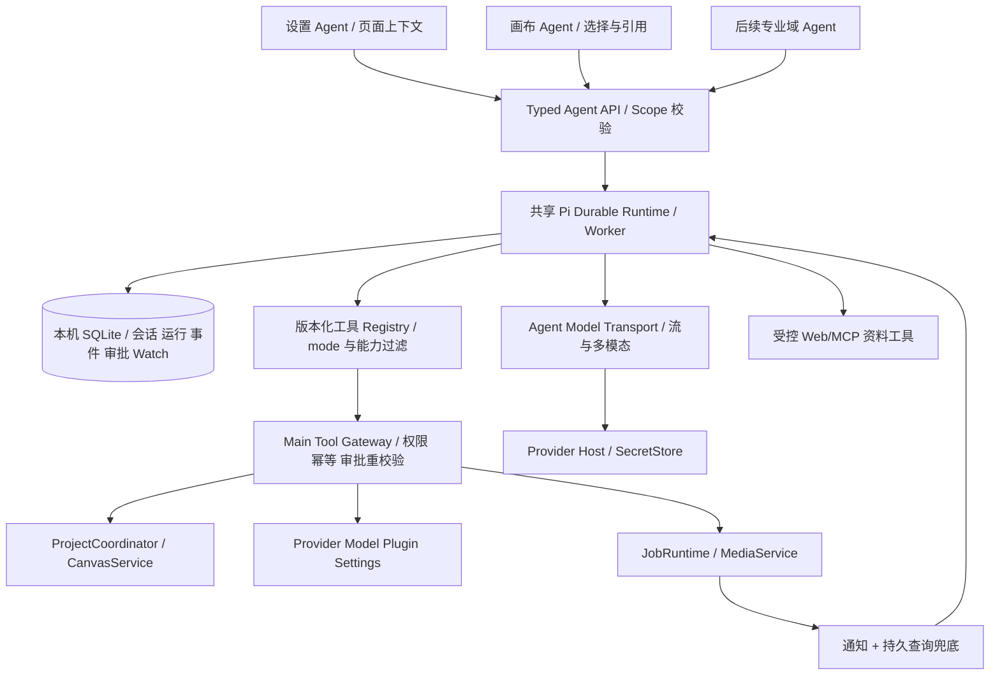

# 内置 Agent 完整迁移设计

产品内置 Agent 展示名称为“小灵”，同时服务于设置和画布两个入口；命名依据见 [D012](../06-决策记录/冻结决策.md#d012-产品与内置-agent-命名)。本文中的 Agent/runtime/scope 等技术名词继续描述运行机制，不代表多个独立品牌助手。

2026-11-19；依据 video-canvas `f0b8ced3687b22de6af0358c682c5e768001ff4f` 的源码与测试静态核验。没有运行上游测试或桌面应用，不能将历史设计文档标注的“已确认/待实现”直接当作当前实现事实。

## 1. 产品纠偏与迁移目标

设置和画布中的 Agent 是 Link Studio 主线能力，必须迁移其工作机制与交互，不是只迁聊天 UI 或 Provider 代码生成。V1 包含共享运行引擎、设置助手和针对首批节点的画布助手；V2 的角色/分镜/短剧/营销等工作区迁移时，同步接入相应上下文、工具、审批与恢复。

之前“V1 仅 Provider 配置助手，完整画布 Agent 整体留到 V2”的实施限制由 D011 修正。最终验收以 [能力覆盖与例外登记](功能覆盖与迁移例外.md)和上游子能力清单为准；没有支持的工具必须明确隐藏/提示，不以空入口宣称已覆盖。

## 2. 源码核验与应保留的设计

| 上游事实及证据（路径相对 video-canvas） | 设计价值 | 桌面迁移 |
| --- | --- | --- |
| `web/src/hooks/use-agent-controller.ts` 同时驱动画布、drama 和 admin；`web/src/pages/canvas/agent-host.tsx` 收起面板仍保留 controller | 多入口共用机制，UI 开关不等于停止任务，隔离高频画布重渲染 | 共用控制器/会话/事件组件，入口注入 scope；面板收起继续接收状态 |
| `web/src/store/admin-page-hints.ts`、`web/src/utils/admin/assistant/page-context.ts` | 页面通过 hints 解耦；页面/模型/渠道/插件成为可见、可移除标签，并记录发送时快照 | 设置页自动带 route、选中 Provider/模型/插件，用户可移除，不把未来页面状态倒灌旧消息 |
| `web/src/utils/agent/selection-refs.ts`、`backend/internal/service/agent/canvas_read.go` | 选中节点、@ 引用、组和视口是任务范围；按需读取详情，避免一次塞满整图 | 目录摘要+显式节点详情，保留已删除引用提示与 read-before-write |
| `backend/internal/service/agent/tool_registry.go`、`tool_decls.json` | 36 项平台声明固定顺序；按 mode 和模型视觉能力过滤，执行时再次校验；有 scriptable 标记 | 迁入版本化 registry/schema/label/verb/policy，而非将权限放进提示词 |
| `agent/src/durable-tools.ts` | 工具调用以 durable task ID 幂等，审批 propose→pause→decide；未知工具重放默认不安全 | side effect receipt 经 Main 持久化，恢复不得只靠模型 tool_call_id；审批同调用只建一次 |
| `backend/internal/service/agent/admin_change.go`、`admin_diff.go`、`admin_approval.go` | 字段级 before/after、base SHA、整单/逐项决定、执行前重新校验 | 设置变更单绑定资源 revision/hash；陈旧项重新预览，不沿用旧批准 |
| `backend/internal/service/agent/admin_action.go`、`web/src/pages/canvas/agent/admin-approval-detail.tsx` | 密钥专用输入和试跑分别处理，敏感值不作为普通聊天结果 | 密钥框直达 Main/SecretStore，只返回状态；试跑有目标/输入/潜在费用提示 |
| `backend/internal/service/agent/canvas.go`、`backend/internal/agent/canvasgraph/` | 先读后改、结构化批量操作、revision 检查、mutation 记录与本轮撤销 | 接 ProjectCoordinator；不能直接写 React store/项目文件；撤销不覆盖之后人工修改 |
| `agent/src/engine/engine.ts`、`agent/test/engine-steer.test.ts` | 插话排队、停止/继续、提问与其他审批的不同处理、busy 状态恢复 | 持久化消息/steer ID；待审批时插话不绕过审批；停止不等于取消供应商生成 |
| `agent/src/engine/watch.ts`、`platform-wait.ts`、`agent/test/engine-watch.test.ts` | 生成结束通过通知快速唤醒，持久轮询兜底；整批完成后回同一会话 | JobRuntime 事件通知+durable watch；按任务批次去重，重启后补查询，不重复提交生成 |
| `agent/src/engine/engine.ts`、`store/store.ts`、`agent/test/engine-recovery.test.ts` | Pi Durable/SQLite 保存会话、运行、事件、审批；在恢复调度前校验上下文和期限 | 优先迁现有 engine/store，替换 Go 平台桥；不另造简化聊天循环 |
| `agent/src/codemode.ts` | QuickJS 工具编排，中间结果留脚本，只有 scriptable 工具能被调用；审批工具不能塞脚本 | 保留 code-mode 的受限工具编排和恢复，区别于 Provider Goja 插件，不引入通用 Node 执行 |
| `agent/src/context.ts`、`compaction.ts`、`attachments.ts`、`model-provider.ts` | 图像上下文裁剪、摘要、文档附件边界、模型按 main/summary/title/activity 用途调用 | 附件经资产授权，媒体按模型能力；内部模型调用也走统一宿主、单独统计，不隐形免费 |
| `web/src/pages/canvas/agent/`、`agent/src/activity-summary.ts`、`card.ts` | 工具活动分组、计划/卡片、审批详情、运行摘要与 token/步骤可见 | 迁入统一 Agent UI，不仅输出聊天文本；观测默认脱敏并保留调用关联 |
| `backend/internal/service/agent/skill_library.go`、`skill_service.go`、`agent/src/web-access.ts` | 技能检索/渐进读取、版本化资源、可选联网 MCP | 保留技能资源与联网资料能力；不因技能文件含 scripts 就默认获得执行权 |

上游 `docs/design/后台Agent助手/`、`画布Agent助手设计/`、`Agent等待生成结果/`、`Agent技能管理/` 用于理解原理，现状以以上代码和对应测试为准。技能“通用脚本执行”在历史文档中明确搁置；当前 code-mode 是受限工具编排，两者不能混为已存在的任意脚本功能。上游目前不支持引用 director 节点理解，不将“导演台有 UI”虚构为已具备 3D Agent 编辑能力。

## 3. 共享架构与部署

默认复用 video-canvas 的 Pi Durable engine/store/事件和已有界面，Fynvra 提供进程生命周期、typed IPC 和秘密管理范式。不将 Fynvra coding agent 替换为视频助手，也不运行两套独立 Agent 会话引擎。具体 SDK、`node:sqlite` 在 Electron utility process 的可用性、QuickJS 与打包在 M0 验证；必要时用受管 Node worker，通讯必须受限，不建立公开本机管理 HTTP 服务。

项目权威数据仍是 ProjectState/Blob。SQLite 是 Agent 运行状态的明确用途，不将“项目暂不用 SQLite”误读为“禁止迁移原 Agent SQLite”。默认 userData 中保存 Agent 数据，scope 区分 device/settings 和 project/canvas；项目复制/未来同步不自动带走原设备会话、密钥或待执行审批。

## 4. 两个入口与上下文契约

共用 AgentSession/Run/Approval/Event/Watch，按 session scope 隔离。scope 包含 settings 或 projectHandle+canvasId，业务 mode 决定工具与写入范围。换项目/设置页不能复用另一 scope 的执行授权；同一项目自动保存与 Agent 写入进入同一 coordinator。

- 设置入口：route、页面资源类型、选中 IDs、配置 revision；标签可见可移除。可以查模型参数、适配接口、检查插件、生成/审阅配置变更、专用密钥录入、dry-run/真实试跑与诊断。
- 画布入口：选择节点/组、@ 引用、viewport、模型及用户目标；内容不是可信指令。目录先摘要，需要细节时工具读取，授权随每次工具执行复查；不因 UI 传了 projectId 就信任访问。
- 附件：授权资产/文本/文档，大小/页数/解码受限，实际发送内容可理解；图片/视频仅向有相应能力的模型提供，缺少能力给明确替代提示。
- 历史上下文：保存发送时标签与快照；重放读取最新授权和状态，不能把旧视图当未变化的写入基线。
- 模型：首个 Agent 仍需人工或内置插件配置可用文本模型；后续官方模型可选，不强制登录。token 流/tool calling/图片视频能力是 Agent Model Transport 契约，不能用仅支持同步文本生成的 Provider 插件冒充完整 Agent 模型支持。

模型 SDK 优先通过 Host 发请求，Agent process 只拿受限模型绑定/会话能力，不能读取长期 API key。保留流、工具调用和模型错误语义；若无法兼容必须登记适配缺口，不能退化成只读纯文本聊天并宣称迁移完成。

## 5. 工具与权限映射（36 项逐项覆盖）

下表是平台工具，不含 Pi 动态安装的 code-mode 等扩展。名称可为兼容保留，实际执行在桌面 Tool Gateway；admin 前缀不授予官方后台管理员权限。

| 上游工具 | Link Studio 去向 | 批次与限制 |
| --- | --- | --- |
| canvas_get_state | 目录/节点按需读、已读集合 | V1 画布助手 |
| canvas_apply_ops | 结构化增改、事务 mutation | V1，首批四类节点和组 |
| canvas_arrange | 确定性布局工具 | V1，受模式与范围限制 |
| canvas_delete | 删除提案/批准后执行 | V1，保留历史/引用保护 |
| plan_update | 持久计划及可见进度 | V1 共用 |
| ask_user | 结构化提问、回答/拒绝/过期 | V1，settings 可适配同等提问能力，非上游已开放事实 |
| model_list | 按当前来源/能力返回可用模型 | V1 自定义，官方增量接目录 |
| generate_media | 生成提案、目标/数量/费用说明、批准后任务 | V1，官方价格仍由服务端权威 |
| task_get | JobRuntime 查询，不重发生成 | V1 |
| skill_search | 技能目录/版本搜索 | V1，项目域技能逐域增加 |
| skill_read | 指令与安全资源渐进读取 | V1，无任意执行权限 |
| canvas_inspect_image | 图片按授权和模型能力提供 | V1 |
| canvas_inspect_video | 视频直读或受限抽帧理解 | V1 明确能力与限制，不必等完整媒体编辑 UI |
| canvas_capture_frame | 本地提帧形成派生资产/节点 | V1 助手工具基础路径；完整工具 UI 可随 V2 |
| web_search | 复用可选资料检索能力 | V1，禁用时明确不可用 |
| web_fetch | 受控抓取/提取资料 | V1，结果是不可信资料，不能改变工具策略 |
| drama_read | 专业域读取 | V2 短剧同步接入 |
| drama_update_outline | 大纲变更预览/审批 | V2 短剧 |
| drama_update_episode | 分集变更预览/审批 | V2 短剧 |
| drama_update_segment | 分镜/片段变更预览/审批 | V2 短剧 |
| drama_run_job | 短剧任务提案/运行/等待 | V2 短剧 |
| admin_list_models | 本机模型列表 | V1 设置；官方配置不可写 |
| admin_get_model | 本机能力/参数/绑定详情 | V1 设置 |
| admin_list_channels | 本机 Provider/端点 | V1 设置，密钥不返回 |
| admin_get_pricing_settings | 官方后台定价设置 | 后续官方管理端，桌面无本机定价权 |
| admin_quote_preview | 官方改价预览 | 后续官方后台；桌面可展示消费估算但非改价工具 |
| admin_propose_changes | 本机模型/Provider/插件设置变更单 | V1 设置，官方后台适配另有授权 |
| admin_list_plugins | 本机插件版本/来源 | V1 设置 |
| admin_get_plugin | 插件源码/manifest/hash | V1 设置，剔除意外嵌入的秘密 |
| admin_plugin_check | 静态/dry-run/mock 与兼容报告 | V1 设置 |
| admin_request_secret | 专用安全输入卡片 | V1 设置，模型只收到状态 |
| admin_test_run | 试跑审批、trace、诊断 | V1 设置，不把 mock 当真实兼容 |
| admin_get_recent_errors | 当前设备授权范围脱敏诊断 | V1 设置 |
| show_card | 有 schema 的结构化结果卡片 | V1 共用，不注入任意 HTML/JS |
| admin_query | 本机配置/运行摘要的白名单查询 | V1 设置，不开放任意 SQL |
| admin_get_resource | 本机授权配置资源详情 | V1 设置，不开放任意文件路径 |

权限最小集由 scope/mode/model capability/disabled tools 共同决定；执行端再校验。资料/技能/插件源码的提示内容不能扩权。V1 不把未迁域工具暴露为可调用占位，V2 域上线必须一并补工具和测试。

## 6. 审批、幂等与跨存储提交

读操作和已授权范围的普通结构化编辑可自动执行；生成、删除、配置变更、填密钥和真实试跑保留上游分类交互，不把每次读/移动都变成审批。

Approval 绑定 run/session/scope、durable tool task ID、资源版本/hash、规范化 payload/hash、选中变更项、有效期与授权上下文。审批前显示实际效果；执行前再次验证授权、配置状态、模型能力和目标。过期/目标变化/部分已执行需返回实际状态或重新预览，不能拿一个布尔 approved 重放任意变更。

Agent SQLite 与项目快照不是同一事务：执行工具先以 durableToolTaskId 映射 operationId，在目标服务事务里保存效果和去重回执，再确认 Agent tool receipt。若目标已提交但引擎未收到，重放查回执返回原结果；反过来不能先记 tool 成功再写项目。对 Provider 配置也要有目标侧回执；已批准外部生成仍按提交未知规则处理，不能因为“有审批”就重复收费调用。

设置变更单逐项/整单支持、每项状态必须真实可见。跨资源不宣称一次 ACID：能在同一配置快照内提交则原子，否则预检后记录每项结果/补偿；不能把部分成功显示整单成功。密钥动作独立受控，不以回滚为由输出旧密钥。

撤销本轮只撤销该 run 的可撤销结构变更。记录 before/after 与目标 ID，检测后来人工/其他 run 修改后跳过冲突或请求处理；不回滚整个项目快照，也不承诺撤销已发生的供应商费用、生成或外部动作。

## 7. Durable 生命周期与 UI 事件

Run 语义为 queued/running、waiting_approval/waiting_input、stopped/failed/interrupted/completed；Watch 是独立持久子状态，不用“主 run completed”推断没有后台任务。具体枚举按上游 adapter 映射，保留原始值可诊断。

- 同 scope 只允许一条活跃写入运行；不同项目可并行，不同 session 不得绕过项目协调器产生并发覆盖。
- 插话以稳定 message/steer ID 排队、记录何时被读取；待审批期间新消息不自动批准。回答、拒绝、取消、继续的语义与 UI 分开呈现。
- 收起面板继续运行；关闭项目/退出需 flush，引擎停止接新写，保存审批/watch，阻止旧 owner 回调落盘。重启先恢复目标数据再恢复引擎调度；离开本机有效 scope 的审批不自动执行。
- query/watch 可重试，side effect 按登记 replay policy；未知工具默认 unsafe。任务结果通知是快速路径，丢通知用持久查询补齐，按批次投递去重，用户停止/关闭项目不被静默唤醒并继续写。
- UI 展示计划、活动摘要/工具子调用、审批卡/字段差异、结构化结果卡、待生成区、上下文与步骤计数、压缩/中断状态。事件 sequence 支持回放/分页，断线补快照，不只依赖瞬时 IPC。
- 重现摘要、会话标题、活动概括的模型用途和消耗记录，保留上下文裁剪及压缩后的可解释提示；不凭 UI 显示思考文本要求保留供应商未提供的隐藏推理。

## 8. 技能、code-mode 与观测

SkillVersion 不可变，保存来源、hash、scope、启用版本和资源白名单，搜索先给目录再按需加载说明/附件；活跃 run 固定版本，升级不换掉进行中指令。迁移现有后台技能/步骤管理中的本机可用部分到设置，不将官方全局发布权限复制给个人用户。

code-mode 保留 QuickJS 限时限内存执行和 scriptable 工具集；模型生成的脚本不能读网络/磁盘/环境/密钥，所有子工具仍经 Gateway 幂等/事件记录。审批、多模态结果等不可脚本调用项在动态工具发现层和执行端双重限制；源字符串检查不是唯一防线。

观测保留 run/工具/模型请求关联、promptVersion、toolsHash、buildSha、状态/步骤/token/错误分类、审批和 watch 时间线，支持脱敏诊断导出。默认不上传本机对话、资料或 trace；官方模型消费依据后续服务账本，不用本地 token 估算充当官方扣费依据。

## 9. 验证与实施

| 批次 | Agent 交付 | 必测证据 |
| --- | --- | --- |
| M0 | 迁入共享引擎最小运行，验证 SQLite、流/tool calling、QuickJS、bridge 与恢复边界 | 原 `engine-recovery/approval/steer/watch/compaction` 等 fixture 对应的新适配测试；未运行不得写通过 |
| S3 | V1-FR-007 共用机制、V1-FR-008 设置助手；保留 FR004 的完整人工配置路径 | 配置读取/变更单、陈旧审批、密钥、试跑与跨资源回执 |
| S4 | V1-FR-009 核心画布助手；与任务运行共用服务 | 选择/@/先读后改/布局/生成审批/watch/插话/撤销冲突/收起续跑 |
| S5/S6 | 联通媒体理解、提帧、code-mode/技能、运行观测及发布验收 | 不接受只有聊天与配置成功的本地版，要求两入口及生成等待闭环 |
| V2 | 专业域功能和对应工具/技能/上下文同步迁移 | 每域至少一条 Agent 辅助主任务与人工路径对照验收 |

以上不要求 V1 提前实现所有专业域，但核心助手不是可选项。详细规格见 V1-FR-007～009；所有原始工具按去向追踪，任何缺失能力必须在例外台账中注明原因与处理。
