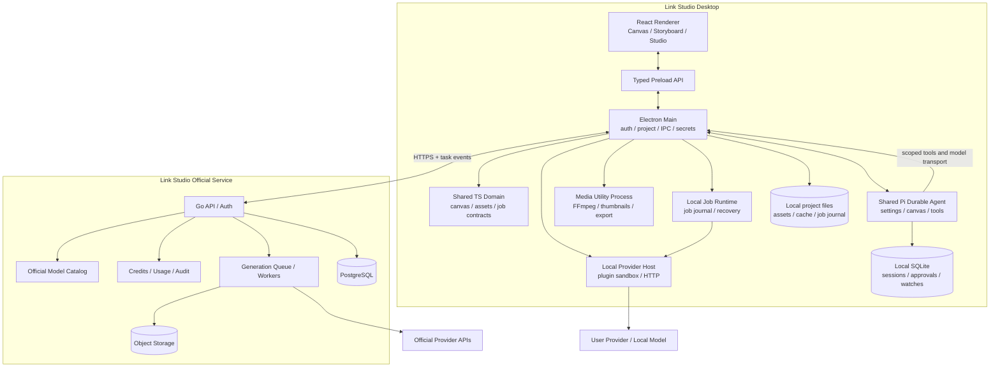

# 总体架构与迁移方案

## 1. 架构结论

采用渐进式“本地优先 Electron 桌面端 + Link Studio 官方服务”架构。首阶段由桌面端负责本地项目、个人 Provider 调用和媒体工作流；官方服务在后续阶段接入账号、官方模型、积分和共享/组织数据。官方模型请求执行路径当前不冻结。

首阶段自定义模型由桌面端 Main/Utility Process 直连用户配置的 Provider。官方模型阶段不得把长期供应商密钥直接打包进客户端；服务端代理或受限短期凭证方案须另行评审。



## 2. 运行时职责

| 组件 | 权威数据/职责 | 不负责 |
| --- | --- | --- |
| Renderer | 交互、视图状态、用户意图、媒体预览 | 读取密钥、任意文件系统访问、官方积分结算 |
| Preload | 最小化的 typed API 与事件订阅 | 业务决策、通用 Node API 暴露 |
| Electron Main | 身份令牌安全存储、IPC 校验、文件授权、本地项目协调、Provider 密钥句柄、生命周期 | 长时媒体转码、UI 状态权威源 |
| TypeScript Domain Core | 画布/资产/生成任务公共契约和纯领域逻辑 | Electron/Web API 依赖 |
| Local Provider Host | 插件校验/沙箱、宿主代发请求、认证注入、轮询请求和输出下载 | 插件任意网络/文件/密钥权限 |
| Local Job Runtime | 本地任务 journal、任务状态机、输出绑定和重启恢复 | Renderer 状态或官方任务权威状态 |
| Media Utility Process | FFmpeg、转码、缩略图、合成和导出 | 项目业务决策 |
| Shared Agent Runtime | Pi Durable/SQLite、会话/审批/watch、设置与画布上下文、工具事件和 code-mode | 长期密钥、绕过 Main 改项目、官方后台权限 |
| 官方 Go 服务 | 登录授权、官方模型目录、官方调用、积分/用量/审计、未来共享/组织 | 读取用户本地路径 |

Main 负责协调和安全边界。耗时的模型轮询、下载、转码和大文件哈希不得阻塞 Main 事件循环。

## 3. 技术栈

### 桌面端

| 层 | 规划 |
| --- | --- |
| Shell | Electron；版本以 `fynvra` 与 `video-canvas` 实施分支实际依赖兼容性验证为准 |
| 构建 | electron-vite；在确定合并基线后统一 Vite/Electron 版本，不复制两份构建配置 |
| UI | React 19、TypeScript strict、Tailwind CSS 4、Lucide |
| 画布 | `@xyflow/react`；优先沿用 video-canvas 画布域组件和数据语义 |
| 状态 | Zustand；服务端缓存与离线同步状态不直接混为画布权威状态 |
| 3D | Three.js、React Three Fiber、Drei，按导演台阶段引入 |
| 图像编辑 | Fabric.js，仅在实际裁剪/标注/合成用例需要时纳入 |
| 媒体读取 | MediaBunny / 浏览器媒体 API；需按目标 Electron Chromium 版本验证 |
| 本地数据 | 不可变版本化 ProjectState JSON + 媒体 Blob，设备级 runtime 保存任务秘密；具体提交恢复见本地数据契约，SQLite 非首批必需 |
| 凭证 | Electron `safeStorage` 或平台安全存储；手工输入后不向 Renderer 回传密钥，不写入项目或日志 |
| 本地媒体 | FFmpeg 子进程/Utility Process；按平台打包并审查许可证与签名 |
| 包管理与质量 | 沿用 Fynvra pnpm、Biome、Vitest/TypeScript 的工程规范，避免保留两套 lint/format 工具链 |

### 官方服务端

| 层 | 规划 |
| --- | --- |
| API/业务 | 保留 `video-canvas` Go 服务和现有分层，渐进适配桌面客户端身份与协议 |
| 数据库 | PostgreSQL 保留用于官方账号、模型配置、任务、积分和审计；这不是本地桌面数据库 |
| 异步任务 | 保留当前队列/Worker 体系；确认任务事件和幂等契约可供桌面端消费 |
| 缓存/队列依赖 | 先沿用现有 Redis/River 等生产依赖；不能因为桌面客户端本地化而删除服务端依赖 |
| 资产存储 | 官方生成临时结果/共享资产使用服务端对象或兼容存储；本地项目资产不自动上传 |
| Provider 插件 | 保留服务端隔离运行的官方 Provider，服务端密钥永不下发 |

### 依赖引入策略

- 先审查两个仓库已有依赖，去重后锁定单一版本，不直接合并 lockfile。
- R3F、Fabric、MediaBunny、FFmpeg 等按具体功能阶段增量引入。
- 项目存储暂不引入 better-sqlite3；共享 Agent 明确沿用 Pi Durable/SQLite，M0 验证 node:sqlite/worker 与平台打包，不因项目 JSON 方案拒绝迁移助手存储。
- 原生模块与二进制需在 macOS Apple Silicon/Intel、Windows x64 目标平台分别验证。

### 本地 Provider 插件

- 采用 Host/Plugin 分离：插件只包含版本化 manifest 和纯转换钩子（输入上下文 -> Request Descriptor；HTTP Response -> 统一任务结果）。
- Host 执行实际 HTTP、认证注入、超时、DNS/IP/redirect 策略、大小限制、异步 query/cancel、输出下载和脱敏审计。
- 插件不可直接访问网络、文件系统、环境变量、进程或 Secret；不允许任意 Node.js 插件直接加载到 Renderer/Main。
- 支持内置、用户手工编辑/导入和 Agent 草拟来源。Agent 可从用户授权的 API 文档/样例生成草稿并运行静态/mock 测试；用户审阅批准绑定源码 hash 后才能启用/访问真实凭证。
- 插件 API 版本、能力声明、同步/异步模式和 query/cancel 能力必须可校验。具体沙箱 Runtime（包含能否复用上游 Goja/纯 JS 子集）在 M0 做安全、性能、Electron 打包与跨平台评估，不在文档阶段先验锁定。
- localhost/private LAN 按用户明确授权开放；拒绝云 metadata、未经批准的 redirect 和 DNS rebinding。

## 4. 本地项目和数据布局

项目是可携带目录，元数据与媒体文件分离。以下为职责示意，实际 S1 目录、字段与提交点以 [本地项目与资产契约](本地项目与资产契约.md) 为准：

```text
<Project>.linkstudio/
  manifest.json              # schemaVersion、projectId、标题、资源索引版本
  state/                     # 不可变 ProjectState，含画布/资产引用及扩展
  assets/sha256/<prefix>/     # 原始/生成媒体 Blob
  runtime/                    # 本地任务/导出状态，敏感内容不默认同步
  exports/                    # 导出作品
  cache/                      # 可删除缓存和代理文件
```

用户级应用数据放在 Electron `userData`：

```text
userData/link-studio/
  account/                    # 非敏感账号状态；refresh token 走系统安全存储
  provider-secrets/           # 密文/安全存储引用，不放入项目
  recent-projects.json
  logs/
```

原则：

- 项目正文不写入全局设置文件。
- 项目 manifest 不含 API Key、访问令牌或供应商秘密。
- 导入默认复制到项目，不移动/删除源文件；高级选项允许显式外部引用（D006）。
- 同项目只有一个可写窗口；Main 协调跨实例项目占用及写队列，后台任务和自动保存也需 owner/revision 校验（D009）。
- 本地与官方任务用稳定 ID 和 `executionSource` 区分；任务恢复不依赖 Renderer 内存。
- 共享空间后续通过同步协议管理项目修订和资产清单，不直接把本地路径上传给服务端。

## 5. 模型与任务契约

统一任务至少包含：

```ts
type ExecutionSource = 'official' | 'custom';

type GenerationJob = {
  jobId: string;
  projectId: string;
  nodeId?: string;
  executionSource: ExecutionSource;
  capability: 'text' | 'image' | 'video' | 'audio';
  providerId: string;
  modelId: string;
  idempotencyKey: string;
  state: 'queued' | 'submitting' | 'running' | 'cancelling' | 'downloading' | 'outcome_unknown' | 'succeeded' | 'failed' | 'cancelled';
  inputRef: string;
  outputAssetIds: string[];
  createdAt: string;
  updatedAt: string;
};
```

此类型只作概念示意，运行状态转移与域接口以 [桌面 API 与任务契约](桌面API与任务契约.md) 为准。以下官方服务路径仅是候选方案，不能视为已冻结的实现要求：

- `official`：桌面端提交带幂等键的请求；服务端重新读取账号、模型权限和定价；冻结/扣结积分、调用官方 Provider、记录最终用量并回传事件。客户端不能提交可信价格或自行宣布结算成功。
- `custom`：Main 校验 Provider 配置并从安全存储取密钥；Utility Process 执行外部请求，结果通过 Main 写入项目资产库。Renderer 只传模型配置 ID 与创作参数。
- 两路使用统一 UI 状态但不同的权威任务存储。官方状态以服务端为准；本地任务状态以本地 journal 为准。
- 外部请求重试必须区分“安全重试”和“结果未知”：提交幂等、轮询可重试；供应商已受理但客户端超时不能盲目重复生成。
- 事件断线后通过任务快照/游标对账，不能只依赖瞬时 IPC 或 WebSocket 事件。

## 6. 登录、官方模型和消费

- 本地项目与自定义 Provider 允许未登录使用。
- 官方模型接入后再确定账号授权；优先评估系统浏览器 OAuth/PKCE 和系统安全存储。
- 长期官方供应商凭证不得下发客户端。桌面端获取模型目录；服务端代理或受限短期授权的执行方式在 S7 前另行 ADR，不因示意图冻结。
- 积分采用服务端权威账本，任务请求带稳定 idempotency key；冻结、结算、退款/释放和管理员调整都应可审计。
- 服务端模型/价格权限变化时，任务创建时按服务端当前策略校验，并把价格版本记录到任务/账本。
- 参考素材上传到官方服务前需有明确的用户意图和隐私提示；大媒体尽可能由桌面端做预签名直传，避免经 API 服务器中转。

## 7. IPC 和安全边界

遵循 Fynvra 的约束，并按视频创作域扩展：

- 每个 IPC 域同步维护 channel constant、Main handler、Preload typed 出口和 Renderer 调用。
- IPC 输入为 `unknown` 后进行 schema/类型收窄；Renderer 只传资源 ID、受限参数和用户选择，不传任意本地绝对路径给不可信页面。
- Preload 不暴露 `ipcRenderer`、`fs`、`child_process` 或通用 HTTP 客户端。
- Renderer 禁止远程导航、任意新窗口和不受控 CSP 绕过。
- 本地自定义 Provider 的 URL 要防止本机服务误访问、凭证转发和 SSRF 类风险；协议/主机策略需单独规格化。
- 日志脱敏 Authorization、API Key、请求体中的敏感素材 URL 和用户输入内容。
- 项目文件路径需限制在用户授权项目根目录；符号链接和路径穿越必须检查。
- FFmpeg 参数用参数数组执行，禁止拼接 shell 命令；媒体解析和插件进程需要资源限制。

## 8. video-canvas 迁移映射

| 上游模块 | 迁移策略 | 目标阶段 |
| --- | --- | --- |
| Web React 创作 UI | 迁入 Electron Renderer；去除浏览器登录页/站点布局，改为桌面导航和文件交互 | V1 |
| 无限画布与节点 | 优先保留节点语义、React Flow 组件、数据校验和画布算法；存储访问改走领域 API | V1 |
| 资产库/上传 | 拆出 Asset Domain；本地导入落入项目资产库，官方任务输出按需下载 | V1 |
| 官方生成任务 | 保留 Go 服务端任务与 Provider；桌面协议接入并实现断线对账 | 自定义闭环之后的官方阶段 |
| Provider 协议插件 | 迁移版本化 manifest、纯钩子和 Host 网络执行契约；用户/Agent 插件经沙箱、校验和人工批准后运行 | V1 起步 |
| 用户/积分/模型后台 | 继续属于官方服务端；桌面端只消费 API，后台可后续扩展组织策略 | V1 官方闭环 |
| Agent Runtime | 优先迁 video-canvas 共享 Pi Durable engine/store/controller；设置/核心画布均在 V1，Fynvra 仅吸收进程/IPC 范式 | V1 双入口，V2 专业域工具 |
| 短剧与分镜 | 保留领域模型和工作流，数据存储接口本地化；拆分移入 Renderer | V2 完整创作域 |
| 营销工作室 | 保留为创作域模块，不能阻塞视频 MVP | V2 |
| 3D 导演台 | 迁入桌面工作区，评估 GPU/资源/导出兼容性 | V2 |
| Go Backend | 保留业务后端用于后续官方服务，不捆绑成本地 HTTP 后端；最小 Goja 插件 runner 是否作为 sidecar 单独评估 | 官方阶段；runner 在 M0 验证 |
| PostgreSQL/Redis/Object Storage | 继续用于官方服务；本地项目不用依赖这些服务 | V1 持续运行 |
| 登录/支付/升级后台 | 官方 Web 管理端保留；客户端新增登录、更新和积分入口，不复制整套管理后台 | 分阶段 |

## 9. Fynvra 能力吸收清单

### 直接吸收原则

- Electron Main/Preload/Renderer 分层和最小权限 Preload。
- typed IPC、unknown 入参验证及 IPC 单元测试。
- 密钥和敏感配置只在 Main/系统安全存储。
- 长任务 Worker 化、生命周期收尾、退出前 flush 和启动恢复。
- React/TypeScript/Tailwind/Zustand/React Flow 工程经验（版本需统一）。
- Biome、Vitest、严格类型检查和依赖边界检查。

### 不直接移植

- Git Worktree、代码 diff、终端、编程角色编排和仓库中心导航。
- Fynvra 的会话 JSONL 数据模型作为视频项目的权威存储。
- 直接合并 Fynvra Pi Agent Runtime 与 video-canvas Durable Agent，除非独立评估证明能降低维护成本。

## 10. 迁移阶段和退出标准

### M0：基线与兼容性验证

- 冻结两个上游 commit，建立独立开发分支和许可证清单。
- 验证目标 Electron 与 React Flow、Three、MediaBunny、原生依赖兼容。
- 定义本地 Provider 插件契约、宿主安全边界和任务恢复语义；官方服务仅预留接口。
- 退出标准：首批上游插件通过兼容性样例，本地任务完成一次可恢复端到端技术 spike；选定满足隔离与打包要求的插件运行时。

### M1：桌面外壳与项目本地化

- 嵌入主要创作 Renderer，加入 Electron 窗口、菜单、深链、文件选择和更新。
- 实现本地项目清单、画布快照、资产导入和安全的项目打开流程。
- 退出标准：断网仍可打开并编辑本地项目，重启后数据一致。

### M2：自定义模型闭环

- Main 安全保存个人凭证，建立 Provider Plugin API、隔离 Host 和首批迁移插件。
- 内置 Agent 可生成/校验 Provider 插件草稿；启用前用户审阅批准。
- 本地任务队列、轮询、取消、错误恢复和输出入库。
- 退出标准：未登录环境下可调用本地/自定义模型；输入后的密钥不回传 Renderer，不写入项目和日志；Agent 不接触凭证。

### M3：视频生产主线

- 完善脚本、画布、分镜、素材引用和预览；媒体进程实现有序视频镜头拼接为 MP4 与可选 BGM（D008）。
- 加入稳定性、自动保存、任务恢复、崩溃保护和大文件体验。
- 退出标准：可由项目输入走到可播放导出文件；主要失败路径有测试和用户可理解反馈。

### M4：官方模型闭环

- 接入官方模型目录和账号。
- 先冻结官方请求执行、凭证、幂等、积分结算/释放和隐私告知。
- 退出标准：服务端任务、结果资产与账本可按任务 ID 对账。

### M5：专业创作域

- 完整短剧、营销工作台、3D 导演台和多 Provider 覆盖。
- 在 V1 双入口助手上扩展专业域上下文/工具/技能，逐域同步验收。
- 退出标准：按各域独立规格验收，不以“代码已复制”作为迁移完成。

### M6：共享空间与组织

- 项目同步、资产按需同步、冲突解决、跨设备恢复。
- 官方后台组织、成员、角色、预算和模型策略。
- 退出标准：跨设备并发修改无静默丢失；组织策略由服务端强制执行并审计。

## 11. 关键风险和缓解

| 风险 | 影响 | 缓解 |
| --- | --- | --- |
| 上游 Web 功能依赖浏览器认证/HTTP 全局状态 | 桌面接入后隐藏耦合导致返工 | 先抽出 API client 与领域层，Renderer 只接桌面适配层 |
| Electron/Go/Agent/Media 多进程 | 启动失败、更新和退出复杂 | V1 自定义闭环不依赖远端 Go；只启动必要的 Agent、媒体和插件进程，统一健康状态和日志关联 ID |
| 官方计费与外部模型调用跨系统 | 重复扣费、任务已生成但结果未知 | 服务端幂等、预冻结/结算、供应商状态对账和账本审计；明确未知结果处置 |
| 自定义端点和凭证 | SSRF、密钥外泄、任意插件执行 | 首版即建立插件隔离、Host 网络策略和凭证注入；通过批准的本地端点支持 LAN/localhost |
| 大媒体同步/下载 | 带宽、存储成本和中断 | 本地默认，官方任务结果按需下载；共享空间采用清单与 Blob 分离、断点续传 |
| Agent 运行时重复或缩水 | 两套状态机维护、仅聊天无法落地任务 | 优先迁现有 durable 引擎，同机制不同 scope，36 工具映射和双入口 E2E，不改简化循环 |
| 大规模复制导致上游升级困难 | 长期分叉成本高 | 尽量以独立包/域模块迁移，维护 upstream source map 和按目录的 fork 差异清单 |
| 许可和媒体资源来源不清 | 分发合规风险 | 保留 MIT/Apache 声明并做逐依赖、素材、字体、模型 SDK 的许可证审计 |

## 12. 进入功能规格前的设计门槛

- 首阶段先完成本地项目与自定义模型契约；二者已确定允许未登录使用。
- 官方模型阶段进入开发前，再冻结登录、请求执行、积分冻结/结算和退款语义。
- V1 核心画布与本地生成/成片范围固定；完整分镜/短剧/营销/导演台归 V2，详见实施基线与迁移台账。
- 验证本地 Provider 插件 API、首批上游插件兼容性与危险 URL/本机地址策略，详见 [Provider 插件与 Agent 配置设计](Provider-插件与-Agent-配置设计.md)。
- 冻结项目数据 schema、资产引用、删除和自动保存/版本恢复策略。
- 确定目标平台、自动更新、签名证书、安装包和 FFmpeg 分发要求。
- 为官方任务、密钥、资产上传、状态机、并发和资金结算建立独立技术设计与 AC。
