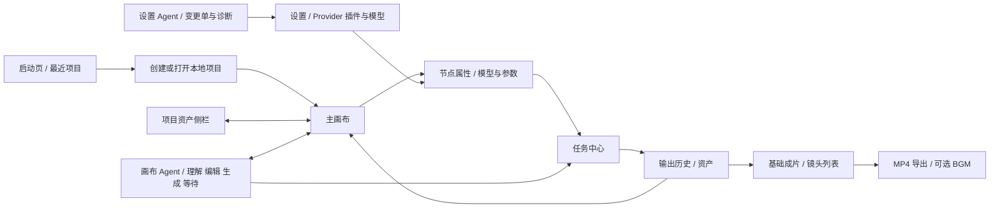

# 首期创作交互与节点迁移

适用 V1 本地创作闭环；这是实现流程与界面职责，不是高保真视觉稿。复用 video-canvas 的创作视觉和交互基础，Fynvra 只提供桌面基础设施；不引入仓库、终端或编程角色导航。

## 1. 工作区和导航

项目顶部显示项目名、保存状态、任务数量、打开资产/基础成片的入口；全局设置单独管理本机 Provider、插件、模型和安全凭证。账号入口在官方批次接入，本地入口不经过登录拦截。

主画布左侧提供节点与资产入口，中间为 React Flow，右侧为可折叠节点属性；任务中心可在不遮住编辑内容的情况下查看进度和失败。布局先沿用上游组件，性能和状态正确后再做视觉细化。

## 2. 首批节点与数据映射

| 上游 kind/结构 | V1 行为 | 本地化映射 | 验收/后续去向 |
| --- | --- | --- | --- |
| script | 编辑文本/提示词，选择文本模型并生成 | prompt/text、modelBindingId、text 输出历史、jobId | S2/S4；不要求先上传脚本到云端 |
| image | 导入/选择图片、参考图、生成和历史切换 | assetId、参数资产 ID、NodeOutputRef | S2/S4；扩图/涂鸦等完整工具归 V2 |
| video | 导入/选择视频、参考图/视频、生成与预览 | assetId、modelBindingId、任务列表、历史输出 | S2/S4；结果可加入基础成片 |
| audio | 导入/选择音频、生成、播放 | assetId、任务/输出历史 | S2/S4；可用作 BGM |
| group | 节点组合、移动和解除分组 | parentId、位置、尺寸 | S2；是结构容器，不是 Provider 能力 |
| character/storyboard/director | 不在新建菜单开放完整工作区 | 未知/延后节点数据原样保留、兼容提示 | V2；不把只读占位算迁移完成 |

S2 映射器读取上游 `canvas`/`group` 结构。脚本优先使用 `text`，其余节点的提示词来自 `params.prompt` 或 `prompt`。媒体只记录由映射器调用方解析的本地 `assetId`，预览 URL 由素材服务按需解析。`src`、`uploadProgress`、`selected` 与 `dragging` 在映射时过滤。`taskId/pendingTaskIds` 到本地任务和 `model` 到设备模型绑定的映射由 S4 接入。

S2 映射器服务代码迁移和 fixture。对识别为延后或未知的上游节点，映射器只写入标题、位置、组关系及有限的来源标识。对于已经存在于本地项目快照的未知记录，兼容投影只读展示，保存操作保留其原始 JSON。面向用户的旧 Web 项目导入在 V2 实现。

## 3. S1 项目与资产交互

新建：名称+系统目录选择 → 创建中 → 成功进入空工作区；非法名称/目录存在不覆盖。打开：目录选择/最近项目 → 版本与完整性检查 → 恢复提示或进入；已打开激活原窗口，另实例占用明确提示。关闭先 flush，失败留在窗口并提供重试；无永久删除项目按钮。

导入：选择文件 → 显示“复制到项目”（默认）及高级“引用外部文件” → 逐项进度 → 资产 ready。重复内容给复用/独立记录；取消只取消未提交导入。导入期间项目变更产生 revision 冲突时自动刷新安全状态，再用相同暂存文件发起新的提交操作，不重复复制或重复登记。

reference 模式提示其依赖原文件；缺失显示占位和重新定位入口；内容不匹配时另行导入，不静默替换。移除有引用资产时列出来源并要求先解除引用，不级联删除节点/任务；取消操作不改项目。

恢复旧快照时显示恢复原因和已恢复修订；只有持久化成功才能显示“已保存”。新 schema 不支持时提示升级/选择受支持副本，不强行可写打开。

## 4. 模型与配置 Agent

用户先选内置插件并手工绑定一个文本模型，或自行导入插件。配置页展示插件来源/版本、端点、模型、能力、密钥是否已设置及测试结果。没有可用文本模型时，助手入口说明依赖并直达人工配置，不形成“必须先用 Agent 才能配 Agent”的循环。

设置 Agent 理解当前页/资源，可查配置/模型能力/错误、读文档、出字段级变更单、接入插件、安全填密钥和试跑。显示差异/基线与逐项结果，陈旧项重新预览，不只是生成草稿。静态/mock 不冒充真实成功，普通同版本生成不反复审代码。

画布 Agent 与设置共用持久引擎/controller、scope 和工具分离。保留选择/@/视口、按需读、布局/结构编辑、提问/计划/卡片、生成/删除审批、后台等待、插话和冲突感知本轮撤销。收起不停止；停止助手不等同取消生成；专业域工具随 V2 接入。细节见完整 Agent 设计。

## 5. 生成与任务中心

节点选择有能力匹配的模型 → 输入提示词与可选参考资产 → 展示服务目标 → 提交。无模型/缺失参考/不兼容参数在提交前提示。提交后允许继续编辑；多个任务结果追加历史，不覆盖新输入。

queued/running/downloading/failed/cancelled/outcome_unknown 显示不同状态。未知结果提供查询/诊断和显式人工处理，不默认显示“重试生成”。不支持远端取消时解释“停止本地跟踪”的实际含义。退出选择等待/尝试取消/退出后恢复，并明确供应商能力限制。

## 6. 基础成片与导出

从视频资产/节点输出“加入成片” → 列表拖动排序、移除 → 选择可选 BGM 和音量 → 选择受支持 profile 和保存位置 → 导出进度 → 播放/定位文件。列表是基础有序镜头组合，不呈现未实现的多轨时间线。

预览显示当前组合参数；正式导出固定配方，导出后继续改列表不影响运行任务。缺失输入或不支持编码在准备阶段提示；覆盖确认与目标文件替换分离，取消/失败不破坏已有成品。

## 7. 分批交互验收

S1 验项目/资产，S2 验节点保存；S3 验共享引擎/设置助手完整变更路径；S4 验核心画布编辑/生成审批/watch/恢复/撤销，S5 验成片及双助手闭环。见 [首期验证计划](../05-测试与发布/首期验证与验收计划.md)与 V1-E2E-02。
